# Auditoría técnica, funcional y visual de «¿Quién mató a la gallina?» (Bollijuego)

**Informe de auditoría y plan de mejoras** · React Native 0.74.5 · Fecha: 2026-10-27

| | |
|---|---|
| **Repositorio** | `Bollijuego` (rama `main`, 88 ficheros versionados) |
| **Alcance** | Todo el código propio (13 ficheros TS/TSX, 2 496 líneas), servidor legado `servidor.js`, configuración (Babel, Metro, TS, Jest, ESLint, Prettier), capa nativa Android/iOS, los 17 assets gráficos, `package.json` y `package-lock.json` |
| **Método** | Lectura completa de cada fichero + **ejecución** del motor, de `tsc`, `eslint`, `jest` y `npm audit` en una copia aislada + prototipos compilados en `strict` (véase §1) |
| **Regla de oro** | Ninguna propuesta altera las reglas, la resolución, el propósito, los personajes ni la temática. Se pule la *presentación* y la *claridad* del argumento, no la mecánica (véase §8.1) |

> **Cómo leer este documento.** El §0 es un resumen de una página para decidir. Los §2–§6 siguen el orden del encargo (arquitectura, motor, multijugador, UI/UX, rendimiento). El §7 es la hoja de ruta incremental. Cada hallazgo lleva un identificador (`ENG-n`, `NET-n`, `UX-n`, `OPS-n`) que se referencia en la hoja de ruta. Todo el código que aparece como «verificado» está compilado en `strict` con el `tsconfig` del proyecto y, cuando procede, ejecutado (resultados en §1.2).

## Índice de contenidos

- [0. Resumen ejecutivo](#0-resumen-ejecutivo)
  - [0.1 Veredicto](#01-veredicto)
  - [0.2 Cifras que importan](#02-cifras-que-importan)
  - [0.3 Los diez hallazgos que más pesan](#03-los-diez-hallazgos-que-más-pesan)
  - [0.4 Qué se propone (en una frase por bloque)](#04-qué-se-propone-en-una-frase-por-bloque)
  - [0.5 Hoja de ruta resumida](#05-hoja-de-ruta-resumida)
- [1. Metodología y evidencia](#1-metodología-y-evidencia)
  - [1.1 Qué se ha leído](#11-qué-se-ha-leído)
  - [1.2 Qué se ha ejecutado](#12-qué-se-ha-ejecutado)
  - [1.3 Hipótesis que se plantearon y se **descartaron**](#13-hipótesis-que-se-plantearon-y-se-descartaron)
  - [1.4 Límites de esta auditoría](#14-límites-de-esta-auditoría)
- [2. Radiografía arquitectónica y mapa del proyecto](#2-radiografía-arquitectónica-y-mapa-del-proyecto)
  - [2.1 Stack y dependencias](#21-stack-y-dependencias)
  - [2.2 Árbol del proyecto](#22-árbol-del-proyecto)
  - [2.3 Arquitectura actual](#23-arquitectura-actual)
  - [2.4 Flujo de navegación (máquina implícita de `App.tsx`)](#24-flujo-de-navegación-máquina-implícita-de-apptsx)
  - [2.5 Cómo viajan los datos, de principio a fin](#25-cómo-viajan-los-datos-de-principio-a-fin)
  - [2.6 Inventario de módulos](#26-inventario-de-módulos)
  - [2.7 Capa nativa y configuración](#27-capa-nativa-y-configuración)
- [3. Motor lógico y gestión de datos (core del juego)](#3-motor-lógico-y-gestión-de-datos-core-del-juego)
  - [3.1 Modelo de datos actual](#31-modelo-de-datos-actual)
  - [3.2 Cómo funciona hoy](#32-cómo-funciona-hoy)
  - [3.3 Lo que está bien](#33-lo-que-está-bien)
  - [3.4 Hallazgos](#34-hallazgos)
  - [3.5 Deuda técnica, acoplamiento y estado](#35-deuda-técnica-acoplamiento-y-estado)
  - [3.6 Propuesta: dominio puro, tipado y verificable](#36-propuesta-dominio-puro-tipado-y-verificable)
  - [3.7 Gestión de estado propuesta](#37-gestión-de-estado-propuesta)
  - [3.8 Claridad de argumentos y narrativa (sin tocar la lógica)](#38-claridad-de-argumentos-y-narrativa-sin-tocar-la-lógica)
- [4. Auditoría y refactorización del multijugador local](#4-auditoría-y-refactorización-del-multijugador-local)
  - [4.1 Cómo funciona hoy](#41-cómo-funciona-hoy)
  - [4.2 Hallazgos](#42-hallazgos)
  - [4.3 Requisitos del diseño nuevo](#43-requisitos-del-diseño-nuevo)
  - [4.4 Arquitectura propuesta](#44-arquitectura-propuesta)
  - [4.5 UX de la conexión](#45-ux-de-la-conexión)
  - [4.6 Qué pasa con las reglas de cada modo](#46-qué-pasa-con-las-reglas-de-cada-modo)
  - [4.7 Plan de pruebas](#47-plan-de-pruebas)
  - [4.8 Riesgos y decisiones abiertas](#48-riesgos-y-decisiones-abiertas)
  - [4.9 *Spike* de validación (2 días, antes de comprometer la Fase 2)](#49-spike-de-validación-2-días-antes-de-comprometer-la-fase-2)
- [5. Salto de calidad visual: cartas, menús e interfaces](#5-salto-de-calidad-visual-cartas-menús-e-interfaces)
  - [5.1 Diagnóstico crítico](#51-diagnóstico-crítico)
  - [5.2 Sistema de diseño propuesto](#52-sistema-de-diseño-propuesto)
  - [5.3 Cartas](#53-cartas)
  - [5.4 Flujo de pantallas rediseñado](#54-flujo-de-pantallas-rediseñado)
  - [5.5 Micro-interacciones y feedback háptico](#55-micro-interacciones-y-feedback-háptico)
  - [5.6 Diseño responsivo y densidades](#56-diseño-responsivo-y-densidades)
  - [5.7 Lista de comprobación de accesibilidad](#57-lista-de-comprobación-de-accesibilidad)
  - [5.8 Pipeline de assets](#58-pipeline-de-assets)
- [6. Rendimiento, estabilidad y escalabilidad técnica](#6-rendimiento-estabilidad-y-escalabilidad-técnica)
  - [6.1 Qué está medido y qué es estimación](#61-qué-está-medido-y-qué-es-estimación)
  - [6.2 Puntos calientes](#62-puntos-calientes)
  - [6.3 Ciclo de vida de la aplicación](#63-ciclo-de-vida-de-la-aplicación)
  - [6.4 Prevención de cierres inesperados](#64-prevención-de-cierres-inesperados)
  - [6.5 Escalabilidad técnica y de producto](#65-escalabilidad-técnica-y-de-producto)
  - [6.6 Compilación, publicación y herramientas](#66-compilación-publicación-y-herramientas)
  - [6.7 Estrategia de pruebas y perfilado](#67-estrategia-de-pruebas-y-perfilado)
- [7. Hoja de ruta de implementación (paso a paso)](#7-hoja-de-ruta-de-implementación-paso-a-paso)
  - [7.1 Principios para no romper nada](#71-principios-para-no-romper-nada)
  - [7.2 Visión general](#72-visión-general)
  - [7.3 Fase 0 — Red de seguridad (3–5 días)](#73-fase-0--red-de-seguridad-35-días)
  - [7.4 Fase 1 — Refactorización de datos y base (8–12 días)](#74-fase-1--refactorización-de-datos-y-base-812-días)
  - [7.5 Fase 2 — Estabilización del multijugador local (12–18 días)](#75-fase-2--estabilización-del-multijugador-local-1218-días)
  - [7.6 Fase 3 — Renovación de UI/UX y cartas (15–25 días)](#76-fase-3--renovación-de-uiux-y-cartas-1525-días)
  - [7.7 Fase 4 — Pulido y efectos (8–12 días)](#77-fase-4--pulido-y-efectos-812-días)
  - [7.8 Cómo se garantiza que el juego sigue siendo 100 % funcional](#78-cómo-se-garantiza-que-el-juego-sigue-siendo-100--funcional)
  - [7.9 Lista de aceptación global](#79-lista-de-aceptación-global)
- [8. Garantías, riesgos y decisiones abiertas](#8-garantías-riesgos-y-decisiones-abiertas)
  - [8.1 Cumplimiento de la regla de oro](#81-cumplimiento-de-la-regla-de-oro)
  - [8.2 Lo que **no** se propone](#82-lo-que-no-se-propone)
  - [8.3 Decisiones abiertas para el equipo](#83-decisiones-abiertas-para-el-equipo)
  - [8.4 Registro de riesgos](#84-registro-de-riesgos)
- [Anexo A — Inventario completo de ficheros (88)](#anexo-a--inventario-completo-de-ficheros-88)
- [Anexo B — Matriz de generación (resumen)](#anexo-b--matriz-de-generación-resumen)
- [Anexo C — Reproducción de los resultados](#anexo-c--reproducción-de-los-resultados)
- [Anexo D — Dominio verificado (código completo)](#anexo-d--dominio-verificado-código-completo)
- [Anexo E — Protocolo y máquina de estados del cliente (código verificado)](#anexo-e--protocolo-y-máquina-de-estados-del-cliente-código-verificado)
  - [E.1 `protocol.ts` — mensajes, esquema y prueba de conocimiento del código](#e1-protocolts--mensajes-esquema-y-prueba-de-conocimiento-del-código)
  - [E.2 `clientMachine.ts` — ciclo de vida del invitado (XState v5)](#e2-clientmachinets--ciclo-de-vida-del-invitado-xstate-v5)
- [Anexo F — Glosario](#anexo-f--glosario)
- [Fuentes](#fuentes)

---

## 0. Resumen ejecutivo

### 0.1 Veredicto

**El corazón del juego está bien resuelto; lo que lo rodea no está a su altura.**

- **Lo bueno, medido.** El generador de casos es rápido y fiable: **23 550 casos aleatorios y 1 256 casos en modo manual sin un solo fallo**, el peor en 58 ms (Node). Las categorías de testimonio A–E y el efecto de los testigos coinciden con una especificación independiente derivada de las cartas físicas en **1 057 536 de 1 057 536 evaluaciones**. El arte de las cartas es excelente y tiene una identidad muy marcada.
- **Lo que falla.** (1) Un defecto lógico localizado: cuando los testimonios «X miente» forman un **ciclo**, el motor entrega casos que **no se pueden deducir** (1,6 % de todos los casos; 227 de 23 550 no tienen *ninguna* solución consistente). (2) El «multijugador» no es una sesión: es una **transferencia única** del caso tras barrer la subred /24 a ciegas. (3) La interfaz no aprovecha el arte y **esconde detrás de un toque** el género y el rasgo, que son los datos con los que se deduce. (4) La base técnica (RN 0.74, `targetSdk 34`, test roto, lint inservible, nada persistido) **impide publicar** y hace frágil cualquier cambio.

### 0.2 Cifras que importan

| Medida | Resultado | Lectura |
|---|---|---|
| Casos generados sin fallo (aleatorio / manual) | 23 550 / 23 550 · 1 256 / 1 256 | El motor es robusto; **no** bloquea el hilo JS (hipótesis inicial **descartada**, ver §3.4) |
| Tiempo de generación (Node) | mediana 0,6 ms · máx. 58 ms | El `setTimeout(…,150)` de `App.tsx` es innecesario |
| Evaluaciones A–E + F(Croqueta) vs. especificación independiente | 0 discrepancias en 1 057 536 | La semántica de testigos es **correcta** |
| Casos con ciclo de «X miente» (sin Croqueta) | 370 de 23 550 (**1,57 %**; 2,33 % con 8 sospechosos) | **ENG-1**: defecto real |
| …de ellos, no deducibles de forma única | 365 de 370 (98,6 %); 227 sin ninguna solución | El jugador puede razonar bien y que se le diga «Te babaste» |
| Payload de red por caso | ≈ 2,2 KB (8 sospechosos) | Trivial; no hace falta fragmentar ni comprimir |
| Peso de assets | 6,92 MB en PNG → **0,60 MB en WebP (−91 %)** | Ahorro enorme sin pérdida visible apreciable |
| Escalado de la portada en un móvil 3× | **4,7×** (382×537 px → 1 170×2 532 px) | Borrosa; además `cover` recorta ~35 % del ancho |
| Pares de color por debajo de 3 : 1 (WCAG) | 3 (2,87 · 2,42 · 2,34) y otros 2 por debajo de 4,5 : 1 | Botón verde «Entregar/Buscar» con texto blanco; descripciones sobre naranja y azul |
| `accessibilityLabel` / `Role` en toda la app | 0 | Sin soporte de lector de pantalla |
| `jest` | **1 suite, falla** al importar `react-native-tcp-socket` | No hay red de seguridad |
| `eslint .` | 3 errores de *parsing* (`.eslintrc.js` vacío) | El *lint* no lint-ea nada |
| `tsc --noEmit` | 0 errores, pero con 12 usos de `any` | Compila, aunque el tipado es decorativo |
| `npm audit` (prod) | 17 avisos (1 crítico), **todos transitivos** del *toolchain* de RN 0.74 | Se resuelven al actualizar RN |

### 0.3 Los diez hallazgos que más pesan

| # | ID | Sev. | Hallazgo | Fase |
|---|---|---|---|---|
| 1 | **OPS-1** | Crítica | `targetSdk 34` y RN 0.74 (mayo 2024): Google Play exige API 36 a nuevas apps y actualizaciones desde el **31-ago-2026**; la prórroga solicitable vence el **1-nov-2026, es decir, en 5 días** desde la fecha de este informe. Además iOS sin icono, *bundle id* de plantilla y *release* firmado con la clave de *debug* | 0 |
| 2 | **NET-1** | Crítica | No existe sesión: el socket se destruye 1,5 s después de enviar el caso. Sin latido, sin ACK, sin reconexión, sin estado visible | 2 |
| 3 | **NET-3** | Alta | El anfitrión **arranca la partida en solitario** si el invitado rechaza el caso por elegir el otro modo multijugador (el *host* marca «conectado» antes de que el invitado valide) | 2 |
| 4 | **NET-2** | Alta | Descubrimiento por barrido ciego de la /24 (hasta ~14,5 s) enviando el PIN **en claro** a cualquier equipo con el puerto 3000 abierto | 2 |
| 5 | **NET-4** | Alta | `crearSala` devuelve el PIN **antes** de que el servidor esté escuchando: con el puerto ocupado se muestra «¡SALA CREADA!» sobre una sala inexistente | 2 |
| 6 | **ENG-1** | Alta | Ciclos de testimonios «X miente»: casos indeducibles (1,57 %) | 1 |
| 7 | **UX-1** | Alta | Género y rasgo (los datos de deducción) sólo se ven tras abrir cada carta; el manual no es accesible durante la partida; `Sospechosos.png` y `Testigos.png` están en el repo **sin usar** | 3 |
| 8 | **UX-4** | Alta | Sin *safe area*: en iPhone con *notch*/Dynamic Island la cabecera del tablero queda bajo la barra de estado | 3 |
| 9 | **APP-1** | Alta | `App.tsx` es un componente-dios (15 `useState`, 5 pantallas, 2 modales *inline*, orquestación de red, *polling*) | 1 |
| 10 | **QA-1** | Alta | Sin pruebas útiles ni CI; `jest` roto, ESLint/Prettier vacíos; nada del estado de partida se persiste (matar el proceso = perder el caso) | 0–1 |

### 0.4 Qué se propone (en una frase por bloque)

1. **Dominio puro y verificable** (`src/domain`): las afirmaciones pasan de «texto que se re-interpreta con `includes`» a un **AST tipado**; el efecto de cada testigo es una función pura `readAs`; el validador es un solver *fiel* que exige **exactamente un modelo** (arregla ENG-1). Prototipo ya hecho: reproduce los 464 textos actuales, coincide en 1 057 536 evaluaciones y genera 3 140 casos únicos (máx. 73 ms) reproducibles por **semilla**.
2. **Multijugador como sesión de verdad**: anfitrión autoritativo, protocolo NDJSON versionado y validado con esquema, descubrimiento por **QR/código → mDNS → barrido acotado**, latido, reconexión con *token*, reloj sincronizado (Versus) y un indicador de conexión por jugador.
3. **UI a la altura del arte**: sistema de diseño derivado de la paleta real de las cartas (madera, pergamino, latón), cartas con volteo 3D, inclinación y brillo (Reanimated + Gesture Handler), atributos visibles en la propia carta, hoja de referencia siempre a mano, háptica y transiciones.
4. **Base técnica publicable**: RN actual con Nueva Arquitectura, `targetSdk 36`, navegación tipada, estado con Zustand (+ XState sólo para el ciclo de la sesión), persistencia, pruebas de paridad y CI.

### 0.5 Hoja de ruta resumida

| Fase | Objetivo | Orden de magnitud* | Riesgo | Puerta de salida |
|---|---|---|---|---|
| **0** Red de seguridad | Tooling arreglado, tests de caracterización del motor, rama de actualización de RN | 3–5 d | Bajo | `tsc`+`lint`+`jest` en verde en CI |
| **1** Datos y base | `domain/` con paridad, ENG-1 resuelto, tipado estricto, Zustand, navegación, persistencia | 8–12 d | Medio | Suite de paridad 100 % y partida individual idéntica |
| **2** Multijugador | Transporte + protocolo + sesión autoritativa + lobby con estado de conexión | 12–18 d | **Alto** (librerías nativas) | Partida a dos con *chaos tests* y 3 combinaciones de red reales |
| **3** UI/UX y cartas | Sistema de diseño, cartas 3D, rediseño de flujo, accesibilidad | 15–25 d | Medio | Revisión de diseño + auditoría de accesibilidad |
| **4** Pulido | Sonido, partículas/Skia, recap explicado, tutorial, métricas | 8–12 d | Bajo | Perfilado en gama baja sin *jank* |

\* Estimación de orden de magnitud para una persona senior que conozca RN; no es un compromiso. Cada fase es independiente y desplegable (patrón *strangler*, §7).


## 1. Metodología y evidencia

### 1.1 Qué se ha leído

Se ha leído **cada fichero versionado** (88). El código propio está en 13 ficheros TS/TSX; el resto es plantilla de React Native, assets y configuración.

| Grupo | Ficheros | Estado de la revisión |
|---|---|---|
| Código de aplicación | `App.tsx`, `src/logic/*` (3), `src/screens/*` (4), `src/components/*` (5) | Leído línea a línea |
| Servidor legado | `servidor.js` | Leído; **no referenciado** por la app |
| Configuración JS | `package.json`, `package-lock.json`, `babel.config.js`, `metro.config.js`, `tsconfig.json`, `jest.config.js`, `.eslintrc.js` (0 bytes), `.prettierrc.js` (0 bytes), `.gitignore`, `.watchmanconfig`, `Gemfile`, `.bundle/config`, `app.json`, `index.js`, `README.md` | Leído |
| Pruebas | `__tests__/App.test.tsx` | Leído y ejecutado |
| Android | `build.gradle` (×2), `settings.gradle`, `gradle.properties`, `gradle-wrapper.properties`, `AndroidManifest.xml` (main y debug), `MainActivity.kt`, `MainApplication.kt`, `styles.xml`, `strings.xml`, `proguard-rules.pro`, iconos | Leído; iconos inspeccionados |
| iOS | `Podfile`, `Info.plist`, `AppDelegate.mm/.h`, `PrivacyInfo.xcprivacy`, `LaunchScreen.storyboard`, `AppIcon.appiconset`, `project.pbxproj` (campos relevantes) | Leído |
| Assets | 17 PNG (12 cartas de personaje/testigo, `Portada`, `Dorso`, `Testimonio`, `Sospechosos`, `Testigos`) | Visualizados 7 representativos; medidos los 17 |

### 1.2 Qué se ha ejecutado

Todo se hizo **fuera del repositorio** (copia aislada, sin tocar `node_modules` ni ficheros versionados). Los resultados que aparecen en este informe proceden de estas ejecuciones:

| ID | Verificación | Cómo | Resultado |
|---|---|---|---|
| V1 | Disponibilidad y coste del generador | Las **157** combinaciones `(sospechosos, asesinos, mentirosos, testigos)` alcanzables desde la UI × 150 casos aleatorios (+ matriz de tiempos con 4 repeticiones) | **23 550/23 550** casos generados. Tiempos: mediana 0,6 ms, máx. 15,3 ms |
| V2 | Modo manual | 1 256 selecciones aleatorias de personajes y testigos | 0 fallos, máx. 58 ms |
| V3 | Evaluador A–E y F(Croqueta) | Especificación **independiente** (regex → semántica derivada de `Sospechosos.png`/`Testigos.png` y del manual) contra `evaluarTestimonio` para 464 afirmaciones × 16 combinaciones de testigos × todas las combinaciones de asesinos (1–4) | **1 057 536** comparaciones, **0** discrepancias (145 152 afirmaciones F sin Croqueta se excluyen porque dependen de quién miente: ver V4) |
| V4 | Consistencia lógica | Solver independiente que enumera *(asesinos × mentirosos)* y acepta sólo mundos donde *«es mentiroso ⇔ su afirmación es falsa»* | Sin ciclos F: **0** discrepancias en 23 180 casos. **Con ciclos F: 370 casos → 365 no deducibles de forma única, 227 sin ninguna solución** |
| V5 | Red: tamaño y codificación | 300 casos serializados como los envía `motorRed`; 2 000 cortes aleatorios del *stream* | 2,0–2,3 KB por caso; **0,7 %** de payloads con `U+FFFD` si el flujo se parte en un punto aleatorio |
| V6 | Calidad del proyecto | `npm ci` + `tsc --noEmit`, `eslint .`, `jest`, `npm audit --omit=dev` en copia aislada | `tsc` 0 errores · `eslint` 3 errores de *parsing* · `jest` falla · 17 avisos transitivos |
| V7 | Prototipo del dominio propuesto | Compilado en `strict` (+`noUnusedLocals`, `noImplicitReturns`) con TS 5.0.4 del proyecto; contrastado con el motor actual | 464/464 textos y etiquetas idénticos; 1 057 536/1 057 536 evaluaciones iguales; 3 140/3 140 casos generados, 0 no únicos, máx. 73 ms; 314/314 reproducibles por semilla |
| V8 | Código de red y UI propuesto | `tsc` *strict* con el `tsconfig` de RN del proyecto sobre 17 ficheros; pruebas ejecutables del *codec*, esquema, latido, reloj y reglas de Versus | 0 errores; codec: 0 tramas erróneas y 0 corrupciones UTF-8 en 300 *streams* × 200 mensajes troceados al azar; esquema: 5/5 entradas hostiles rechazadas; reloj: 7,6 ms de error con RTT 34 ms |
| V9 | Assets | `sharp` (WebP calidad 82 y 70) y medición de escalado | PNG 6,92 MB → WebP **0,60 MB** (−91 %) / 0,43 MB (−94 %) |
| V10 | Contraste | Fórmula WCAG 2.x sobre los pares texto/fondo de la UI | 3 pares por debajo de 3 : 1 y 2 por debajo de 4,5 : 1 (§5.1, UX-6) |

### 1.3 Hipótesis que se plantearon y se **descartaron**

Una auditoría útil también dice qué *no* es un problema:

| Hipótesis inicial | Resultado | Consecuencia |
|---|---|---|
| «`generarCaso` bloquea el hilo JS durante segundos con configuraciones difíciles» (15 000 intentos × 100 reintentos) | **Falsa.** Todas las configuraciones accesibles se resuelven en ≤ 15 ms (Node). Con Hermes en gama baja cabe esperar un orden de magnitud más, aún muy por debajo de 200 ms | No hace falta *worker* ni generación asíncrona. El `setTimeout(…,150)` de `App.tsx` es innecesario |
| «Hay combinaciones de la UI imposibles de generar» | **Falsa** (0 fallos en 23 550 + 1 256) | No hace falta deshabilitar combinaciones. Sí conviene devolver un error tipado en vez de un caso vacío (ENG-4) |
| «Las categorías de testimonio tienen errores de semántica» | **Falsa** para A–E y F(Croqueta) (0 en 1 057 536) | El motor de reglas es fiable; el defecto está en los **ciclos** (ENG-1) |
| «Pasar listas a `FlatList` mejoraría el rendimiento» | **Irrelevante**: el tablero tiene ≤ 8 filas | El coste real está en el cronómetro de 1 Hz, las notas y el peso de las imágenes (§6) |

### 1.4 Límites de esta auditoría

- **No se ha ejecutado la app en simulador ni en dispositivo, ni sobre una red real.** Las afirmaciones sobre red (tiempos del barrido, permisos de iOS, comportamiento en segundo plano) son análisis de código y de documentación oficial, y están marcadas como tal. Antes de invertir en la Fase 2 se recomienda un *spike* de dos días en dispositivos reales (§4.9).
- **No se dispone de las fuentes del arte** (sólo PNG de 385×538). Las recomendaciones de resolución asumen que existen originales de mayor tamaño; si no, habrá que reescalar con IA o redibujar.
- **Versiones de librerías.** Se han contrastado con la documentación oficial a fecha de hoy (véase «Fuentes»), pero el soporte de la Nueva Arquitectura de `react-native-tcp-socket` y `react-native-zeroconf` **no ha podido confirmarse**: se trata como riesgo y se aísla tras una interfaz (`Transport`).
- **Estimaciones de esfuerzo**: órdenes de magnitud, no compromisos.


## 2. Radiografía arquitectónica y mapa del proyecto

### 2.1 Stack y dependencias

| Capa | Actual | Observación |
|---|---|---|
| Runtime | React Native **0.74.5**, React **18.2.0**, Hermes activado, **Nueva Arquitectura desactivada** (`newArchEnabled=false`) | RN 0.74 salió en abril de 2024; hoy está fuera de la ventana de soporte (la rama estable actual es la 0.8x) |
| Lenguaje | TypeScript **5.0.4**, `strict: true` heredado de `@react-native/typescript-config` | `strict` queda neutralizado por 12 usos de `any` y `Record<string, any>` |
| Navegación | **Ninguna librería**: `useState<'bienvenida'\|'lobby'\|…>` en `App.tsx` | Sin pila, sin gesto de retroceso, sin *back* de Android, sin *deep links* |
| Estado | `useState` local en `App.tsx` + estado **de módulo** mutable en `motorRed.ts` | Ver APP-1 y NET-12 |
| Red local | `react-native-tcp-socket` 6.4.1, `react-native-network-info` 5.2.2 | Soporte de Nueva Arquitectura no confirmado; ver §4.9 |
| Gráficos | `react-native-svg` 15.2.0 (sólo para las notas) | Correcto |
| Animación / gestos / háptica / sonido / persistencia / i18n | **Ninguna** (sólo un `Animated.loop` en la portada) | Gran margen de mejora (§5) |
| Pruebas | `jest` 29 + `react-test-renderer` 18.2 | 1 suite de plantilla, **falla** (OPS-5) |
| Tooling | ESLint 8 / Prettier 2.8.8 con ficheros de configuración **vacíos** | *Lint* inservible (OPS-5) |
| Android | Gradle 8.6, Kotlin 1.9.22, `compileSdk`/`targetSdk` **34**, `minSdk` 23, NDK 26.1 | `targetSdk` insuficiente para publicar (OPS-1) |
| iOS | Deployment target **13.4**, CocoaPods `< 1.15` | Sin icono, *bundle id* de plantilla (OPS-3) |

### 2.2 Árbol del proyecto

```text
Bollijuego/
├── App.tsx                          278 L  Orquestador: máquina de pantallas, estado global, 2 modales inline
├── index.js · app.json                     Registro del componente «Bollijuego»
├── servidor.js                       68 L  Servidor HTTP de «salas» LEGADO (no referenciado; puerto 3000)
├── src/
│   ├── logic/
│   │   ├── tipos.ts                  48 L  Tipos del dominio (3 de 8 sin uso)
│   │   ├── motorMisterio.ts         348 L  Pool de testimonios · evaluación · generación · unicidad
│   │   └── motorRed.ts              204 L  TCP anfitrión/invitado · estado global de módulo
│   ├── screens/
│   │   ├── PantallaBienvenida.tsx   127 L  Portada + selección de modo + acceso al manual
│   │   ├── PantallaInicio.tsx       269 L  Configuración del caso + rejilla de selección manual
│   │   ├── PantallaLobby.tsx        162 L  Rol (host/invitado) + teclado numérico de PIN
│   │   └── PantallaTablero.tsx      294 L  HUD + testigos + rejilla sospechoso/testimonio + zoom
│   ├── components/
│   │   ├── CartaSospechoso.tsx       62 L  Imagen + etiqueta de nombre
│   │   ├── CartaTestimonio.tsx       95 L  Dorso ⇄ testimonio (estado local)
│   │   ├── ManualReglas.tsx         224 L  Reglas (texto estático)
│   │   ├── ModalSolucion.tsx        214 L  Selección de asesinos/mentirosos + resultado
│   │   └── PapiroNotas.tsx          171 L  Libreta a mano alzada (SVG + PanResponder)
│   └── assets/images/  (17 PNG · 6,92 MB)
├── __tests__/App.test.tsx                  Prueba de plantilla (falla)
├── android/ · ios/                         Proyectos nativos (plantilla RN 0.74)
└── .eslintrc.js · .prettierrc.js           0 bytes
```

### 2.3 Arquitectura actual

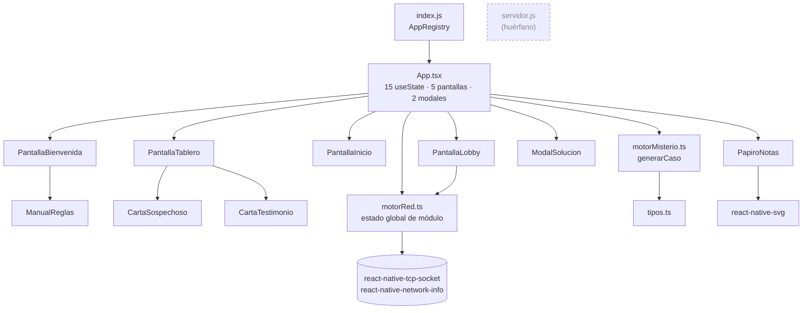

**Rasgos estructurales**

1. **Un único «dios»**: `App.tsx` decide la pantalla, posee el caso, la configuración, las notas, el cronómetro, el código de sala y cinco *flags* de modal, y además lanza la generación y la red.
2. **La lógica de negocio y la UI se mezclan en el mismo árbol de dependencias**, pero la separación *física* ya existe (`src/logic/*` no importa nada de UI). Es un buen punto de partida: el motor de reglas es extraíble tal cual.
3. **`motorRed.ts` es un *singleton* implícito** (siete variables `let` a nivel de módulo). No se puede instanciar dos veces, ni testear sin red, ni inyectar.
4. **No hay capa de datos**: ni persistencia, ni repositorio de assets (el mapa `IMAGENES` está copiado **tres veces**).

### 2.4 Flujo de navegación (máquina implícita de `App.tsx`)

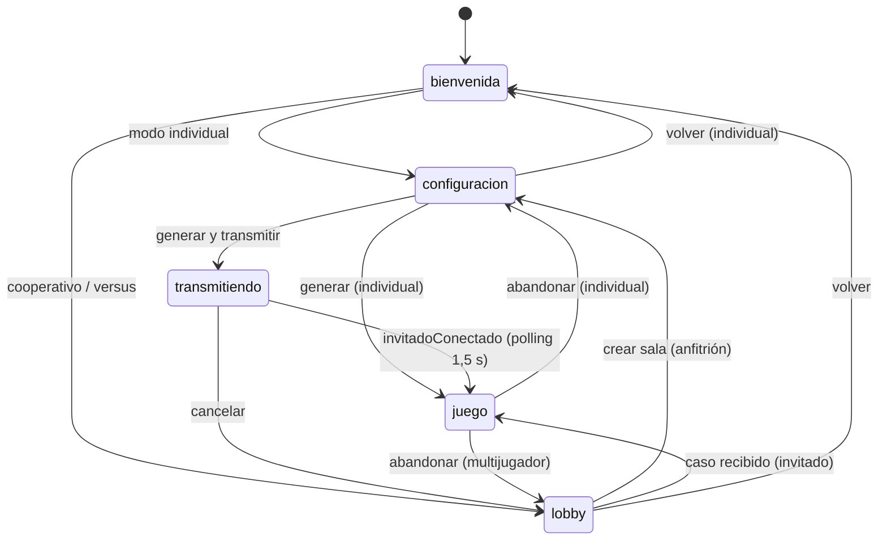

Observaciones: no hay estado `resultado` (el resultado vive dentro de `ModalSolucion`), la pantalla `transmitiendo` está escrita *inline* en `App.tsx`, y ninguna transición se anima. El botón físico «atrás» de Android **cierra la app** desde cualquier punto (no hay `BackHandler`).

### 2.5 Cómo viajan los datos, de principio a fin

| Dato | Nace en | Viaja por | Muere en | Riesgo |
|---|---|---|---|---|
| `config` (objeto **sin tipo**: `sospechososTotales`, `asesinos`, `mentirosos`, `testigosActivos`, `modoSeleccion`, `personajesManuales`, `testigosManuales`) | `PantallaInicio.iniciarJuego` | prop `onGenerarCaso(config: any)` → `App.iniciarNuevoCaso` → `generarCaso(config: any)`; se guarda en `configActual: any` | `confirmarAbandonar` | La interfaz `ConfiguracionCaso` de `tipos.ts` **no coincide** con el objeto real (`cantidadSospechosos` vs `sospechososTotales`…) y no se usa |
| `CasoGenerado` (`personajes: any`, `testigos`, `asignaciones`, `solucion`) | `generarCaso` | `useState` en `App` → props `caso` a Tablero, Notas y Solución; en red: `JSON.stringify` → TCP → `JSON.parse … as CasoGenerado` | `setCaso(null)` | La **solución viaja dentro del caso** a todas las pantallas y al invitado; en red no hay validación de forma |
| `notasJugador` (cadena JSON de trazos) | `PapiroNotas` (en cada trazo) | `onActualizarNotas` → `useState` de `App` → vuelve como `notasGuardadas` → `JSON.parse` en un `useEffect` | `confirmarAbandonar` | Reserializa **todos** los trazos en cada trazo; actualización de estado de otro componente dentro de un *updater* (impuro) |
| `tiempoInicio` (`Date.now()`) | `App` (al entrar en `juego`) | prop → `PantallaTablero` (cronómetro) y `ModalSolucion` (tiempo final) | `confirmarAbandonar` | Reloj de pared (cambia si el usuario ajusta la hora); **en multijugador cada dispositivo fija el suyo** (NET-6) |
| `codigoSala` | `crearSala` | `App` → `PantallaTablero` (se recibe y **no se usa**) | `cancelarHost` | Prop muerta |
| `gameKey` (entero) | `App` | `key=` del tablero | — | Fuerza un re-montaje total para «resetear» las cartas reveladas (el estado `revelada` es local) |

### 2.6 Inventario de módulos

| Módulo | Qué hace | De quién depende | Observaciones clave |
|---|---|---|---|
| `App.tsx` | Estado y navegación; lanza generación; crea sala; *polling* de «invitado conectado»; modales de abandono y error | todo | APP-1. Tres rutas distintas de «nueva partida» con lógica duplicada (`iniciarNuevoCaso`, `handleReroll`, `manejarCasoRecibido`) |
| `motorMisterio.ts` | Define los 8 sospechosos y 4 testigos; genera el *pool* de hasta 58 afirmaciones por hablante; elige una por sospechoso; comprueba unicidad por fuerza bruta | `tipos.ts` | Núcleo correcto salvo ENG-1; semántica atada al texto (ENG-2) |
| `motorRed.ts` | Anfitrión: servidor TCP en :3000, valida PIN y envía el caso. Invitado: barrido de la subred probando el PIN | `motorMisterio` (sólo tipo), RN | §4. Estado global mutable |
| `tipos.ts` | Tipos | — | `Testigo`, `ModoJuego`, `ConfiguracionCaso` declarados y **sin uso** |
| `PantallaBienvenida` | Portada (imagen + «TOCA PARA EMPEZAR» parpadeante) y menú de 3 modos + manual | `ManualReglas` | La fase `modos` **no** es desplazable |
| `PantallaInicio` | 4 *steppers* con límites (3–8 sospechosos; asesinos y mentirosos ≤ ⌈s/2⌉; testigos ≤ 1 si s ≤ 5, si no ≤ 2), modo aleatorio/manual, rejilla manual | — | Mapa `IMAGENES` duplicado; estilos muertos (`cajaHost`, `textoHost`) |
| `PantallaLobby` | Elegir rol; teclado numérico de 4 dígitos; llamar a `unirseSala` | `motorRed` | «Cancelar» no cancela la búsqueda (NET-8) |
| `PantallaTablero` | HUD (nº de asesinos/mentirosos, cronómetro), testigos, rejilla de pares sospechoso+testimonio, barra Notas/Resolver, menú y zoom | `CartaSospechoso`, `CartaTestimonio` | Re-render de todo el tablero cada segundo (§6.2); cabecera sin *safe area* |
| `CartaSospechoso` | Imagen + nombre | — | No muestra género ni rasgo (UX-1) |
| `CartaTestimonio` | Dorso → al tocar, revela el texto; tocar de nuevo → zoom | — | Texto a 10 pt, `numberOfLines={6}`; `resetToken` jamás se pasa |
| `ModalSolucion` | Marcar asesinos y mentirosos, comprobar **cantidades**, entregar (una sola vez), mostrar resultado | — | Acción irreversible sin confirmación (UX-9) |
| `PapiroNotas` | Dibujo libre con lápiz/«goma» sobre papel pautado | `react-native-svg` | §6.2. La «goma» pinta del color del papel |
| `ManualReglas` | Texto estático de reglas, escala de rasgos y efectos de los testigos | — | **Sólo accesible desde el menú de modos**, no durante la partida (UX-1) |

### 2.7 Capa nativa y configuración

| ID | Sev. | Hallazgo | Evidencia |
|---|---|---|---|
| **OPS-1** | Crítica | `targetSdk`/`compileSdk` 34. Google Play exige **API 36** a apps nuevas y actualizaciones desde el 31-ago-2026 (prórroga solicitable hasta el 1-nov-2026, que a fecha de este informe vence en 5 días) | `android/build.gradle` · fuente en «Fuentes» |
| **OPS-2** | Alta | El *build* `release` se firma con la clave de *debug*; R8/ProGuard desactivado; `versionCode 1` | `android/app/build.gradle` (`signingConfig signingConfigs.debug` en `release`) |
| **OPS-3** | Alta | **`ios/` es idéntico a la plantilla de RN (0 cambios en el historial de git)**, indicio de que el proyecto sólo se ha trabajado y probado en Android. iOS: `AppIcon.appiconset` **sin ninguna imagen**; *bundle id* `org.reactjs.native.example.Bollijuego`; *launch screen* de plantilla (blanco, «Powered by React Native»); `NSLocationWhenInUseUsageDescription` **vacío**; **sin** `NSLocalNetworkUsageDescription` | `ios/Bollijuego/*`, `project.pbxproj` |
| **OPS-4** | Media | `AndroidManifest`: cinco permisos Bluetooth (`BLUETOOTH`, `_ADMIN`, `_SCAN`, `_CONNECT`, `_ADVERTISE`) y ubicación fina/gruesa **sin uso real** (no hay código Bluetooth; la red local no necesita ubicación). Icono de Android con la ilustración cortada por el borde y sin icono adaptativo (no existe `mipmap-anydpi-v26`) | `AndroidManifest.xml`, `mipmap-*` |
| **OPS-5** | Alta | Herramientas de calidad inoperantes: `.eslintrc.js` y `.prettierrc.js` **fueron vaciados en el segundo commit** (la plantilla traía `extends: '@react-native'` y la configuración de Prettier; se recuperan con `git show dc13842:.eslintrc.js`), hoy de 0 bytes (`eslint .` da 3 errores de *parsing* y no revisa ningún `.ts/.tsx`); `jest` falla porque `react-native-tcp-socket` es ESM sin `transformIgnorePatterns` ni *mocks* de módulos nativos; no hay CI | ejecutado (V6) |
| **OPS-6** | Baja | `servidor.js` (HTTP de salas, `Access-Control-Allow-Origin: *`, `JSON.parse` sin `try`, escucha en **:3000, el mismo puerto que el TCP del juego**) no lo referencia nadie | `grep` en todo el repo |
| **OPS-7** | Media | `npm audit --omit=dev`: 17 avisos (1 crítico, 7 altos, 9 moderados), **todos transitivos** (`shell-quote`, `brace-expansion`, `joi`, `js-yaml`, `node-forge`, `@react-native-community/cli*`…), pertenecen al *toolchain* de RN 0.74 y no se empaquetan en la app | ejecutado (V6) |
| **OPS-8** | Baja | `README.md` es el de la plantilla de RN: no documenta el juego, las reglas, cómo jugar en red ni la arquitectura | lectura |
| **OPS-9** | Baja | Nombre comercial incoherente: `displayName` «Bollijuego» frente al título del juego «¿Quién mató a la gallina?» | `app.json`, `Portada.png` |
| **OPS-10** | Info | Positivo: Hermes activo, `allowBackup=false`, `usesCleartextTraffic` sólo en *debug*, `NSAllowsArbitraryLoads=false`, `PrivacyInfo.xcprivacy` presente | lectura |


## 3. Motor lógico y gestión de datos (core del juego)

> **Este capítulo no cambia ninguna regla.** Todo lo que se propone se valida contra el motor actual con una suite de **paridad** (§3.6.6): el juego resultante debe producir, para cada afirmación, cada combinación de testigos y cada conjunto de asesinos, **el mismo valor de verdad** que hoy.

### 3.1 Modelo de datos actual

**Sospechosos** (`motorMisterio.ts` L13-22). El «rasgo» es una escala de afecto de 4 niveles con forma masculina y femenina:

| Nivel | Rasgo | Chico | Chica |
|:-:|---|---|---|
| 0 | Muy Arisco/a | Tavio | Pili |
| 1 | Arisco/a | Pork | Charlot |
| 2 | Cariñoso/a | Lolo | Luisa |
| 3 | Muy Cariñoso/a | Charls | Reisy |

**Testigos** (`TESTIGOS_DB`, L24): Thomas, Mr. Red, La Vicente, Croqueta Batista. No «declaran»: **cambian cómo se leen** las cartas de los demás.

**Categorías de afirmación** (`generarPool`, L140-191). Con 8 sospechosos hay 58 por hablante (464 en total):

| Cat. | Forma | Ejemplo | Lo altera | Nº por hablante |
|:-:|---|---|---|:-:|
| A | Autoinculpación / exculpación / acusación | «He sido yo.» · «No ha sido Pili.» | — | 16 |
| F | Veracidad de otro | «Pork miente.» · «Pork dice la verdad.» | Croqueta Batista | 14 |
| B | Género | «Al menos un asesino es un chico.» | Thomas | 4 |
| C | Rasgo | «Ningún asesino es Muy Arisco.» | Mr. Red (arisco) · La Vicente (cariñoso) | 8 |
| D | Comparativa de afecto | «Al menos un asesino es más cariñoso que yo.» | Mr. Red · La Vicente | 8 |
| E | Género + comparativa | «Al menos un asesino es una chica y menos arisco que yo.» | Thomas + Mr. Red/La Vicente | 8 |

**Tipos** (`tipos.ts`): `Personaje {nombre, gen, rasgo}`, `Testimonio {texto, cat, speaker, target?, tags, rasgo?, rel_word?, estaRevelado?}`, `Asignacion`, `CasoGenerado {personajes: any, testigos, asignaciones, solucion}`.

### 3.2 Cómo funciona hoy

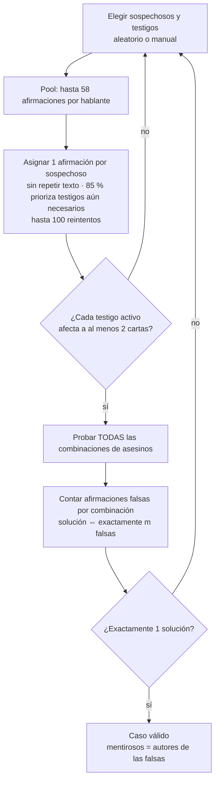

La idea de fondo es correcta y elegante: **generar al azar y validar por enumeración** que el caso tiene solución única. Con ≤ 8 sospechosos, C(8,4) = 70 combinaciones es trivial.

### 3.3 Lo que está bien

- **La unicidad se *demuestra*, no se supone**: cada caso entregado ha sido enumerado completo.
- **Semántica de testigos correcta** para A–E y F-con-Croqueta (V3: 0 discrepancias en 1 057 536 evaluaciones).
- **La sustitución de Mr. Red y La Vicente es simultánea, no encadenada** (el `else if` de L97-100 y L105-106): con ambos en mesa cada uno actúa sólo sobre «su» palabra. Es la lectura correcta, aunque ni el manual ni las cartas lo digan (§3.8).
- **Sin mutación de entradas**: `evaluarTestimonio` copia `visitados`, `shuffle` copia el array.
- **Rendimiento sobrado** (V1/V2).
- **Separación física** `logic/` ⇄ `screens/`: el motor no importa nada de React Native.

### 3.4 Hallazgos

#### ENG-1 · Los ciclos de «X miente» producen casos que no se pueden deducir — **Alta**

**Dónde.** `evaluarTestimonio`, L58 (`if (visitados.has(pSpeaker.nombre)) return false;`) y L74-76 (recursión sobre el testimonio del objetivo).

**Qué pasa.** Sin Croqueta en mesa, «X miente» se evalúa como «el testimonio de X es falso», recursivamente. Si A habla de B, B de C y C de A, la recursión vuelve a un hablante ya visitado y el código **decide arbitrariamente que su testimonio es falso**. Ese «falso» no corresponde a ninguna asignación coherente de verdad/mentira: el motor etiqueta como mentirosos a personas cuyo testimonio, leído con las reglas del manual, **debería ser verdadero**.

**Por qué es un problema de reglas del juego y no de gusto.** El manual dice que un mentiroso dice «EXACTAMENTE LO CONTRARIO». Un ciclo impar de «miente» es una **paradoja** (Tavio: «Charls miente» · Charls: «Reisy miente» · Reisy: «Tavio miente» no admite ninguna asignación consistente). Un ciclo par admite dos. En ambos casos el jugador **no puede** llegar a la solución única que el motor le va a exigir.

**Evidencia (V4).** 23 550 casos generados con el motor actual, comprobados con un solver que sólo acepta mundos donde *«es mentiroso ⇔ su afirmación es falsa»*:

| Sospechosos | Casos | Con ciclo F | % | Defectuosos |
|:-:|--:|--:|--:|--:|
| 3 | 1 200 | 2 | 0,17 % | 1 |
| 4 | 1 200 | 3 | 0,25 % | 3 |
| 5 | 2 700 | 33 | 1,22 % | 31 |
| 6 | 4 050 | 32 | 0,79 % | 32 |
| 7 | 7 200 | 132 | 1,83 % | 131 |
| 8 | 7 200 | 168 | **2,33 %** | 167 |
| **Total** | **23 550** | **370** | **1,57 %** | **365** |

- Sin ciclos (23 180 casos): **0 discrepancias** entre el motor y el solver fiel. El defecto está acotado a los ciclos.
- Con ciclos: 365 de 370 (98,6 %) no tienen solución única; **227 no tienen ninguna** solución consistente; en 307 la solución que el motor «oculta» ni siquiera es un modelo válido.
- Ejemplo real generado (4 sospechosos, 1 asesino, 1 mentiroso, sin testigos): *Tavio: «Charls miente.» · Reisy: «Tavio miente.» · Charls: «Reisy miente.» · Pork: «Ningún asesino es Arisco.»* — el motor responde «asesino: Pork; mentiroso: Pork», que **no** es un modelo consistente.

**Consecuencia.** Un jugador que razona perfectamente puede recibir «¡HAS FALLADO! Te babaste». Es el peor tipo de fallo en un juego de deducción: castiga la inteligencia.

**Arreglo** (§3.6): validar con el solver fiel (`findModels`) y exigir **exactamente un modelo**. No cambia ninguna regla: aplica la que ya existe («mentiroso = su afirmación es falsa») sin atajos. Algunos casos con ciclo par seguirán siendo válidos cuando el resto de cartas desambigüe, y eso es deseable.

#### ENG-2 · La semántica depende del texto que se muestra — **Alta (deuda)**

`evaluarTestimonio` decide qué significa una carta con `texto.includes("Al menos")`, `"Ningún"`, `"más"`, `"chico"`, `"He sido yo"`, `"miente"` (L66-135). Consecuencias:

1. **Cualquier retoque de redacción rompe las reglas en silencio** (cambiar «Ningún asesino» por «Ninguno de los asesinos», corregir una tilde o traducir).
2. El `return true;` final (L137) convierte un texto no reconocido en «afirmación verdadera» **sin avisar**.
3. Las categorías son letras (`"A"`…`"F"`) y los testigos afectados son cadenas libres en `tags` (`"Mr. Red"`), duplicadas como claves en 4 ficheros.
4. Es imposible mostrar, sin parsear de nuevo, «qué significa realmente esta carta con estos testigos», que es justo lo que el jugador necesita para entender sus errores (§3.8).

**Arreglo:** AST tipado de afirmaciones + `renderEs()` para el texto + `readAs()` para los testigos (§3.6). Se ha comprobado que el AST reproduce **exactamente** los 464 textos actuales (ida y vuelta) y las mismas etiquetas de testigo (V7).

#### ENG-3 · Tipado decorativo y modelo con redundancias — **Media**

- `Rasgo` es una unión de **ocho cadenas** (con género gramatical) y `getValorAfecto`/`normalizarRasgo` reconstruyen el nivel con `includes("Arisc")` (L26-40). El dato real es un entero 0–3 y un género.
- 12 usos de `any`, entre ellos `CasoGenerado.personajes` (duplica `asignaciones[].personaje`), `generarCaso(config: any)`, `useState<any>` para la configuración y el *cast* `(caso as any).testigosActivos` (L43 de `PantallaTablero`, una compatibilidad con una forma antigua del caso que ya no existe).
- `ConfiguracionCaso` (`cantidadSospechosos`…) **no coincide** con el objeto real (`sospechososTotales`…) y nadie la usa; `Testigo`, `ModoJuego` y `estaRevelado` también están muertos; la unión `'individual' | 'cooperativo' | 'versus'` está escrita **7 veces**.
- Los nombres de personaje y testigo viajan como `string` y sirven de clave para imágenes, efectos y red. Una errata («Mr Red») produce `undefined` en `IMAGENES[...]` sin error de compilación.

#### ENG-4 · Fallo silencioso y *reroll* sin guarda — **Media (latente)**

`generarCaso` devuelve un caso **vacío** si agota los intentos (L343-348). `iniciarNuevoCaso` lo comprueba (`App.tsx` L68) pero `handleReroll` **no** (L103-105): se guardaría un caso sin asignaciones → tablero vacío, HUD «0 | 0», y `ModalSolucion.cantidadCorrecta` se cumple con 0 = 0 → **«¡CASO RESUELTO!» instantáneo**. No se observó ningún fallo en 24 806 generaciones, de modo que es latente, pero el arreglo es de una línea y el patrón (devolver un valor «vacío válido») es peligroso. Propuesta: `Result<Caso, GenError>`.

#### ENG-5 · Casos no reproducibles — **Media**

`Math.random` (L215, L272-275) sin semilla: no se puede reproducir un caso para un informe de error, compartir «el caso de hoy», re-generar en el invitado ni escribir pruebas deterministas. Con una semilla, **caso = semilla + configuración** (V7: 314/314 reproducibles).

#### ENG-6 · Código redundante — **Baja**

`if (solucionesValidas.length === 1)` anidado dos veces (L328-329); `personajes` duplicado; comentarios `// FIX:` residuales; `getCombinations` recalcula en cada intento.

#### ENG-7 · La solución viaja pegada al caso — **Media**

`CasoGenerado.solucion` se pasa a todas las pantallas (el HUD usa los *recuentos*) y, en red, al invitado. Hoy no importa porque la comprobación es local, pero impide un modelo autoritativo (§4.4.6) y es una fuga innecesaria. Debe separarse el **caso público** (lo que se ve) del **secreto** (la solución).

#### ENG-8 · Rendimiento del generador — **Info (no es un problema)**

Medido (V1/V2): mediana 0,6 ms, máximo 58 ms, 0 fallos en 24 806 generaciones. No se necesita *worker*, ni generación asíncrona, ni deshabilitar combinaciones de la UI.

### 3.5 Deuda técnica, acoplamiento y estado

| ID | Sev. | Hallazgo | Evidencia |
|---|---|---|---|
| **APP-1** | Alta | `App.tsx` concentra **15 `useState`**, 5 pantallas, 2 modales *inline*, la orquestación de generación/red y un *polling*. Tres rutas de «nueva partida» con lógica casi idéntica (`iniciarNuevoCaso`, `handleReroll`, `manejarCasoRecibido`) | `App.tsx` L13-27, L60-114 |
| **APP-2** | Media | `cargando` hace un `return` temprano que **desmonta todo el árbol** (incluidos tablero y modales) | `App.tsx` L152-159 |
| **APP-3** | Media | **Duplicación**: `IMAGENES` ×3; `formatearTiempo` ×2; el patrón de overlay (`absoluteFill` + `zIndex/elevation: 1000`) ×8; descripciones de testigos en `PantallaTablero` (L58-66), en `ManualReglas` y en el código del motor (además de en `Testigos.png`); los **nombres** de personajes y testigos en `PERSONAJES`/`TESTIGOS_DB` y de nuevo en `TODOS_PERSONAJES`/`TODOS_TESTIGOS` | grep |
| **APP-4** | Media | `setTimeout(…, 150)` para «dar tiempo a pintar el spinner» (innecesario: ENG-8) y *polling* cada 1,5 s de una variable local (`comprobarEstadoSala` es `async` y sólo devuelve un booleano de módulo) | `App.tsx` L29-42, L65 |
| **APP-5** | Media | **Mutación de estado impura**: `PapiroNotas` invoca `onActualizarNotas` (un `setState` del padre) **dentro** del *updater* de `setTrazos` (L75-81). React lo ejecuta durante el render del hijo → aviso «Cannot update a component while rendering a different component» y doble ejecución en `StrictMode` | `PapiroNotas.tsx` |
| **APP-6** | Media | Estado de red como **variables `let` de módulo** (7), imposible de testear o instanciar dos veces | `motorRed.ts` L6-12 |
| **APP-7** | Media | **Nada se persiste**: si el sistema mata el proceso (memoria, llamada, el usuario «limpia» apps) se pierde el caso, las notas, el cronómetro y —en red— no hay forma de volver a obtenerlo | grep (sin AsyncStorage/MMKV) |
| **APP-8** | Baja | Estado local que debería elevarse o derivarse: `CartaTestimonio.revelada` se «resetea» re-montando todo el tablero con `key` (`gameKey`) en lugar de ser parte del estado de la partida; `resetToken` existe y **nunca se pasa** | `CartaTestimonio.tsx` |

### 3.6 Propuesta: dominio puro, tipado y verificable

#### 3.6.1 Principios

1. `src/domain/` es **TypeScript puro**: cero imports de `react-native`. Se ejecuta en Node → pruebas rápidas y deterministas.
2. **Las afirmaciones son datos** (un AST), no texto. El texto se **renderiza** desde el AST.
3. **El efecto de cada testigo es una función pura** `readAs(afirmación, testigosActivos) → afirmación`: *lo que dice la carta* → *lo que significa*.
4. **La verdad se evalúa sobre un «mundo»** `{asesinos, mentirosos}` con una función total y exhaustiva (el compilador avisa si falta un caso).
5. **Un caso es válido si y sólo si tiene exactamente un modelo** (solver fiel).
6. **Todo el azar sale de una semilla** (`caso = semilla + configuración`).
7. **El caso público y la solución se separan** (§3.6.5).

#### 3.6.2 El AST de afirmaciones (verificado)

```ts
export type Quant = 'SOME' | 'NONE';   // "Al menos un" | "Ningún"
export type Dir = 'MORE' | 'LESS';
export type Axis = 'WARM' | 'COLD';    // cariñoso | arisco

export type Statement =
  | { kind: 'SELF_GUILTY' }
  | { kind: 'SELF_INNOCENT' }
  | { kind: 'ACCUSE'; target: SuspectId }
  | { kind: 'CLEAR'; target: SuspectId }
  | { kind: 'LIAR'; target: SuspectId }
  | { kind: 'TRUTHFUL'; target: SuspectId }
  | { kind: 'GENDER'; q: Quant; gender: Gender }
  | { kind: 'TRAIT'; q: Quant; level: Level }
  | { kind: 'COMPARE'; q: Quant; dir: Dir; axis: Axis }
  | { kind: 'GENDER_COMPARE'; gender: Gender; dir: Dir; axis: Axis };

const assertNever = (x: never): never => { throw new Error(`Statement no contemplado: ${JSON.stringify(x)}`); };
```

#### 3.6.3 Los testigos como transformaciones puras (verificado)

```ts
/** Lo que la carta DICE → lo que SIGNIFICA con los testigos activos (sustitución simultánea, sin encadenar). */
export function readAs(s: Statement, active: ReadonlySet<WitnessId>): Statement {
  const flipG = (g: Gender): Gender => (active.has('Thomas') ? (g === 'M' ? 'F' : 'M') : g);
  const mapLevel = (l: Level): Level =>
    active.has('Mr. Red') && l <= 1 ? ((3 - l) as Level)
    : active.has('La Vicente') && l >= 2 ? ((3 - l) as Level) : l;
  const mapAxis = (a: Axis): Axis =>
    active.has('Mr. Red') && a === 'COLD' ? 'WARM'
    : active.has('La Vicente') && a === 'WARM' ? 'COLD' : a;
  switch (s.kind) {
    case 'LIAR': return active.has('Croqueta Batista') ? { kind: 'CLEAR', target: s.target } : s;
    case 'TRUTHFUL': return active.has('Croqueta Batista') ? { kind: 'ACCUSE', target: s.target } : s;
    case 'GENDER': return { ...s, gender: flipG(s.gender) };
    case 'TRAIT': return { ...s, level: mapLevel(s.level) };
    case 'COMPARE': return { ...s, axis: mapAxis(s.axis) };
    case 'GENDER_COMPARE': return { ...s, gender: flipG(s.gender), axis: mapAxis(s.axis) };
    case 'SELF_GUILTY': case 'SELF_INNOCENT': case 'ACCUSE': case 'CLEAR': return s;
    default: return assertNever(s);
  }
}
```

| Testigo | Carta (`Testigos.png`) | Qué cambia | Motor actual | Propuesta |
|---|---|---|---|---|
| Thomas | ♂ ↔ ♀ | El género en B y E | `texto.includes("chica")` (L90-93) | `flipG` en `GENDER` y `GENDER_COMPARE` |
| Mr. Red | Arisco → Cariñoso | «Arisco/Muy Arisco» (C) y la palabra «arisco» (D, E) | L97-98, L105 | `level ≤ 1 → 3 − level` · `COLD → WARM` |
| La Vicente | Cariñoso → Arisco | Análogo | L99-100, L106 | `level ≥ 2 → 3 − level` · `WARM → COLD` |
| Croqueta Batista | Verdad ↔ Identidad | «X miente» = «X es inocente» · «X dice la verdad» = «X es culpable» | L70-73 | `LIAR → CLEAR` · `TRUTHFUL → ACCUSE` |

Nótese que `3 − level` es exactamente la **reflexión de la escala** (Muy Arisco ↔ Muy Cariñoso, Arisco ↔ Cariñoso), lo que hace evidente que las dos sustituciones no se encadenan.

Los testigos que afectan a cada carta —hoy cadenas libres en `tags`— se **derivan** del AST:

```ts
/** Qué testigos pueden alterar la lectura de una carta (sustituye a los `tags` string del motor actual). */
export function affectedBy(s: Statement): WitnessId[] {
  switch (s.kind) {
    case 'LIAR': case 'TRUTHFUL': return ['Croqueta Batista'];
    case 'GENDER': return ['Thomas'];
    case 'TRAIT': return [s.level <= 1 ? 'Mr. Red' : 'La Vicente'];
    case 'COMPARE': return [s.axis === 'COLD' ? 'Mr. Red' : 'La Vicente'];
    case 'GENDER_COMPARE': return ['Thomas', s.axis === 'COLD' ? 'Mr. Red' : 'La Vicente'];
    default: return [];
  }
}
```

#### 3.6.4 Evaluación y solver fiel (verificado)

```ts
export interface World { readonly killers: ReadonlySet<SuspectId>; readonly liars: ReadonlySet<SuspectId> }
const byId = new Map<SuspectId, Suspect>(SUSPECTS.map(s => [s.id, s]));

/** ¿Es verdadera la afirmación (ya "leída") en este mundo? Función pura y total. */
export function holds(s: Statement, speaker: SuspectId, w: World): boolean {
  const me = byId.get(speaker)!;
  const K = [...w.killers].map(id => byId.get(id)!);
  const q = (quant: Quant, f: (k: Suspect) => boolean) => (quant === 'SOME' ? K.some(f) : !K.some(f));
  const cmp = (dir: Dir, axis: Axis, k: Suspect) => ((dir === 'MORE') === (axis === 'WARM') ? k.level > me.level : k.level < me.level);
  switch (s.kind) {
    case 'SELF_GUILTY': return w.killers.has(speaker);
    case 'SELF_INNOCENT': return !w.killers.has(speaker);
    case 'ACCUSE': return w.killers.has(s.target);
    case 'CLEAR': return !w.killers.has(s.target);
    case 'LIAR': return w.liars.has(s.target);
    case 'TRUTHFUL': return !w.liars.has(s.target);
    case 'GENDER': return q(s.q, k => k.gender === s.gender);
    case 'TRAIT': return q(s.q, k => k.level === s.level);
    case 'COMPARE': return q(s.q, k => cmp(s.dir, s.axis, k));
    case 'GENDER_COMPARE': return K.some(k => k.gender === s.gender && cmp(s.dir, s.axis, k));
    default: return assertNever(s);
  }
}
```

```ts
export interface Slot { readonly speaker: SuspectId; readonly statement: Statement }

export function combos<T>(arr: readonly T[], k: number): T[][] {
  const out: T[][] = [];
  const go = (start: number, acc: T[]) => {
    if (acc.length === k) { out.push([...acc]); return; }
    for (let i = start; i < arr.length; i++) { acc.push(arr[i]); go(i + 1, acc); acc.pop(); }
  };
  go(0, []);
  return out;
}

/**
 * Solver FIEL: un mundo es modelo ⇔ para todo hablante p: (p ∈ mentirosos) ⇔ su afirmación (leída) es falsa en ese mundo.
 * Enumera (asesinos × mentirosos) y corta en `limit` (2 basta para comprobar unicidad).
 */
export function findModels(slots: readonly Slot[], witnesses: ReadonlySet<WitnessId>, nKillers: number, nLiars: number, limit = 2): World[] {
  const ids = slots.map(s => s.speaker);
  const read = slots.map(s => readAs(s.statement, witnesses));
  const found: World[] = [];
  const liarSets = combos(ids, nLiars).map(l => new Set(l));
  for (const K of combos(ids, nKillers)) {
    const killers = new Set(K);
    for (const liars of liarSets) {
      const w: World = { killers, liars };
      if (slots.every((sl, i) => liars.has(sl.speaker) === !holds(read[i], sl.speaker, w))) {
        found.push(w);
        if (found.length >= limit) return found;
      }
    }
  }
  return found;
}
```

`findModels` es la corrección de ENG-1. Un mundo es **modelo** si todos los hablantes cumplen *«es mentiroso ⇔ su afirmación (ya leída) es falsa en ese mundo»*. Cuando el testimonio de A trata de la veracidad de B, el valor de B **forma parte del mundo** en vez de calcularse con un atajo, de modo que ya no hay recursión ni «ciclo que romper». Con `limit = 2` la comprobación de unicidad se detiene en cuanto encuentra un segundo modelo. Coste máximo: C(8,4)² = 4 900 mundos × ≤ 8 afirmaciones.

#### 3.6.5 Caso público frente a secreto

```ts
interface GameCase {                 // lo que existe en el anfitrión / en partida individual
  seed: number; rulesVersion: 1;
  witnesses: WitnessId[];
  slots: { speaker: SuspectId; statement: Statement }[];
  solution: { killers: SuspectId[]; liars: SuspectId[] };   // ← secreto
}
type PublicCase = Omit<GameCase, 'solution'> & { killers: number; liars: number };   // ← lo que ve la UI y viaja por red
```

La UI sólo necesita los **recuentos** (HUD). La solución se consulta únicamente al entregar (`verify(submission)`) o al explicar el resultado (`explain`).

La generación con semilla (`mulberry32` + `generateCase(cfg, seed)`) mantiene **el mismo algoritmo y las mismas probabilidades** que hoy (85 % de prioridad a testigos necesarios, ≥ 2 cartas por testigo, 100 reintentos, 15 000 intentos); el único cambio es que la validez la decide `findModels(...).length === 1`. El código completo está en el Anexo D.

#### 3.6.6 Verificación: cómo se garantiza que no se rompe nada

El prototipo (V7) se contrastó con el motor actual:

| Prueba | Resultado |
|---|---|
| Compila en `strict` + `noUnusedLocals` + `noImplicitReturns` (TS 5.0.4 del proyecto) | ✔ 0 errores |
| Mismo *pool* (464 afirmaciones) y ida y vuelta texto → AST → texto | ✔ 464/464 idénticas |
| Etiquetas de testigo del motor (`tags`) frente a `affectedBy()` | ✔ 0 diferencias |
| `holds(readAs(·))` frente a `evaluarTestimonio` (16 combinaciones de testigos × todos los conjuntos de asesinos × 464 afirmaciones) | ✔ **1 057 536/1 057 536** |
| Generador nuevo en las 157 configuraciones × 20 semillas | ✔ 3 140/3 140 generados · 0 sin solución única (verificado con `findModels`) · máx. 73 ms |
| Reproducibilidad por semilla | ✔ 314/314 |
| `explain()` coherente (`isLiar ⇔ ¬holdsInTruth`) | ✔ 1 980/1 980 tarjetas en 360 casos |

La misma comparación pasa a ser **la prueba de paridad permanente** de la Fase 1 (esquema):

```ts
// __tests__/parity.test.ts  — congela el motor actual en src/legacy/ y lo compara con src/domain/
import * as legacy from '../src/legacy/motorMisterio';
import * as D from '../src/domain';

test('mismas afirmaciones y mismas etiquetas de testigo', () => { /* 464 textos y tags */ });

test.each(allWitnessMasks)('misma verdad: %s', mask => {
  for (const killers of allKillerSets(1, 4))
    for (const t of legacy.generarPool(legacy.PERSONAJES)) {
      const st = parse(t.texto);                              // sólo en el test
      if (isLiarOrTruthful(st) && !mask.has('Croqueta Batista')) continue;   // el defecto ENG-1 vive aquí
      expect(D.holds(D.readAs(st, mask), t.speaker, worldOf(killers)))
        .toBe(legacy.evaluarTestimonio(/* … */));
    }
});

test('el generador sólo emite casos con exactamente un modelo', () => { /* 157 configs × N semillas */ });
```

#### 3.6.7 Recap explicable (`explain`, verificado)

```ts
export interface Explanation {
  speaker: SuspectId;
  said: string;          // lo que pone en la carta
  read: string;          // lo que significa con los testigos activos
  readDiffers: boolean;  // ¿algún testigo cambió la lectura?
  holdsInTruth: boolean; // ¿es cierto en la solución real?
  isLiar: boolean;
}

/** Recap post-partida: "dijo X → significaba Y → era verdad/mentira". Sin tocar ninguna regla. */
export function explain(c: GameCase): Explanation[] {
  const active = new Set<WitnessId>(c.witnesses);
  const world: World = { killers: new Set(c.solution.killers), liars: new Set(c.solution.liars) };
  return c.slots.map(sl => {
    const read = readAs(sl.statement, active);
    return {
      speaker: sl.speaker,
      said: renderEs(sl.statement),
      read: renderEs(read),
      readDiffers: renderEs(read) !== renderEs(sl.statement),
      holdsInTruth: holds(read, sl.speaker, world),
      isLiar: world.liars.has(sl.speaker),
    };
  });
}
```

Ejemplo **real y reproducible** (semilla `20261027`, 5 sospechosos, 2 asesinos, 2 mentirosos, Thomas en mesa):

| Sospechoso | Dijo | Se lee (con Thomas) | Es… |
|---|---|---|---|
| Pork | «Al menos un asesino es **una chica** y más cariñoso que yo.» | «Al menos un asesino es **un chico** y más cariñoso que yo.» | **Mentira** → mentiroso |
| Charlot | «Al menos un asesino es **un chico** y más arisco que yo.» | «Al menos un asesino es **una chica** y más arisco que yo.» | **Mentira** → mentiroso |
| Luisa | «Al menos un asesino es menos cariñoso que yo.» | (igual) | Verdad |
| Tavio | «No ha sido Luisa.» | (igual) | Verdad |
| Reisy | «Ningún asesino es **una chica**.» | «Ningún asesino es **un chico**.» | Verdad |

**Solución:** asesinos Charlot y Reisy · mentirosos Pork y Charlot. Esta tabla es exactamente lo que el jugador necesita ver al fallar (o al acertar): **por qué**. Hoy sólo se le dice «La verdad era: …» (`ModalSolucion` L141-147).

### 3.7 Gestión de estado propuesta

#### 3.7.1 Decisión

| Opción | Encaja para… | No encaja para… | Veredicto |
|---|---|---|---|
| **Context API** | Inyección de dependencias y tema (cambian poco) | Estado que cambia a menudo (re-renderiza a todos los consumidores; sin selectores) | Sólo para DI/tema |
| **Redux Toolkit** | Equipos grandes, *time-travel*, middleware complejo | Un juego pequeño: *boilerplate* y *providers* desproporcionados | No |
| **Zustand** | Estado de juego/UI con **selectores**, *middleware* `persist`, sin *provider*, el almacén se testea fuera de React | Flujos con tiempo y reintentos (no es su cometido) | ✔ **Estado de partida y UI** |
| **XState** | **Máquinas de estados** con temporizadores, reintentos y estados anidados | Estado de datos trivial | ✔ **Sólo el ciclo de vida de la sesión de red** (§4.5) |
| **React Navigation** (native-stack, tipado) | Pantallas, *back* de Android, gestos, transiciones, *deep links* | — | ✔ Sustituye al `pantallaActiva` manual |

**Regla de oro de estado:** *cada dato tiene un único dueño*. (1) **Dominio inmutable** (`GameCase`) — se crea una vez y no se muta; (2) **progreso de partida y ajustes** (Zustand + persistencia): cartas reveladas, marcas, trazos, tiempo de inicio; (3) **efímero de UI** (`useState` local): el modal abierto, el dedo sobre una carta.

#### 3.7.2 Almacén con persistencia y selectores (verificado)

```ts
import { create } from 'zustand';
import { createJSONStorage, persist, type StateStorage } from 'zustand/middleware';
import type { SuspectId } from '../domain';

/** Adaptador mínimo: MMKV (síncrono) o AsyncStorage implementan este contrato. */
export declare const kv: { getString(k: string): string | undefined; set(k: string, v: string): void; delete(k: string): void };
const storage: StateStorage = {
  getItem: k => kv.getString(k) ?? null,
  setItem: (k, v) => kv.set(k, v),
  removeItem: k => kv.delete(k),
};

export interface Stroke { tool: 'pen' | 'eraser'; pts: number[] } // [x0,y0,x1,y1,…] en vez de una cadena SVG que crece
interface GameState {
  mode: 'individual' | 'cooperativo' | 'versus';
  caseSeed: number | null;
  startedAtWallMs: number | null;      // solo para restaurar tras un kill del proceso
  revealed: Record<SuspectId, boolean>;
  marks: Record<SuspectId, { killer: boolean; liar: boolean }>;
  strokes: Stroke[];
  revealTestimony(id: SuspectId): void;
  setMark(id: SuspectId, k: 'killer' | 'liar', v: boolean): void;
  addStroke(s: Stroke): void;
  reset(): void;
}

const empty = { caseSeed: null, startedAtWallMs: null, revealed: {} as GameState['revealed'], marks: {} as GameState['marks'], strokes: [] as Stroke[] };

export const useGame = create<GameState>()(
  persist(
    set => ({
      mode: 'individual',
      ...empty,
      revealTestimony: id => set(s => ({ revealed: { ...s.revealed, [id]: true } })),
      setMark: (id, k, v) => set(s => {
        const cur = s.marks[id] ?? { killer: false, liar: false };
        return { marks: { ...s.marks, [id]: { ...cur, [k]: v } } };
      }),
      addStroke: st => set(s => ({ strokes: [...s.strokes, st] })),
      reset: () => set({ ...empty }),
    }),
    { name: 'bollijuego.game.v1', storage: createJSONStorage(() => storage), version: 1 },
  ),
);

// Selectores atómicos: el tablero solo se re-renderiza si SU carta cambia.
export const useRevealed = (id: SuspectId) => useGame(s => !!s.revealed[id]);
```

- `persist` + un adaptador mínimo (`MMKV` síncrono, o `AsyncStorage`) resuelve **APP-7**: tras un *kill* del proceso se ofrece «Continuar partida».
- Los **trazos** pasan de una cadena SVG que crece sin límite a **arrays de puntos** (se pueden simplificar, deshacer y serializar en una fracción del tamaño).
- Selectores atómicos (`useRevealed(id)`): una carta sólo se re-renderiza si **su** estado cambia (hoy cambia todo el tablero cada segundo, §6.2).

#### 3.7.3 Cómo queda `App.tsx`

```tsx
export default function App() {
  return (
    <GestureHandlerRootView style={{ flex: 1 }}>
      <SafeAreaProvider>
        <ThemeProvider>
          <ErrorBoundary>
            <NavigationContainer><RootNavigator /></NavigationContainer>
          </ErrorBoundary>
        </ThemeProvider>
      </SafeAreaProvider>
    </GestureHandlerRootView>
  );
}
```

De ~280 líneas a ~15. Cada pantalla consume sus datos del almacén con selectores; las acciones (`startSolo`, `host`, `join`, `submit`) viven en *hooks* de funcionalidad (`features/game`, `features/lobby`).

### 3.8 Claridad de argumentos y narrativa (sin tocar la lógica)

**Diagnóstico.** Para deducir hacen falta tres tipos de dato: *qué dice cada carta*, *qué es cada sospechoso* (género y nivel de afecto) y *qué hace cada testigo*. Hoy:

- **Qué es cada sospechoso** sólo se ve al abrir el zoom de la carta (`PantallaTablero` L204-208). La carta de la rejilla muestra una ilustración y un nombre en 12 pt.
- **Qué hace cada testigo** exige tocar su retrato (62×87) y leer una frase ambigua.
- **El manual** (que contiene la tabla de rasgos y los efectos) **no es accesible durante la partida**.
- `Sospechosos.png` y `Testigos.png` —las cartas de referencia del juego físico, con la matriz nombre × género × nivel y los efectos en notación gráfica— **están en el repositorio y no se usan en ninguna pantalla**.

**Dos lenguajes distintos usan el mismo verbo.** El manual dice que el mentiroso significa «EXACTAMENTE LO CONTRARIO» (negación) y las descripciones de los testigos dicen que «**invierte**» (sustitución de una palabra por otra). «Invierte» significa dos cosas diferentes en la misma pantalla. Además, la descripción de Croqueta Batista en el tablero («Invierte los testimonios sobre quién miente y quien es culpable») **no coincide** con el manual ni con el código (que sólo permutan «miente/dice la verdad» ↔ «inocente/culpable», sin tocar «Ha sido X»).

**Propuestas** (ordenadas por impacto/coste; ninguna altera reglas):

| # | Mejora | Detalle | ¿Toca reglas? |
|:-:|---|---|:-:|
| 1 | **Atributos visibles en la carta** | Glifo ♂/♀ y 1–4 corazones sobre la ilustración, con el mismo lenguaje gráfico que `Sospechosos.png` (corazón = afecto, ♂/♀ = género). Se dibujan como capa nativa, no en el PNG | No: es información pública en el manual y en la carta física |
| 2 | **Hoja de referencia siempre a mano** | *Bottom sheet* (gesto hacia arriba o botón) con la matriz de `Sospechosos.png` y los efectos de `Testigos.png` (rehechos en nativo o usando los PNG), más «cómo se lee un mentiroso» | No |
| 3 | **Los testigos muestran su efecto** | Bajo cada retrato en mesa, la notación de la carta: «♂ ↔ ♀», «Arisco → Cariñoso», «Cariñoso → Arisco», «Verdad ↔ Identidad» | No |
| 4 | **Vocabulario unificado** | Mentiroso: «**dice lo contrario**» (negación). Testigo: «**se lee cambiando X por Y**» (sustitución). Se acaba el doble sentido de «invierte» | No (narrativa) |
| 5 | **Texto enriquecido en el testimonio** | Resaltar cuantificador, género, rasgo, comparativa y nombres con `segmentsEs()` (verificado: 464/464 coinciden con `renderEs`). Tamaño ≥ 12 pt en rejilla (hoy 10) | No |
| 6 | **Acusaciones con retrato** | «Ha sido [chip Pork]» en lugar de recordar un nombre | No |
| 7 | **Recap «¿Por qué?»** | Tras entregar: tabla de `explain()` («dijo → se lee → era…») | No |
| 8 | **Regla explícita de testigos simultáneos** | «Mr. Red y La Vicente a la vez: cada uno sólo cambia su palabra; no se encadenan» | No (aclara lo que el motor ya hace) |
| 9 | **Tutorial interactivo** | Caso fijo de 3 sospechosos y 1 testigo (semilla fija) que enseña leer, mentir y testigos en 90 s | No |
| 10 | **Modo asistido (opt-in, *desactivado* por defecto)** | Marca las cartas afectadas por un testigo activo (`affectedBy`) | Sólo si el jugador lo activa; **el equipo de diseño debe confirmarlo** |
| 11 | **Voz** | Se conserva el tono («¡Suuuu!», «Te babaste»); se añaden variantes para no repetir y se evitan párrafos en mayúsculas | No |
| 12 | **Accesibilidad textual** | `accessibilityLabel` por carta: «Pork, chico, arisco. Testimonio: …» | No |

**Textos de testigos: actual → propuesto**

| Testigo | Hoy (`PantallaTablero` L58-66) | Propuesto |
|---|---|---|
| Thomas | «Invierte los géneros en los testimonios.» | «Cambia **chico** por **chica** (y al revés) en lo que se dice sobre género.» |
| Mr. Red | «Invierte los testimonios que buscan a alguien Arisco.» | «Donde se diga **Arisco** (o **Muy Arisco**, o **más/menos arisco**), léelo como **Cariñoso** (**Muy Cariñoso**, **cariñoso**).» |
| La Vicente | «Invierte los testimonios que buscan a alguien Cariñoso.» | «Donde se diga **Cariñoso** (o **Muy Cariñoso**, o **más/menos cariñoso**), léelo como **Arisco** (**Muy Arisco**, **arisco**).» |
| Croqueta Batista | «Invierte los testimonios sobre quién miente y quien es culpable.» | «**“X miente” significa “X es inocente”.** **“X dice la verdad” significa “X es culpable”.**» |
| *(nota común)* | — | «Si Mr. Red y La Vicente están a la vez, cada uno cambia sólo su palabra: no se encadenan.» |


## 4. Auditoría y refactorización del multijugador local

> **Resumen.** Lo que hoy se llama «Cooperativo» y «Versus» es, técnicamente, **una transferencia única de un JSON por TCP** seguida de dos partidas en solitario con el mismo caso. No hay sesión, no hay presencia, no hay sincronización y no hay forma de saber si el otro jugador sigue ahí. Eso, más un descubrimiento por barrido ciego de la subred, es lo que hace que se sienta «rudo» y frágil. El diseño propuesto convierte la transferencia en una **sesión autoritativa** sin cambiar ninguna regla de ningún modo.

### 4.1 Cómo funciona hoy

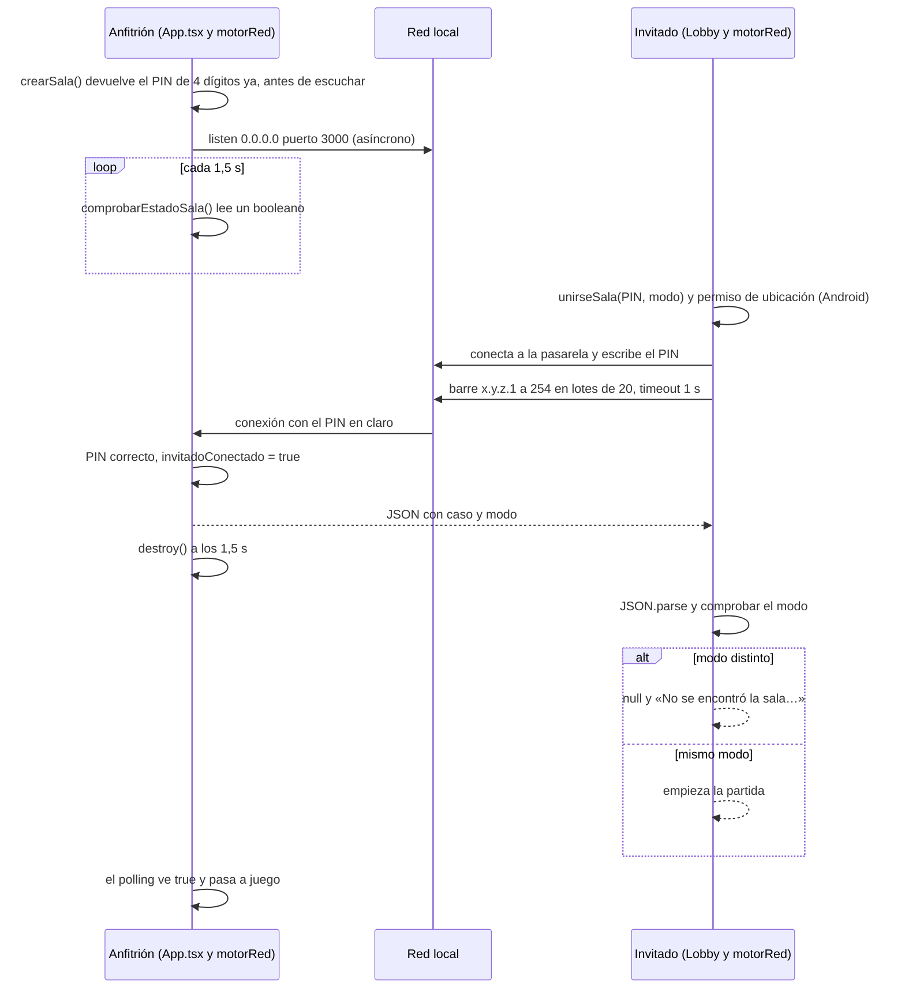

**Presupuesto de latencia actual** (análisis de código, no medido en dispositivo):

| Tramo | Mejor caso | Peor caso | Origen |
|---|---|---|---|
| Intento a la pasarela | ~ms | 1,5 s | `intentarConexionDirecta(gateway, …, 1500)` |
| Barrido de la subred | — (si acierta la pasarela) | 13 lotes × 1 s = **13 s** | `motorRed.ts` L182-195 |
| Detección en el anfitrión | 0 s | **1,5 s** | `setInterval(…, 1500)` en `App.tsx` |
| **Total hasta que ambos ven el tablero** | ≈ 0,1 s | **≈ 14,5–16 s** | |

**Resumen de limitaciones por área**

| Área | Estado actual |
|---|---|
| Protocolo | Texto plano: el invitado envía el PIN en bruto; el anfitrión responde con un JSON sin delimitador ni longitud (el invitado va concatenando y reintentando `JSON.parse`) |
| Sesión | **Inexistente**: el *socket* se cierra 1,5 s después de enviar el caso |
| Sincronización | Ninguna tras la entrega; cada dispositivo fija su `tiempoInicio` por su cuenta |
| Desconexión | No se detecta (no hay latido ni canal abierto) |
| Latencia | No se mide; no hay arranque simultáneo |
| Jugadores | Nominalmente 2, pero el servidor acepta **cualquier número** de invitados mientras la partida dure |
| Plataformas | Android pide ubicación; iOS carece de las claves de red local (§2.7) |

### 4.2 Hallazgos

| ID | Sev. | Hallazgo | Evidencia |
|---|---|---|---|
| **NET-1** | Crítica | **No hay sesión.** Tras escribir el caso se destruye el *socket* (`setTimeout(destroy, 1500)`). Nada puede volver a viajar: ni estado, ni presencia, ni resultados | `motorRed.ts` L52-59 |
| **NET-2** | Alta | **Descubrimiento por barrido ciego** de la /24: pasarela (1,5 s) + 13 lotes de 20 con 1 s de *timeout* ≈ 14,5 s en el peor caso. Asume máscara /24 (redes /23, /22, /16 quedan sin cubrir). **Envía el PIN en claro a cualquier equipo que responda en el puerto 3000** (servidores de desarrollo, paneles…). En iOS 14+ dispara el aviso de red local; en Wi-Fi con aislamiento de clientes todo vence por *timeout* | L92-94, L165-195 |
| **NET-3** | Alta | **El anfitrión empieza solo.** `invitadoConectado = true` se fija al validar el PIN, **antes** de que el invitado compruebe el modo (`parseado.modo === modoLocal`, L118). Si el invitado entró desde el otro modo multijugador, rechaza el caso pero el anfitrión ya ha arrancado. Lo mismo si el *parse* falla o si se conecta un tercer dispositivo | L53-56 frente a L116-124 |
| **NET-4** | Alta | **Sala fantasma.** `crearSala` devuelve el PIN sin esperar a `listening`. Si el puerto está ocupado, el manejador de error sólo llama a `apagarRed()` (que además borra `pinHost`): la UI sigue en «¡SALA CREADA!» con un *spinner* eterno, sin aviso ni *timeout* | L75-81 |
| **NET-5** | Alta | **Sin acuse, latido ni reconexión.** El anfitrión no sabe si el invitado recibió y entendió el caso; si el invitado cierra la app, el anfitrión sigue jugando «en cooperativo» solo | todo el fichero |
| **NET-6** | Alta | **Relojes no sincronizados (Versus).** El anfitrión fija `tiempoInicio` cuando su *polling* de 1,5 s detecta la conexión (`App.tsx` L33-37); el invitado, al terminar su *parse* (L56). No hay cuenta atrás ni instante de salida común, y el tiempo se mide con `Date.now()` (reloj de pared). Los resultados **no se transmiten**: el modal pide «¡Compáralo con tu rival!» (`ModalSolucion` L133) | `App.tsx`, `ModalSolucion.tsx` |
| **NET-7** | Alta | **Cero observabilidad.** Siete `catch (e) {}`, dos `catch (error) { return null }`, `socket.on('error', () => {})`. Seis o más causas distintas (permiso denegado, sin Wi-Fi, IP inválida, PIN erróneo, modo distinto, anfitrión inalcanzable/aislamiento, iOS sin permiso de red local) acaban en **un único mensaje**: «No se encontró la sala o el modo de juego no coincide» | `motorRed.ts`, `PantallaLobby.tsx` L87 |
| **NET-8** | Media | **«Cancelar» no cancela.** Volver atrás durante la búsqueda cambia la fase de la pantalla pero la promesa de `unirseSala` sigue viva; si termina con éxito llama a `onCasoRecibido` y **arranca una partida sin que el usuario lo quiera**. La pantalla dice «Descargando caso…» mientras en realidad está barriendo la red, sin progreso | `PantallaLobby.tsx` L29-43, L114-128 |
| **NET-9** | Alta | **Nada se valida.** `JSON.parse(buffer)` y `parseado.caso as CasoGenerado`: cualquier dispositivo que responda en el puerto con `{caso, modo}` provoca un fallo de ejecución (p. ej. `caso.solucion.asesinos.length`). Tampoco hay límite de tamaño (`buffer += …`) | L103-127 |
| **NET-10** | Media | **Decodificación por paquete.** `data.toString()` en cada evento: un carácter UTF-8 multibyte (`ñ`, `ó`, `¿`) partido entre dos segmentos TCP se corrompe en `U+FFFD`. Medido (V5): 0,7 % de payloads por cada corte del *stream*; el caso ocupa ≈ 2,2 KB, es decir ~2 segmentos. Latente, no reproducido en dispositivo | L52, L105 |
| **NET-11** | Alta | **Permisos incorrectos.** Pide **ubicación fina** «para encontrar la partida local» (la conexión TCP en LAN no la necesita; la negativa devuelve `null` sin explicación). El manifiesto declara 5 permisos Bluetooth **sin código que los use**. iOS: ni `NSLocalNetworkUsageDescription` ni `NSBonjourServices`; `NSLocationWhenInUseUsageDescription` vacío | L149-163, `AndroidManifest.xml`, `Info.plist` |
| **NET-12** | Media | **Singleton y *polling*.** Siete variables `let` de módulo; `comprobarEstadoSala` es `async` pero sólo lee un booleano local y se consulta cada 1,5 s | L6-12, L203-205 |
| **NET-13** | Media | **Sin ciclo de vida.** No hay `AppState`, ni *keep-awake*, ni `BackHandler`, ni reacción a cambios de red. Si el anfitrión bloquea la pantalla esperando, el sistema puede suspender el *socket* de escucha | grep |
| **NET-14** | Media | **PIN débil y servidor abierto.** 9 000 valores sin límite de intentos; el servidor se queda abierto toda la partida y acepta invitados ilimitados; puerto fijo 3000 (choca con herramientas de desarrollo y con `servidor.js`) | L46, L79 |
| **NET-15** | Baja | `servidor.js` (HTTP de «salas», CORS `*`, `JSON.parse` sin `try`) es un resto de una arquitectura anterior: no lo usa nadie | `servidor.js` |

### 4.3 Requisitos del diseño nuevo

| # | Requisito | Resuelve |
|:-:|---|---|
| R1 | **Sesión persistente** con presencia de cada jugador | NET-1, NET-5 |
| R2 | **Anfitrión autoritativo**: él es dueño del reloj, del caso secreto y del ganador | NET-3, NET-6, ENG-7 |
| R3 | **Descubrimiento sin barrido ciego** (QR/código → mDNS → barrido acotado como último recurso) | NET-2 |
| R4 | **Resiliencia**: latido, reconexión con *token*, *backoff*, ventana de gracia | NET-5, NET-13 |
| R5 | **Arranque simultáneo** con reloj sincronizado y medición monotónica | NET-6 |
| R6 | **El secreto no viaja en claro** (prueba de conocimiento, no el PIN) | NET-2, NET-14 |
| R7 | **Todo mensaje se valida** con esquema, tamaño máximo y versión | NET-9, NET-10 |
| R8 | **Testeable sin red**: el transporte es una interfaz con implementación *loopback* | NET-12 |
| R9 | **Feedback visible** del estado de cada jugador y errores con causa | NET-7, NET-8 |
| R10 | **Sin cambios de reglas** en ningún modo (§4.6) | — |

### 4.4 Arquitectura propuesta

#### 4.4.1 Capas

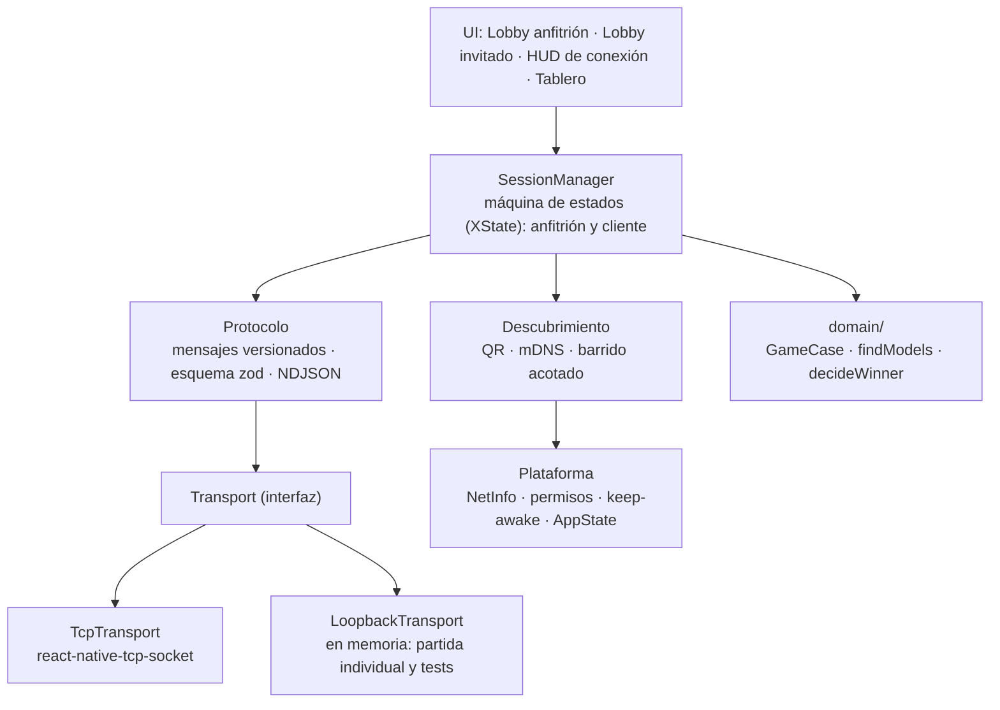

**La partida individual es una sesión de un solo jugador con `LoopbackTransport`.** Un único camino de código para los tres modos: lo que se prueba en individual prueba el 90 % del multijugador.

#### 4.4.2 Quién es dueño de qué

| Dato | Dueño | Cómo lo conocen los demás |
|---|---|---|
| Plantilla de jugadores (`roster`) y estado de cada enlace | Anfitrión | `ROSTER` (difusión) |
| Caso público | Anfitrión | `WELCOME` (sin la solución) |
| **Solución secreta** | Anfitrión (en Versus) | Sólo tras `SUBMIT`, en `RESULT` |
| Reloj de partida | Anfitrión | `START{atHostMs}` + muestras de latido |
| Ganador (Versus) | Anfitrión | `RESULT` |
| Notas, cartas reveladas, marcas | Cada jugador (privado) | No viajan |

#### 4.4.3 Descubrimiento en tres niveles

| Nivel | Mecanismo | Ventajas | Límites |
|:-:|---|---|---|
| **1** | **QR** con `bollijuego://join?h=<ip>&p=<puerto>&c=<código>` y **código manual** de 6 caracteres. Sin descubrimiento: la dirección va en el QR | Instantáneo y a prueba de multidifusión; sirve en un *hotspot* | Requiere cámara (o escribir la IP) |
| **2** | **mDNS/Bonjour** `_bollijuego._tcp`, nombre de instancia = `HMAC(código, "name")[0..8]` (el código nunca se anuncia; el invitado calcula el nombre y lo resuelve) | Sin escaneo, sin permisos de ubicación, lista de «salas cercanas» | Depende de que la red permita multidifusión; librerías nativas (§4.8) |
| **3** | **Barrido acotado** con la **máscara real** (`NetInfo.details.subnet`, no «/24»), máx. 1 022 *hosts*, concurrencia 32, *abortable*, progreso visible, y sólo se envía `HELLO` (nunca el secreto) | Último recurso cuando nada anuncia | Lento; aislamiento de clientes lo anula |

Detalles que cierran NET-14:

- **Puerto**: el primero libre del rango 47800–47809 (no el 3000). El nivel 3 sólo sondea ese rango.
- **Código de sala**: 6 caracteres del alfabeto `ABCDEFGHJKMNPQRSTUVWXYZ23456789` (sin 0/O, 1/I/L) → ≈ 8,9·10⁸ combinaciones. Sirve a la vez de *nombre*, de *secreto* y de lo que el usuario teclea.
- **Aislamiento detectado**: si hay Wi-Fi y la dirección conocida vence por *timeout*, se muestra «La red parece aislar dispositivos (típico en Wi-Fi de invitados u hoteles). Prueba con el punto de acceso del móvil del anfitrión», con una ayuda ilustrada.

#### 4.4.4 Protocolo

- **Trama**: una línea JSON por mensaje (**NDJSON**), UTF-8, máx. 64 KB por línea.
- **Sobre común**: `{ v, seq, ack, t, … }` — `v` = versión del protocolo; `seq` propio y creciente (idempotencia: un mensaje repetido se descarta); `ack` = último `seq` del otro lado procesado.
- **Dos versiones** en el *handshake*: `PROTOCOL_VERSION` (formato) y `RULES_VERSION` (semántica del motor y diccionario de cartas). Si no coinciden: `REJECT{BAD_RULES}` con mensaje «actualiza la app».
- **Validación**: nada que llegue por red entra en la app sin pasar por `parseLine(line, schema)`; sin *casts*.

| Dir. | Tipo | Carga | Cuándo |
|:-:|---|---|---|
| H→C | `CHALLENGE` | `salt` | Al conectar |
| C→H | `HELLO` | `clientId`, `name`, `mode`, `rulesVersion`, `proof = HMAC(código, salt‖clientId)`, `resumeToken?` | Respuesta al reto |
| H→C | `WELCOME` | `you`, `resumeToken`, `roster`, `caseDto` (sin solución) | `HELLO` válido |
| H→C | `REJECT` | `BAD_PROOF` · `BAD_RULES` · `MODE_MISMATCH` · `ROOM_FULL` · `ALREADY_STARTED` | `HELLO` inválido (**el anfitrión no marca «conectado»**: NET-3) |
| H→C | `ROSTER` | jugadores con `link`, `rttMs`, `ready`, `submitted` | Cada cambio |
| C→H | `READY` | `ready` | Lobby |
| H→C | `START` | `atHostMs` (instante absoluto del reloj del anfitrión) | Todos listos |
| C↔H | `PING` / `PONG` | `t0`, `t1`, `t2` | Cada 2 s |
| C→H | `SUBMIT` | `killers`, `liars`, `elapsedMs` | Entrega |
| H→C | `RESULT` | `winnerId`, `board`, `truth` | Veredicto |
| C→H | `BYE` | — | Salida voluntaria |

El esquema completo (`zod`) está en el Anexo E (`protocol.ts`, verificado).

#### 4.4.5 *Handshake*

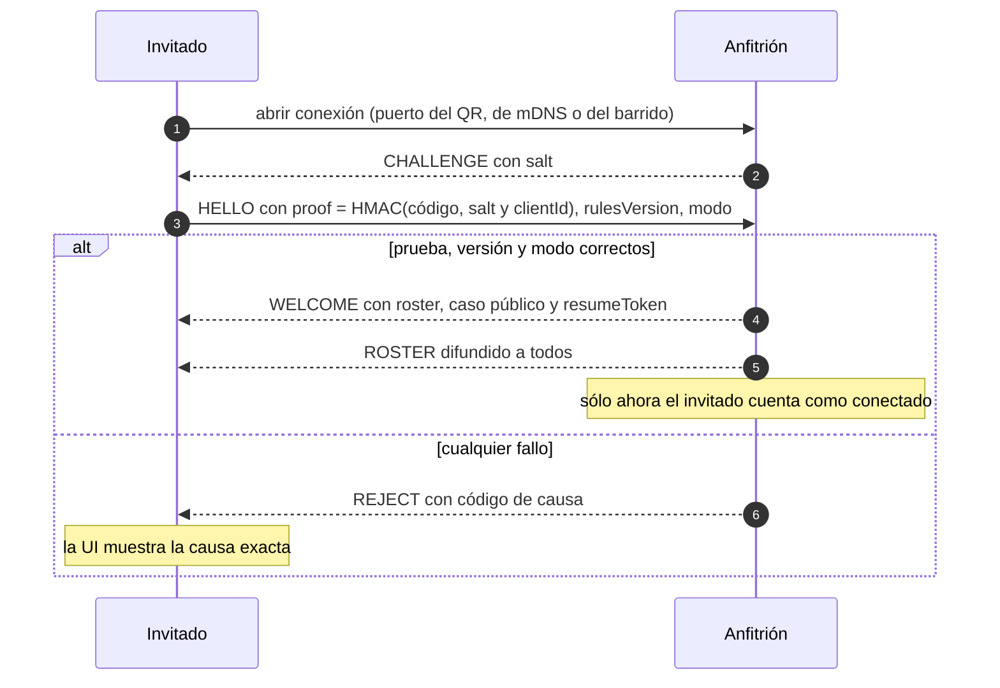

El **código nunca viaja**: se demuestra su conocimiento. Los equipos que contesten en un puerto ajeno sólo ven un `HELLO` con una prueba sin valor fuera de esa sesión.

#### 4.4.6 Autoridad y secreto de la solución

| Modo | Dónde se comprueba la entrega | Por qué |
|---|---|---|
| Individual | Local (el «anfitrión» es el propio dispositivo) | No hay rival |
| **Cooperativo** | **Puede viajar al cliente** y comprobarse localmente | No hay incentivo a hacer trampas; resiste la caída del anfitrión. Cada jugador conserva **su** intento y **su** resultado, como hoy |
| **Versus** | **Sólo en el anfitrión**: el cliente nunca recibe la solución antes de entregar | Es una carrera: el veredicto no puede depender del dispositivo del rival |

**Decisión recomendada:** el protocolo transporta siempre `caseDto` sin solución y el anfitrión la envía al cliente **sólo en Cooperativo** (o tras `RESULT`). Si el equipo prefiere un único comportamiento, es preferible el de Versus.

#### 4.4.7 Latido y estado del enlace

| Estado | Condición | Efecto |
|---|---|---|
| `ok` | Tráfico en los últimos 5 s | Indicador verde, muestra RTT |
| `degraded` | 5–12 s sin tráfico | Ámbar, «conexión inestable» |
| `lost` | ≥ 12 s | Se dispara reconexión; en el anfitrión, el hueco se **reserva 60 s** |

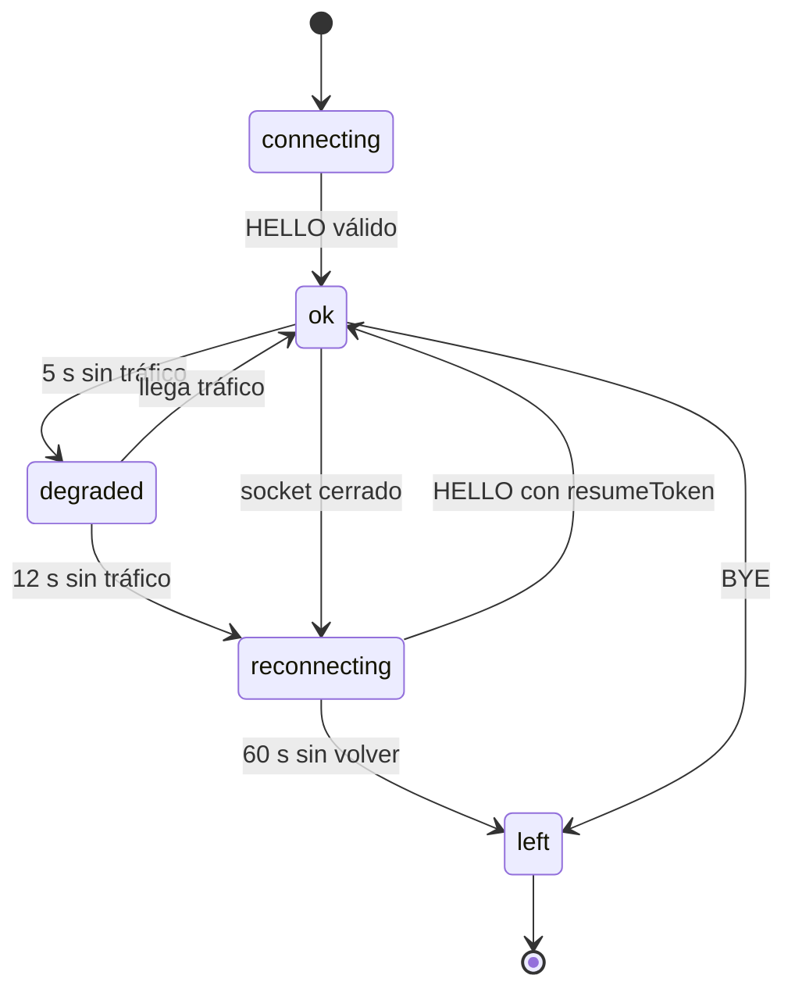

Cualquier mensaje recibido cuenta como señal de vida (`heard()`), no sólo el `PONG`. El monitor tiene el reloj **inyectado**, de modo que se prueba con *fake timers* y sin red (verificado: secuencia `ok → degraded → lost → ok`).

```ts
export type LinkState = 'ok' | 'degraded' | 'lost';

export interface LivenessConfig { pingEveryMs: number; degradedAfterMs: number; lostAfterMs: number }
export const DEFAULT_LIVENESS: LivenessConfig = { pingEveryMs: 2_000, degradedAfterMs: 5_000, lostAfterMs: 12_000 };

/** Monitor de latido con reloj inyectable (se testea con fake timers y sin red). */
export class Liveness {
  private lastHeard: number;
  private state: LinkState = 'ok';
  private timer: ReturnType<typeof setInterval> | undefined;

  constructor(
    private readonly now: () => number,
    private readonly sendPing: () => void,
    private readonly onChange: (s: LinkState) => void,
    private readonly cfg: LivenessConfig = DEFAULT_LIVENESS,
  ) { this.lastHeard = now(); }

  start(): void { this.stop(); this.timer = setInterval(() => this.tick(), this.cfg.pingEveryMs); }
  stop(): void { if (this.timer) clearInterval(this.timer); this.timer = undefined; }

  /** Llamar con CUALQUIER mensaje recibido (no solo PONG): el tráfico también demuestra vida. */
  heard(): void { this.lastHeard = this.now(); this.set('ok'); }

  tick(): void {
    const silence = this.now() - this.lastHeard;
    this.set(silence >= this.cfg.lostAfterMs ? 'lost' : silence >= this.cfg.degradedAfterMs ? 'degraded' : 'ok');
    if (this.state !== 'lost') this.sendPing();
  }

  private set(s: LinkState): void { if (s !== this.state) { this.state = s; this.onChange(s); } }
}
```

#### 4.4.8 Reconexión y reanudación

- El cliente conserva el caso y su estado local (el almacén persistido de §3.7).
- Reintenta con *backoff* exponencial (0,5 s, 1 s, 2 s, 4 s, 8 s tope) hasta 60 s en total, y presenta `HELLO{resumeToken}`.
- El anfitrión reasocia el hueco y responde `WELCOME` con la **fase actual** (lobby, cuenta atrás, jugando). Si estaba jugando, el cronómetro del jugador **no se detiene** (se mide desde `START`).
- Pasados los 60 s: `left`. En Versus, el rival ve «Luis abandonó» y la partida sigue.

La máquina de estados del cliente (XState v5, verificada con `tsc`) y el resto del código está en el Anexo E; el diagrama de §4.4.7 es su proyección sobre el enlace.

#### 4.4.9 Arranque simultáneo y reloj (Versus)

1. En el lobby todos pulsan `READY`; el anfitrión los ve en `ROSTER`.
2. El anfitrión envía `START{atHostMs = hostNow + 3000}`.
3. Cada cliente estima su *offset* con las últimas 8 muestras de `PING/PONG` y se queda con la de **menor RTT**; `toLocalTime(atHostMs, offset)` da el instante local de salida.
4. Cuenta atrás visible **3 – 2 – 1**; el tablero se desvela en el instante común (error típico en Wi-Fi: unos milisegundos).
5. El tiempo del jugador se mide con un reloj **monotónico** (`performance.now()`), no con `Date.now()`, y se envía en `SUBMIT.elapsedMs`.

```ts
export interface PingSample { t0: number; t1: number; t2: number; t3: number } // t0/t3: reloj cliente · t1/t2: reloj host

/** Estimación tipo NTP con cuatro marcas de tiempo. offset = (reloj host) − (reloj cliente). */
export const estimate = ({ t0, t1, t2, t3 }: PingSample) => ({
  rttMs: (t3 - t0) - (t2 - t1),
  offsetMs: ((t1 - t0) + (t2 - t3)) / 2,
});

/** Se queda con la muestra de MENOR RTT (la menos contaminada por colas/retardos del Wi-Fi). */
export function bestOffset(samples: readonly PingSample[]): { rttMs: number; offsetMs: number } | null {
  if (samples.length === 0) return null;
  return samples.map(estimate).reduce((a, b) => (b.rttMs < a.rttMs ? b : a));
}

/** Convierte "arranca en T del host" a "arranca en T local" (usar un reloj MONOTÓNICO, no Date.now()). */
export const toLocalTime = (atHostMs: number, offsetMs: number): number => atHostMs - offsetMs;
```

Verificado: con un reloj del anfitrión 5 000 ms adelantado y *jitter* asimétrico de 2–42 ms, el error de estimación fue de 7,6 ms con RTT de 34 ms.

**La regla de Versus no cambia**: «gana el más rápido **en acertar**». El anfitrión sólo automatiza la comparación que hoy hacen los jugadores de palabra:

```ts
export interface Submission { playerId: string; correct: boolean; elapsedMs: number; receivedAtHostMs: number }

/**
 * Regla (sin cambios): gana quien ENTREGA CORRECTO en menos tiempo.
 * Empates: el primero que llegó al host. Si nadie acierta, no hay ganador.
 */
export function decideWinner(subs: readonly Submission[]): string | null {
  const correct = subs.filter(s => s.correct);
  if (correct.length === 0) return null;
  return [...correct].sort((a, b) => a.elapsedMs - b.elapsedMs || a.receivedAtHostMs - b.receivedAtHostMs)[0].playerId;
}
```

#### 4.4.10 Ciclo de vida

| Situación | Hoy | Propuesta |
|---|---|---|
| El anfitrión espera con la pantalla bloqueándose | El sistema puede suspender el *socket*; sala muerta sin aviso | `keep-awake` mientras `hosting`; aviso «no cambies de app» |
| El anfitrión pasa a segundo plano > unos segundos | Igual | Al volver se comprueba que el *listener* sigue atendiendo (autoconexión de prueba); si no, se **re-escucha en el mismo puerto** y los clientes reconectan solos |
| El cliente pasa a segundo plano | Sin efecto (no hay conexión) | El latido se pausa; al volver, `PING` inmediato; si el enlace murió, reconexión con `resumeToken` |
| Llamada entrante / notificación | — | Idéntico a segundo plano |
| El sistema mata el proceso | Se pierde todo | Estado persistido → «Continuar partida»; reconexión con `resumeToken` si sigue dentro de la ventana |
| Se pierde el Wi-Fi | No se entera | `NetInfo` → estado `reconnecting` y mensaje «Sin Wi-Fi» |
| Botón «atrás» de Android | Cierra la app | `BackHandler`: primero cierra hojas, luego pide confirmación |
| Rotación | Permitida pero sin diseño | Se fija vertical en el tablero (o se diseña en §5.6) |

> Nota: iOS suspende las apps poco después de pasar a segundo plano y los *sockets* de escucha dejan de atender; no existe un modo de fondo legítimo para un juego. Es un comportamiento de plataforma, así que el diseño asume **que el anfitrión permanece en primer plano** y hace que volver sea indoloro. Se valida en el *spike* de §4.9.

#### 4.4.11 Transporte, *framing* y validación (código verificado)

El **contrato mínimo** del transporte y una implementación sobre `react-native-tcp-socket`. `listen()` **sólo resuelve cuando el socket escucha de verdad** y rechaza si el puerto está ocupado (arregla NET-4):

```ts
/** Contrato mínimo que necesita el juego. Cambiar de librería (TCP, WebSocket, BLE…) = una clase nueva. */
export interface Connection {
  readonly remote: string;
  send(bytes: Uint8Array): void;
  close(): void;
  onData(cb: (chunk: Uint8Array) => void): () => void;
  onClose(cb: (hadError: boolean) => void): () => void;
}

export interface Listener {
  readonly port: number;
  onConnection(cb: (c: Connection) => void): () => void;
  stop(): Promise<void>;
}

export interface Transport {
  /** Resuelve SOLO cuando el socket está realmente escuchando; rechaza si el puerto está ocupado. */
  listen(opts: { port: number }): Promise<Listener>;
  connect(opts: { host: string; port: number; timeoutMs: number }): Promise<Connection>;
}
```

```ts
import TcpSocket from 'react-native-tcp-socket';
import type { Connection, Listener, Transport } from './transport';

/** Sin `setEncoding`, la librería entrega Buffer (bytes), nunca texto: la decodificación UTF-8 es cosa del LineDecoder. */
const toBytes = (d: unknown): Uint8Array => new Uint8Array(d as ArrayLike<number>);

function wrap(socket: InstanceType<typeof TcpSocket.Socket>, remote: string): Connection {
  socket.setNoDelay(true);
  return {
    remote,
    send: bytes => { socket.write(bytes); },
    close: () => socket.destroy(),
    onData: cb => { const h = (d: unknown) => cb(toBytes(d)); socket.on('data', h); return () => socket.off('data', h); },
    onClose: cb => { const h = (err: boolean) => cb(err); socket.on('close', h); return () => socket.off('close', h); },
  };
}

export const tcpTransport: Transport = {
  listen: ({ port }) =>
    new Promise<Listener>((resolve, reject) => {
      const subs = new Set<(c: Connection) => void>();
      const server = TcpSocket.createServer(socket => {
        const c = wrap(socket, `${socket.remoteAddress ?? '?'}:${socket.remotePort ?? 0}`);
        subs.forEach(cb => cb(c));
      });
      server.once('error', err => reject(err)); // EADDRINUSE llega aquí, ANTES de anunciar la sala
      server.listen({ port, host: '0.0.0.0', reuseAddress: true }, () =>
        resolve({
          port,
          onConnection: cb => { subs.add(cb); return () => subs.delete(cb); },
          stop: () => new Promise<void>(res => server.close(() => res())),
        }),
      );
    }),

  connect: ({ host, port, timeoutMs }) =>
    new Promise<Connection>((resolve, reject) => {
      const timer = setTimeout(() => { socket.destroy(); reject(new Error('CONNECT_TIMEOUT')); }, timeoutMs);
      const socket = TcpSocket.createConnection({ host, port }, () => { clearTimeout(timer); resolve(wrap(socket, `${host}:${port}`)); });
      socket.once('error', err => { clearTimeout(timer); reject(err); });
    }),
};
```

El *codec* trabaja con **bytes** y decodifica UTF-8 sólo líneas completas (arregla NET-10), impone un límite de trama y obliga a pasar por el esquema (arregla NET-9):

```ts
import type { ZodType } from 'zod';

export class FrameTooLarge extends Error { constructor() { super('FRAME_TOO_LARGE'); } }

/**
 * Reensambla un stream TCP en líneas (NDJSON). Trabaja con BYTES y decodifica UTF-8 solo
 * líneas COMPLETAS: un carácter multibyte ('ñ', 'ó', '¿') partido entre dos paquetes jamás se corrompe.
 */
export class LineDecoder {
  private pending: Uint8Array = new Uint8Array(0);
  constructor(
    private readonly decodeUtf8: (bytes: Uint8Array) => string,
    private readonly maxFrameBytes = 64 * 1024,
  ) {}

  push(chunk: Uint8Array): string[] {
    const merged = new Uint8Array(this.pending.length + chunk.length);
    merged.set(this.pending, 0);
    merged.set(chunk, this.pending.length);
    const lines: string[] = [];
    let start = 0;
    for (let i = 0; i < merged.length; i++) {
      if (merged[i] === 0x0a) { lines.push(this.decodeUtf8(merged.subarray(start, i))); start = i + 1; }
    }
    this.pending = merged.slice(start);
    if (this.pending.length > this.maxFrameBytes) throw new FrameTooLarge();
    return lines;
  }
}

export type Parsed<T> = { ok: true; value: T } | { ok: false; reason: 'BAD_JSON' | 'BAD_SCHEMA' };

/** Nada que venga de la red entra en la app sin pasar por el esquema. */
export function parseLine<T>(line: string, schema: ZodType<T>): Parsed<T> {
  let raw: unknown;
  try { raw = JSON.parse(line); } catch { return { ok: false, reason: 'BAD_JSON' }; }
  const r = schema.safeParse(raw);
  return r.success ? { ok: true, value: r.data } : { ok: false, reason: 'BAD_SCHEMA' };
}

export const encodeLine = (msg: unknown): string => JSON.stringify(msg) + '\n';
```

Verificado: 300 *streams* × 200 mensajes con `ñ`, `ó`, `¿` troceados en puntos arbitrarios → **0 tramas erróneas y 0 corrupciones UTF-8**; 5/5 entradas hostiles rechazadas; un mensaje válido se acepta; una trama sin salto de línea por encima del límite lanza `FrameTooLarge`.

#### 4.4.12 Errores con causa y diagnóstico

| Código | Causa | Mensaje al usuario |
|---|---|---|
| `NO_WIFI` | Sin interfaz Wi-Fi/Ethernet | «Conéctate a la misma Wi-Fi que el anfitrión (o usa su punto de acceso).» |
| `NOT_FOUND` | mDNS y barrido sin resultados | «No encuentro esa sala. Comprueba el código y que estáis en la misma red.» |
| `ISOLATED` | Dirección conocida (QR) vence por *timeout* con Wi-Fi activo | «Esta red parece aislar dispositivos. Prueba con el punto de acceso del móvil del anfitrión.» |
| `BAD_PROOF` | Código incorrecto | «Código incorrecto.» (sin revelar nada más) |
| `MODE_MISMATCH` | Modo distinto | «Esa sala es de modo Versus; tú has elegido Cooperativo.» |
| `BAD_RULES` | Versiones incompatibles | «Tu versión del juego es distinta. Actualiza la app.» |
| `ROOM_FULL` / `ALREADY_STARTED` | — | «La sala está llena.» / «La partida ya ha empezado.» |
| `LOCAL_NET_DENIED` | iOS rechazó «Red local» | «Activa «Red local» para Bollijuego en Ajustes.» con botón a Ajustes |
| `PORT_BUSY` | `listen()` falló | «No puedo abrir la sala. Reinicia la app o prueba otra red.» |

Además, un **registro circular** de eventos de red (200 entradas: IP, subred, puerto, resultado de cada intento, códigos) y una pantalla oculta «Diagnóstico de red» con botón «Copiar informe». Hoy depurar un fallo de campo es imposible (NET-7).

### 4.5 UX de la conexión

| Estado del enlace | Indicador | Texto | Acción disponible |
|---|---|---|---|
| `connecting` | Punto pulsante gris | «Conectando…» | Cancelar (cancela de verdad) |
| `ok` | Punto verde + RTT | «Ana · 18 ms» | — |
| `degraded` | Punto ámbar | «Conexión inestable» | — |
| `reconnecting` | Anillo giratorio | «Reconectando… 12 s» | Salir |
| `left` | Punto vacío | «Luis abandonó» | — |

**Lobby del anfitrión**

```text
┌────────────────────────────────────────────────┐
│ <  SALA DE INVESTIGACIÓN                [=]    │
├────────────────────────────────────────────────┤
│ Código de la sala                              │
│    K  7  M  2  Q  X          Modo: VERSUS      │
│                                                │
│   ┌──────────┐               6 sospechosos     │
│   │  [ QR ]  │               2 asesinos        │
│   │          │               2 mentirosos      │
│   └──────────┘               Wi-Fi: CasaGarcía │
├────────────────────────────────────────────────┤
│ JUGADORES                                2 / 2 │
│ (o) Ana (tú)                            listo  │
│ (o) Luis             18 ms              listo  │
├────────────────────────────────────────────────┤
│           [   INICIAR  ·  3-2-1   ]            │
│                 Cerrar sala                    │
└────────────────────────────────────────────────┘
```

**Lobby del invitado**

```text
┌────────────────────────────────────────────────┐
│ <  UNIRSE A UNA SALA                           │
├────────────────────────────────────────────────┤
│ Salas cercanas                                 │
│ ┌────────────────────────────────────────┐     │
│ │ Sala de Ana · Versus                   │     │
│ │ 6 sospechosos · 1 plaza libre          │     │
│ └────────────────────────────────────────┘     │
│                                                │
│ ────────────────  o  ───────────────────       │
│ Código   [K] [7] [M] [2] [Q] [X]               │
│                                                │
│ [ Escanear QR ]            [ IP manual ]       │
├────────────────────────────────────────────────┤
│ Buscando…                 Wi-Fi: CasaGarcía    │
└────────────────────────────────────────────────┘
```

### 4.6 Qué pasa con las reglas de cada modo

| Modo | Regla hoy (manual) | Con el diseño nuevo | ¿Cambia? |
|---|---|---|:-:|
| Individual | «Resuelve el misterio a tu propio ritmo» | Igual (sesión *loopback*) | No |
| Cooperativo | «Ambos recibiréis el mismo caso exacto. Cada uno usa su propia hoja de notas y debéis razonar juntos» | Mismo caso exacto (misma semilla/DTO), notas privadas, un intento por jugador | No |
| Versus | «Ambos jugáis el mismo caso **al mismo tiempo**… ¡El más rápido en acertar gana!» | Arranque realmente simultáneo (cuenta atrás), tiempo medido por dispositivo con reloj monotónico, el anfitrión **automatiza** la comparación | No (hace cierta la frase «al mismo tiempo») |

### 4.7 Plan de pruebas

1. **Unitarias** (Node, sin red): `codec` (troceo aleatorio), `protocol` (entradas hostiles), `liveness` (reloj falso), `clock`, `decideWinner`, `findModels`.
2. **Integración con `LoopbackTransport`**: anfitrión y cliente en el mismo proceso; secuencias completas *handshake → lobby → start → submit → result*.
3. **Pruebas de caos** sobre un *wrapper* del transporte: partir paquetes en 1 byte, duplicar, retrasar, reordenar *seq*, cortar el enlace a mitad de `WELCOME`, matar al anfitrión; el invariante: **ninguna pérdida de estado y ningún caso corrupto**.
4. **Máquina de estados**: pruebas por modelo (cada transición alcanzable y cada estado final alcanzable).
5. **Matriz manual en dispositivos reales**: Android × iOS × (router doméstico · *hotspot* de iOS · *hotspot* de Android · Wi-Fi con aislamiento · VPN activa) × (anfitrión/invitado) × (bloquear pantalla · cambiar de app · apagar Wi-Fi 10 s).

### 4.8 Riesgos y decisiones abiertas

| Riesgo | Prob. | Impacto | Mitigación |
|---|:-:|:-:|---|
| `react-native-tcp-socket` no funcione limpio con la Nueva Arquitectura (no confirmado) | Media | Alto | `Transport` es una interfaz: un *spike* decide; alternativa: un módulo nativo mínimo (≈ 150 líneas por plataforma) o `react-native-udp` |
| La librería de mDNS (`react-native-zeroconf`: última versión 0.13.8, 2023) esté poco mantenida o sin Nueva Arquitectura | Media | Medio | El **nivel 1 (QR/código) no la necesita**: mDNS es una mejora progresiva; plan B: módulo nativo propio (`NsdManager` / `NWBrowser`) |
| iOS suspende al anfitrión en segundo plano | Alta | Medio | Diseño que asume primer plano + re-escucha + reconexión |
| Redes con aislamiento de clientes | Media | Alto | Detección + guía de *hotspot* (§4.4.3) |
| Acuerdo de producto: ¿la solución viaja al cliente en Cooperativo? | — | Bajo | Decisión de §4.4.6 |

### 4.9 *Spike* de validación (2 días, antes de comprometer la Fase 2)

Entregable: una tabla pasa/falla sobre **dispositivos reales** (mínimo 1 iPhone y 2 Android de gamas distintas):

1. `listen`/`connect`/`close` y *framing* con la librería TCP elegida sobre la **Nueva Arquitectura** (RN actual), iOS 17/18 y Android 13–16.
2. Publicación y exploración mDNS en ambos sistemas; nombre de instancia derivado del código.
3. Flujo del aviso de **Red local** de iOS (primera vez, denegado, concedido) y mensajes asociados.
4. Comportamiento con la app del anfitrión 30 s en segundo plano (iOS y Android).
5. Detección de aislamiento de clientes y de *hotspots* iOS/Android en ambos roles.
6. RTT y error de reloj medidos (objetivo: error de arranque < 50 ms en Wi-Fi doméstica).

**Criterio de salida:** si (1) o (2) fallan, se mantiene QR + código + barrido acotado (niveles 1 y 3) y se difiere el mDNS; el resto del diseño no cambia.


## 5. Salto de calidad visual: cartas, menús e interfaces

### 5.1 Diagnóstico crítico

**El punto de partida es un arte excelente y una interfaz que no está a su altura.** Las cartas tienen identidad propia (ilustración con marco de latón, pergamino, madera, aves y plumas); la interfaz que las rodea es un tema oscuro genérico con colores de paleta *Flat UI* y emojis como iconos.

| | | | |
|:-:|:-:|:-:|:-:|
|  |  |  |  |
| `Portada.png` · se estira con `cover` hasta 4,7× | `Dorso.png` · con huellas de gallina y reloj de arena | `Testimonio.png` · globo con rabillo hacia el sospechoso | Carta de sospechoso · sin nombre, género ni rasgo |
| 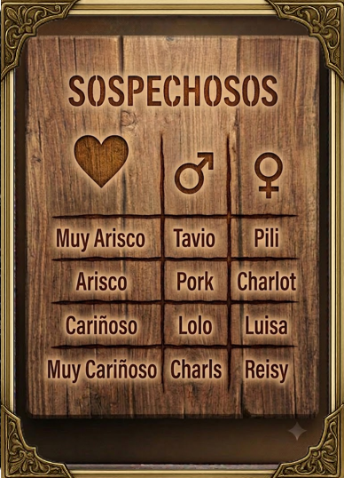 | 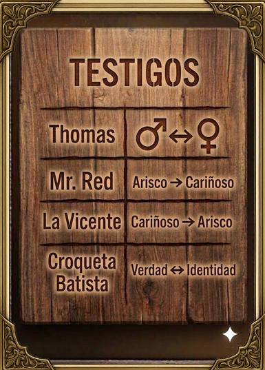 | | |
| `Sospechosos.png` · matriz nombre × género × nivel · **sin usar** | `Testigos.png` · efectos en notación gráfica · **sin usar** | | |

| ID | Sev. | Hallazgo | Evidencia |
|---|---|---|---|
| **UX-1** | Alta | **La información para deducir está escondida.** El género y el rasgo sólo aparecen en el zoom de cada carta; el manual (con la tabla de rasgos y los efectos) no es accesible durante la partida; `Sospechosos.png` y `Testigos.png`, que resuelven exactamente esto, no se usan (§3.8) | `PantallaTablero` L204-208, `PantallaBienvenida` L74-82 |
| **UX-2** | Alta | **La interfaz no habla el idioma del arte.** 24 colores hexadecimales distintos en 206 usos; el azul pizarra `#1e272e` de fondo y los botones `#2980b9`, `#c0392b`, `#27ae60`, `#8e44ad`, `#d35400` son la paleta *Flat UI* (no tiene relación con la madera/pergamino/latón del arte). Sólo el dorado `#d4af37` (33 usos) conecta con las cartas. **27 líneas usan emojis como iconos** (🐔🕵️🥚🔪📖📝⚖️🎲🚪✏️🧽🗑️❌), que cambian de dibujo en cada fabricante y no se pueden tematizar | grep |
| **UX-3** | Media | **El testimonio se lee mal en la rejilla**: 10 pt, `numberOfLines={6}` (corta sin aviso), `fontFamily: 'serif'` (depende de la plataforma), sin `maxFontSizeMultiplier` | `CartaTestimonio.tsx` L36, L88-95 |
| **UX-4** | Alta | **Sin *safe area*.** Sólo la portada usa `SafeAreaView` (el del núcleo de RN, que sólo actúa en iOS). La cabecera del tablero (`padding: 12`) empieza en y = 0: en iPhone con *notch*/Dynamic Island queda **bajo la barra de estado**. Los parches son *magic numbers* (`paddingTop: 40` en el manual, `20` en las notas). `StatusBar translucent={false}` sólo afecta a Android | `PantallaTablero` L247, `ManualReglas` L120, `PapiroNotas` L162 |
| **UX-5** | Media | **Resolución y peso de los assets.** `Portada.png` (382×537) en un móvil de 390×844 dp a 3× se escala **4,72×** (borrosa) y `cover` recorta ~35 % del ancho; el zoom (280 dp) escala 2,18×; los 17 PNG pesan 6,92 MB y llevan canal alfa que, en la muestra comprobada (`Tavio.png`), es totalmente opaco (esquina y centro con alfa 255) | V9 |
| **UX-6** | Alta | **Accesibilidad.** 0 `accessibilityLabel`/`Role`; botones sólo con emoji; **3 pares de color ni siquiera alcanzan 3 : 1** (el umbral de texto grande): blanco sobre `#27ae60` (**2,87:1**, botones «Buscar caso», «Entregar solución», «Confirmar»), `#bdc3c7` sobre `#d35400` (**2,34:1**) y sobre `#2980b9` (**2,42:1**) (descripciones de los botones de modo); otros dos (blanco sobre `#2980b9`, 4,30 : 1, y sobre `#d35400`, 4,17 : 1) sólo valen para texto grande; objetivos táctiles por debajo de 44 pt: casillas de resolución 30×30, botones ± 36×36 | V10 |
| **UX-7** | Media | **Layout rígido.** Anchos en `%` y tamaños fijos (testigos 62×87, rejilla de 2 pares por fila), `PantallaBienvenida` en modo «modos» **sin scroll** (desborda en pantallas bajas o en horizontal), orientación horizontal permitida en iOS/Android y no diseñada, sin *breakpoints* para tabletas | `getDistribucion`, `Info.plist`, manifiesto |
| **UX-8** | Media | **Modales caseros**: 8 *overlays* `absoluteFill` con `zIndex/elevation: 1000`; sin `Modal`, sin *back* de Android, sin gestión de foco ni animación; la pantalla «transmitiendo» es otro *overlay* | grep |
| **UX-9** | Media | **Acción irreversible sin salvaguarda.** «Entregar solución» es de un solo intento y se activa con un toque; las casillas son pequeñas y se pulsa «ENTREGAR» en cuanto cuadran los recuentos | `ModalSolucion` L44-54, L110-116 |
| **UX-10** | Alta | **Sin feedback ni movimiento.** Una sola animación en toda la app (el parpadeo de «TOCA PARA EMPEZAR»); cero háptica, cero sonido; todos los cambios de pantalla son instantáneos; los botones sólo bajan la opacidad | grep |
| **UX-11** | Media | **Notas**: un único color y grosor, sin deshacer, la «goma» pinta del color del papel (los trazos nunca desaparecen), re-render por cada punto, no persiste, y no hay ninguna ayuda estructurada de deducción (la libreta está en blanco) | `PapiroNotas.tsx` |
| **UX-12** | Baja | **Marca**: iOS sin icono y con *launch screen* blanco «Powered by React Native» (flash blanco antes de un tema oscuro); icono de Android con la ilustración cortada; nombre «Bollijuego» frente al título «¿Quién mató a la gallina?» | OPS-3, OPS-4, OPS-9 |
| **UX-13** | Media | **Marca visible en el arte.** Varias cartas llevan en la **esquina inferior derecha un destello ✦ semitransparente** (muy evidente en `Testigos.png`, tenue en `Portada.png` y `Dorso.png`) con el aspecto de la marca visible de una herramienta de generación de imágenes. Antes de publicar conviene **confirmar la procedencia y los derechos del arte** y retocar esa esquina | inspección de las 8 esquinas muestreadas (`Tavio`, `Thomas`, `Testimonio`, `Sospechosos`, `Testigos`, `Dorso`, `Portada`, `Pili`) |

### 5.2 Sistema de diseño propuesto

#### 5.2.1 Paleta derivada del arte

Colores dominantes **medidos** en las cuatro piezas más representativas (cuantización a 3 bits por canal; son aproximaciones):

| Pieza | Dominantes (% del área) |
|---|---|
| `Portada` | `#f0d0b0` 14 % · `#907050` 13 % · `#b09070` 9 % · `#d0b090` 8 % · `#705030` 5 % |
| `Testimonio` | `#b09070` 11 % · `#907050` 11 % · `#d0b090` 10 % · `#503030` 9 % · `#f0d0b0` 8 % |
| `Sospechosos` | `#907050` 22 % · `#705030` 15 % · `#503030` 10 % · `#b07050` 7 % · `#301010` 5 % |
| `Dorso` | `#705030` 19 % · `#505030` 14 % · `#f0d0b0` 12 % · `#d0b090` 9 % · `#d0d090` 8 % |

Tokens propuestos (afinados sobre esas muestras y **verificados contra WCAG AA**; el diseñador debe validar el tono final):

| Token | Valor | Uso | Contraste con su texto |
|---|---|---|---|
| `wood900` | <span style="display:inline-block;width:14px;height:14px;background:#1b120c;border:1px solid #888"></span> `#1b120c` | Fondo de app | `textOnDark` sobre él: **14,87 : 1** |
| `wood800` | <span style="display:inline-block;width:14px;height:14px;background:#2b1c12;border:1px solid #888"></span> `#2b1c12` | Placas, hojas | `gold` sobre él: **7,31 : 1** |
| `wood700` | <span style="display:inline-block;width:14px;height:14px;background:#3d2a1b;border:1px solid #888"></span> `#3d2a1b` | Botón neutro | `textOnDark`: **10,96 : 1** |
| `parchment` | <span style="display:inline-block;width:14px;height:14px;background:#ead9b6;border:1px solid #888"></span> `#ead9b6` | Papel (notas, testimonio) | `ink` sobre él: **12,03 : 1** |
| `ink` | <span style="display:inline-block;width:14px;height:14px;background:#2a1a12;border:1px solid #888"></span> `#2a1a12` | Tinta | — |
| `brass` / `gold` | <span style="display:inline-block;width:14px;height:14px;background:#b8893a;border:1px solid #888"></span> `#b8893a` · <span style="display:inline-block;width:14px;height:14px;background:#d9a441;border:1px solid #888"></span> `#d9a441` | Marcos, botón primario | `ink` sobre `gold`: **7,44 : 1** |
| `blood` | <span style="display:inline-block;width:14px;height:14px;background:#8e2a22;border:1px solid #888"></span> `#8e2a22` | Peligro / mentiroso | `textOnDark`: **6,76 : 1** |
| `sage` | <span style="display:inline-block;width:14px;height:14px;background:#46603a;border:1px solid #888"></span> `#46603a` | Confirmar / verdad | `textOnDark`: **5,65 : 1** |
| `textOnDark` / `textMuted` | `#f1e6cc` · `#b9a883` | Texto | `textMuted` sobre `wood900`: **7,90 : 1** |

```ts
/** Tokens derivados del arte real (Portada/Testimonio/Sospechosos/Dorso): madera oscura, pergamino, latón. */
export const color = {
  wood900: '#1b120c', wood800: '#2b1c12', wood700: '#3d2a1b', wood500: '#6f4f31',
  parchment: '#ead9b6', parchmentDim: '#c9b48a', ink: '#2a1a12',
  brass: '#b8893a', gold: '#d9a441', goldBright: '#f1c40f',
  blood: '#8e2a22', bloodBright: '#a53126', sage: '#46603a',
  textOnDark: '#f1e6cc', textMuted: '#b9a883',
} as const;

export const space = { xs: 4, sm: 8, md: 12, lg: 16, xl: 24, xxl: 32 } as const;
export const radius = { sm: 6, md: 10, lg: 16, card: 12, pill: 999 } as const;
export const hit = { min: 44 } as const; // objetivo táctil mínimo (HIG 44 pt · Material 48 dp)

/** Relación de aspecto REAL de las cartas (385×538). */
export const CARD_ASPECT = 385 / 538;

export const shadow = (elevation: 1 | 2 | 3) => ({
  elevation: elevation * 3,
  shadowColor: '#000',
  shadowOpacity: 0.18 + elevation * 0.06,
  shadowRadius: 2 + elevation * 3,
  shadowOffset: { width: 0, height: elevation * 2 },
});
```

El sistema actual tiene 3 pares por debajo de 3 : 1 y 2 más por debajo de 4,5 : 1; el propuesto cumple AA en todos los pares de texto. Se añaden **tokens de espaciado, radios y objetivo táctil mínimo (44)** y `CARD_ASPECT = 385/538`, la relación **real** de las cartas (hoy el código usa `0.7`, que no coincide y con `cover` recorta ligeramente el marco).

#### 5.2.2 Tipografía

| Rol | Característica | Candidatas (fuentes con licencia libre; **verificar licencia y cobertura de `¿ ¡ ñ á é í ó ú` antes de adoptar**) |
|---|---|---|
| Título y cabeceras | Serifa gruesa tipo cartel del oeste, como el título de `Portada.png` | Rye, Alfa Slab One |
| Testimonios | Serifa de lectura con carácter de imprenta antigua o de máquina de escribir | IM Fell English, Special Elite |
| Cifras, HUD | Monoespaciada o de cifras tabulares (el cronómetro no «baila») | Una de las anteriores con `fontVariant: ['tabular-nums']` |

Política de escalado: `allowFontScaling` activo, con `maxFontSizeMultiplier` acotado en las cartas (≈ 1,3) para no romper el globo, y **mínimo de 12 pt** en la rejilla.

#### 5.2.3 Iconografía

Sustituir los emojis por **iconos SVG propios** con `react-native-svg` (ya instalado): pluma, huevo, huella de gallina (el `Dorso.png` ya las usa como motivo), lupa, sello, cuchillo, calavera, corazón (afecto) y los glifos ♂/♀ de `Sospechosos.png`. Se tematizan, escalan sin pérdida y se ven igual en todos los dispositivos.

#### 5.2.4 Componentes base y movimiento

`Button` (primario latón · neutro madera · peligro · fantasma), `Plate` (placa de madera con borde de latón), `Sheet` (hoja inferior), `Chip`/`Badge`, `ConnectionDot`, `HeartMeter` (1–4 corazones), `GenderGlyph`. Todos con área táctil ≥ 44 pt, estados `pressed/disabled/focused` y `accessibilityRole`.

| Token de movimiento | Valor | Uso |
|---|---|---|
| `tap` | 90 ms, `ease-out` | Respuesta de botón (escala 0,97) |
| `flip` | muelle `damping 16 · stiffness 140` ≈ 420 ms | Volteo de carta |
| `sheet` | 260 ms | Hojas inferiores |
| `page` | 220 ms | Transición entre pantallas |
| Reducir movimiento | `useReducedMotion()` → fundidos de 120 ms | Preferencia del sistema |

### 5.3 Cartas

#### 5.3.1 Anatomía propuesta

El arte no se toca: **se le superponen capas nativas** (sobre el PNG/WebP, nunca dentro).

```text
┌────────────────────────────┐
│ [M]                  ####  │   1  glifo de género · nivel de afecto (# = lleno)
│                            │
│                            │   2  arte de la carta (WebP)
│       ilustración          │   3  marco de estado (selección / marca)
│         (WebP)             │   4  sello ASESINO / MENTIROSO (desde Notas y Resolver)
│                            │   5  brillo diagonal que sigue al dedo
│   ╔════════════════════╗   │
│   ║        PORK        ║   │   6  cinta de nombre (pergamino con borde de latón)
│   ╚════════════════════╝   │
└────────────────────────────┘
```

El glifo y los corazones reutilizan el **lenguaje gráfico de `Sospechosos.png`** (corazón = afecto, ♂/♀ = género), de modo que el jugador que ya conoce la carta física lo reconoce sin aprender nada.

#### 5.3.2 Estados e interacciones

| Gesto | Resultado | Háptica |
|---|---|---|
| Tocar testimonio **oculto** | Volteo 3D (dorso → testimonio) | `flip` |
| Tocar testimonio **revelado** | Zoom con transición desde su posición (≈ 260 ms) | `tap` |
| Pulsación larga sobre sospechoso | «Ojeada»: ficha con género, nivel y mis notas, sin salir del tablero | `tap` |
| Arrastrar sobre una carta | Inclinación 3D y brillo (`TiltCard`) | — |
| Pellizco / doble toque en el zoom | 1× ⇄ 2×; deslizar hacia abajo cierra | `tap` al cerrar |
| Casilla de marca (Resolver) | Ciclo vacío → asesino → mentiroso → ambos, con sello | `select` |

#### 5.3.3 Volteo 3D (verificado)

El giro corre **en el hilo de UI** (*worklets*), sin pasar por JS: 60 fps aun con el hilo JS ocupado. Se respeta «reducir movimiento».

```tsx
import React, { useEffect } from 'react';
import { Pressable, StyleSheet, type StyleProp, type ViewStyle } from 'react-native';
import Animated, { interpolate, useAnimatedStyle, useReducedMotion, useSharedValue, withSpring, withTiming } from 'react-native-reanimated';
import { CARD_ASPECT } from './theme';

interface Props {
  front: React.ReactNode;
  back: React.ReactNode;
  flipped: boolean;
  onPress?: () => void;
  onFlipDone?: (flipped: boolean) => void;
  style?: StyleProp<ViewStyle>;
}

/** Volteo 3D en el hilo UI (worklets): 0 → 1 = dorso → cara. Respeta "reducir movimiento" del sistema. */
export function FlipCard({ front, back, flipped, onPress, onFlipDone, style }: Props) {
  const p = useSharedValue(flipped ? 1 : 0);
  const reduce = useReducedMotion();

  useEffect(() => {
    const target = flipped ? 1 : 0;
    if (reduce) { p.value = withTiming(target, { duration: 120 }); return; }
    p.value = withSpring(target, { damping: 16, stiffness: 140, mass: 0.9 }, finished => {
      if (finished && onFlipDone) { /* runOnJS(onFlipDone)(flipped) en la app real */ }
    });
  }, [flipped, reduce, p, onFlipDone]);

  const backStyle = useAnimatedStyle(() => ({
    transform: [{ perspective: 900 }, { rotateY: `${interpolate(p.value, [0, 1], [0, 180])}deg` }],
  }));
  const frontStyle = useAnimatedStyle(() => ({
    transform: [{ perspective: 900 }, { rotateY: `${interpolate(p.value, [0, 1], [180, 360])}deg` }],
  }));

  return (
    <Pressable onPress={onPress} style={[styles.box, style]} accessibilityRole="button" accessibilityState={{ expanded: flipped }}>
      <Animated.View style={[styles.face, backStyle]}>{back}</Animated.View>
      <Animated.View style={[styles.face, frontStyle]}>{front}</Animated.View>
    </Pressable>
  );
}

const styles = StyleSheet.create({
  box: { aspectRatio: CARD_ASPECT, width: '100%' },
  face: { ...StyleSheet.absoluteFillObject, backfaceVisibility: 'hidden', borderRadius: 12, overflow: 'hidden' },
});
```

#### 5.3.4 Inclinación y brillo (verificado)

```tsx
import React from 'react';
import { StyleSheet, type LayoutChangeEvent } from 'react-native';
import { Gesture, GestureDetector } from 'react-native-gesture-handler';
import Animated, { interpolate, useAnimatedStyle, useSharedValue, withSpring } from 'react-native-reanimated';

/** Inclinación 3D siguiendo el dedo + brillo que se desplaza (efecto "carta de coleccionista"). */
export function TiltCard({ children }: { children: React.ReactNode }) {
  const w = useSharedValue(1);
  const h = useSharedValue(1);
  const x = useSharedValue(0.5); // 0..1 dentro de la carta
  const y = useSharedValue(0.5);
  const pressed = useSharedValue(0);

  const pan = Gesture.Pan()
    .onBegin(() => { pressed.value = withSpring(1); })
    .onUpdate(e => { x.value = Math.min(1, Math.max(0, e.x / w.value)); y.value = Math.min(1, Math.max(0, e.y / h.value)); })
    .onFinalize(() => { x.value = withSpring(0.5); y.value = withSpring(0.5); pressed.value = withSpring(0); });

  const card = useAnimatedStyle(() => ({
    transform: [
      { perspective: 800 },
      { rotateX: `${interpolate(y.value, [0, 1], [10, -10])}deg` },
      { rotateY: `${interpolate(x.value, [0, 1], [-10, 10])}deg` },
      { scale: interpolate(pressed.value, [0, 1], [1, 1.04]) },
    ],
    shadowOpacity: interpolate(pressed.value, [0, 1], [0.2, 0.45]),
    shadowOffset: { width: interpolate(x.value, [0, 1], [6, -6]), height: interpolate(y.value, [0, 1], [10, 2]) },
  }));

  const sheen = useAnimatedStyle(() => ({
    opacity: interpolate(pressed.value, [0, 1], [0, 0.35]),
    transform: [{ translateX: interpolate(x.value, [0, 1], [-120, 120]) }, { rotate: '18deg' }],
  }));

  const onLayout = (e: LayoutChangeEvent) => { w.value = e.nativeEvent.layout.width; h.value = e.nativeEvent.layout.height; };

  return (
    <GestureDetector gesture={pan}>
      <Animated.View onLayout={onLayout} style={[styles.card, card]}>
        {children}
        <Animated.View pointerEvents="none" style={[styles.sheen, sheen]} />
      </Animated.View>
    </GestureDetector>
  );
}

const styles = StyleSheet.create({
  card: { borderRadius: 12, overflow: 'visible', shadowColor: '#000', shadowRadius: 12, elevation: 8 },
  sheen: { position: 'absolute', top: -40, bottom: -40, width: 60, backgroundColor: '#fff' },
});
```

#### 5.3.5 Zoom con transición compartida

En lugar de depender de *shared element transitions* aún experimentales: medir la carta con `measureInWindow`, montar una copia en una capa superior y animar `left/top/width/height` (o `translate + scale`) hacia el rectángulo central con `withTiming`. Al cerrar, la animación inversa. El fondo oscurece con la misma curva. Cierre por gesto de arrastre vertical (`Gesture.Pan` + umbral de velocidad).

#### 5.3.6 Materiales y brillo: tres niveles

| Nivel | Técnica | Coste | Cuándo |
|:-:|---|---|---|
| 1 | Brillo diagonal con `translateX` y opacidad (ya incluido en `TiltCard`) + sombra dinámica | Nulo | Fase 3 |
| 2 | Viñeta y grano con `react-native-svg` (patrones); *shimmer* en cartas «reveladas» | Bajo | Fase 3 |
| 3 | `@shopify/react-native-skia`: *foil* con *shader*, partículas de plumas, sombras suaves reales | **Aumenta el tamaño de la app** y añade una dependencia nativa | Fase 4, sólo si compensa. Alternativa más ligera: Lottie con plumas pre-renderizadas por un ilustrador |

#### 5.3.7 Rendimiento y accesibilidad de las cartas

- `React.memo` en `SuspectCard`/`TestimonyCard` con *props* estables; el estado «revelada» vive en el almacén por id (selector atómico) en lugar de en el estado local.
- Imágenes en WebP y, si hay originales, en 2× y 3×; precarga al entrar en el tablero.
- Sombras animadas sólo en la carta activa; 8 pares como máximo: no se necesita virtualización.
- `accessibilityLabel` por carta: «Pork, chico, arisco» y «Testimonio de Pork: …» (o «sin revelar»); `accessibilityHint`: «Doble toque para girar».

### 5.4 Flujo de pantallas rediseñado

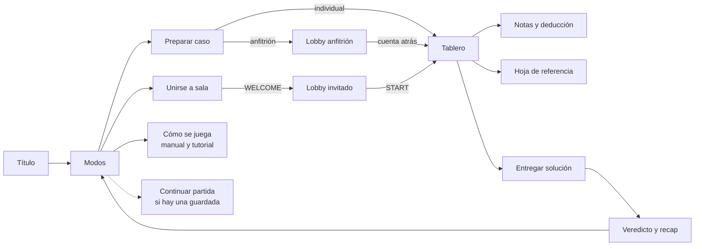

**Navegación**: `native-stack` de React Navigation, tipado; gestos de retroceso desactivados **sólo** en el tablero (se sustituye por la confirmación de abandono, y el botón de Android lo gestiona `useAndroidBack`). `Notas`, `Referencia` y `Entregar` son **hojas modales** de la propia pila (se acabaron los 8 *overlays* a mano).

#### 5.4.1 Título y modos

- Portada con **parallax** leve (giroscopio o desplazamiento) y plumas cayendo (Lottie o Skia, Fase 4); «TOCA PARA EMPEZAR» con pulso de Reanimated.
- Modos como **tres cartas grandes** (no tres botones planos): ilustración, una frase por modo y glifo; `FlatList` horizontal con *snap* en móvil, fila en tableta. «Continuar partida» aparece si hay estado guardado. Accesos a «Cómo se juega» y «Ajustes» (sonido, háptica, idioma) como iconos.

#### 5.4.2 Preparar caso

Los cuatro *steppers* se convierten en **controles segmentados con vista previa** («6 sospechosos · 2 asesinos · 2 mentirosos · 1 testigo»), con límites visibles (hoy se descubren al pulsar un botón gris), **preajustes** *Fácil / Normal / Difícil* sólo como atajos a configuraciones que ya existen, y la selección manual como rejilla con retratos grandes. Botones ≥ 48 dp.

#### 5.4.3 Tablero (HUD, mesa y testigos)

```text
┌────────────────────────────────────────────────────┐
│ [=]   ASESINOS 2 · MENTIROSOS 2              03:12 │
│       (o) Luis · 18 ms        (sólo multijugador)  │
├────────────────────────────────────────────────────┤
│ TESTIGOS                                           │
│ [Thomas  M<->F]   [Mr. Red  Arisco->Cariñoso]      │
├────────────────────────────────────────────────────┤
│ ┌────────┐┌───────┐    ┌────────┐┌───────┐         │
│ │Tavio   ││« ... »│    │Pili    ││ dorso │         │
│ │[M] #...││       │    │[F] #...││       │         │
│ └────────┘└───────┘    └────────┘└───────┘         │
│       ... mesa de madera · scroll ...              │
├────────────────────────────────────────────────────┤
│ [ Referencia ]     [ Notas ]     [ Resolver ]      │
└────────────────────────────────────────────────────┘
```

- **HUD**: *safe area* correcta, iconos SVG, y el cronómetro como componente **aislado** (`Stopwatch`, verificado) para que el tic de 1 s no re-renderice el tablero.
- **Mesa**: textura de madera tileable en vez de azul plano.
- **Testigos**: retrato + efecto en notación gráfica; al tocar, ficha ampliada con el texto aclarado de §3.8.
- **Rejilla** calculada con el ancho real (`useWindowDimensions`), no con porcentajes.

#### 5.4.4 Notas y deducción

La libreta a mano alzada se conserva (es parte del encanto) y se **mejora**: trazos como arrays de puntos con suavizado, grosor y 3 tintas, **deshacer/rehacer**, goma real (borra trazos por cercanía) y persistencia. Se añade una **rejilla opcional de deducción** (sospechoso × «asesino / mentiroso / ?») que alimenta las marcas de las cartas y el Resolver; el jugador que prefiera papel en blanco no la abre.

#### 5.4.5 Entregar y veredicto

- **Entregar**: casillas de 48 dp con sellos, contadores «2/2 asesinos · 1/2 mentirosos» en vivo y el botón **«mantén pulsado para entregar»** (`HoldToConfirm`, verificado) porque la acción es irreversible.
- **Veredicto**: las cartas **giran** y se estampan los sellos reales (ASESINO, MENTIROSO) con háptica de éxito/error; después la tabla **«¿Por qué?»** de `explain()` (§3.6.7). En Versus: clasificación de la carrera con tiempos.

```tsx
import React from 'react';
import { StyleSheet, Text } from 'react-native';
import { Gesture, GestureDetector } from 'react-native-gesture-handler';
import Animated, { cancelAnimation, Easing, runOnJS, useAnimatedStyle, useSharedValue, withTiming } from 'react-native-reanimated';
import { color, hit, radius } from './theme';
import { haptic } from './haptics';

/** "Entregar solución" es IRREVERSIBLE (una sola entrega): exige mantener pulsado ~0,7 s con barra de progreso. */
export function HoldToConfirm({ label, disabled, onConfirm }: { label: string; disabled?: boolean; onConfirm: () => void }) {
  const progress = useSharedValue(0);

  const fire = () => { haptic('success'); onConfirm(); };
  const press = Gesture.LongPress()
    .enabled(!disabled)
    .minDuration(700)
    .maxDistance(24)
    .onBegin(() => { progress.value = withTiming(1, { duration: 700, easing: Easing.linear }); runOnJS(haptic)('tap'); })
    .onStart(() => { runOnJS(fire)(); })
    .onFinalize(() => { cancelAnimation(progress); progress.value = withTiming(0, { duration: 160 }); });

  const bar = useAnimatedStyle(() => ({ width: `${progress.value * 100}%` }));
  return (
    <GestureDetector gesture={press}>
      <Animated.View style={[styles.btn, disabled && styles.disabled]} accessibilityRole="button" accessibilityHint="Mantén pulsado para entregar" accessibilityState={{ disabled }}>
        <Animated.View style={[styles.fill, bar]} />
        <Text style={styles.label}>{label}</Text>
      </Animated.View>
    </GestureDetector>
  );
}

const styles = StyleSheet.create({
  btn: { minHeight: hit.min + 8, borderRadius: radius.md, backgroundColor: color.wood700, borderWidth: 2, borderColor: color.gold, overflow: 'hidden', justifyContent: 'center', alignItems: 'center' },
  fill: { position: 'absolute', left: 0, top: 0, bottom: 0, backgroundColor: color.sage },
  disabled: { opacity: 0.45 },
  label: { color: color.textOnDark, fontWeight: '700', letterSpacing: 1, textTransform: 'uppercase' },
});
```

### 5.5 Micro-interacciones y feedback háptico

| Evento | Háptica | Visual | Sonido (opcional, con interruptor) |
|---|---|---|---|
| Pulsar un carácter del código | `select` | Casilla con rebote | tic |
| Código completo | `tap` | Casillas se iluminan en latón | — |
| Voltear testimonio | `flip` | Volteo 3D + brillo | papel |
| Abrir zoom | `tap` | Transición compartida | — |
| Marcar asesino / mentiroso | `select` | Sello que cae | sello |
| Mantener «Entregar» | `tap` al inicio | Barra de progreso | — |
| Acierto | `success` | Cartas giran, plumas | fanfarria breve |
| Fallo | `error` | Sacudida suave, sellos rojos | cacareo |
| Cuenta atrás 3-2-1 | `tap` por segundo, `heavy` en 0 | Números grandes | tic-tic-gong |
| Conexión establecida / perdida | `success` / `error` | Punto verde / ámbar | — |
| El rival entregó (Versus) | `tap` | Chip del rival cambia | — |

El módulo `haptics.ts` (verificado) es la **única puerta** de entrada: se puede desactivar globalmente en Ajustes y cambiar de librería (`react-native-haptic-feedback` o `expo-haptics`) tocando un fichero.

```ts
import ReactNativeHapticFeedback from 'react-native-haptic-feedback';

/** Única puerta de entrada a la vibración: cambiar de librería (o desactivarla en Ajustes) = tocar un fichero. */
type Kind = 'tap' | 'select' | 'flip' | 'success' | 'error' | 'heavy';
const MAP = { tap: 'impactLight', select: 'selection', flip: 'impactMedium', success: 'notificationSuccess', error: 'notificationError', heavy: 'impactHeavy' } as const;

let enabled = true;
export const setHapticsEnabled = (v: boolean) => { enabled = v; };
export const haptic = (k: Kind) => {
  if (enabled) ReactNativeHapticFeedback.trigger(MAP[k], { enableVibrateFallback: true, ignoreAndroidSystemSettings: false });
};
```

### 5.6 Diseño responsivo y densidades

- **Rejilla calculada**: `ancho_carta = (anchoContenedor − huecos) / columnas`; 2 pares por fila en móvil, 3–4 en tableta/plegable, definido por *breakpoints* (`useWindowDimensions`), con `CARD_ASPECT` real.
- **Orientación**: bloquear vertical en el tablero hasta diseñar la horizontal (`android:screenOrientation` y `UISupportedInterfaceOrientations`); en tabletas, horizontal con mesa a pantalla completa.
- **Safe area** con `react-native-safe-area-context` (inserciones reales por dispositivo) en lugar de constantes.
- **Densidades**: cada carta en 2× (≈ 770×1076) y 3× (≈ 1155×1614) si existen originales; nombres `Tavio@2x.webp` / `@3x.webp`.
- **Texto**: tamaños en `sp` escalables, mínimos y máximos por rol (§5.2.2); `numberOfLines` sólo con `adjustsFontSizeToFit` y suelo de 11 pt.
- **Pantallas bajas**: toda pantalla de menú en `ScrollView` con `contentContainerStyle: { flexGrow: 1 }`.

### 5.7 Lista de comprobación de accesibilidad

| Área | Criterio de aceptación |
|---|---|
| Lector de pantalla | Todo control con `accessibilityRole` y etiqueta; orden de foco lógico; las cartas se leen completas |
| Contraste | Todo texto ≥ 4,5 : 1 (3 : 1 en texto grande); estados no dependen sólo del color (sello + icono) |
| Tamaño táctil | ≥ 44 pt (iOS) / 48 dp (Android) |
| Texto dinámico | Probado a 130 % y 200 % sin recortes críticos |
| Movimiento | `useReducedMotion` respetado: sin volteos ni parallax |
| Háptica / sonido | Interruptores en Ajustes; nada transmite información *sólo* por vibración o sonido |
| Daltonismo | Asesino/mentiroso distinguibles por forma e icono |

### 5.8 Pipeline de assets

| Acción | Resultado medido |
|---|---|
| PNG → **WebP** (calidad 82, sin alfa) | 6,92 MB → **0,60 MB** (−91 %); calidad 70: 0,43 MB (−94 %) |
| Re-exportar desde los originales a 2× y 3× | Elimina el 4,7× de la portada y el 2,18× del zoom (si no existen originales, reescalado asistido o redibujado) |
| Renombrar (`Mr.-Red.png` → `mr-red.webp`) y centralizar en un único `assets/cards.ts` | Se acaba la triple copia de `IMAGENES` |
| Textura de mesa de madera *tileable* y papel de libreta | Sustituye al fondo plano |
| Icono de app y *splash* | Android: icono **adaptativo** (primer plano 432×432 + fondo); iOS: `AppIcon` completo (1024 y derivados); *splash* con fondo `wood900` y la gallina, no el blanco de plantilla |
| Placeholders desenfocados (*blurhash*) con `expo-image`, o precarga | Sin parpadeos al entrar en el tablero |


## 6. Rendimiento, estabilidad y escalabilidad técnica

### 6.1 Qué está medido y qué es estimación

| Categoría | Contenido |
|---|---|
| **Medido** | Coste del generador (V1/V2), peso y compresión de assets (V9), tamaño del payload de red (V5), contraste (V10), resultados de `tsc`/`eslint`/`jest`/`audit` (V6) |
| **Estimado por análisis de código** | Re-renders del tablero, coste de las notas, latencia del descubrimiento, comportamiento en segundo plano |
| **No medido (requiere dispositivo)** | FPS reales, memoria real, tiempo de arranque, consumo de batería. El plan de perfilado está en §6.7 |

### 6.2 Puntos calientes

| ID | Sev. | Hallazgo | Evidencia y estimación | Arreglo |
|---|---|---|---|---|
| **PERF-1** | Media | **El cronómetro re-renderiza todo el tablero cada segundo.** `setSegundos` vive en `PantallaTablero`, el mismo componente que contiene el HUD, los testigos, 3–8 pares de cartas y los modales. Ninguna carta está memorizada | `PantallaTablero` L45-50. En una partida de 20 min son ≈ 1 200 renders completos | `Stopwatch` aislado y memorizado (verificado, §5.4.3) + `React.memo` en cartas + selectores atómicos |
| **PERF-2** | Media | **Las notas hacen trabajo cuadrático.** Cada evento de movimiento (≈ 60–120 Hz) concatena a una cadena SVG que crece (`M…L…L…`) y llama a `setTrazoActual`, de modo que **React y `react-native-svg` re-analizan la cadena entera por fotograma** (O(n²) por trazo). Al soltar: `JSON.stringify` de **todos** los trazos → estado de `App` → vuelve como prop → `useEffect` con `JSON.parse` y `setTrazos` → se vuelven a renderizar **todos** los `<Path>` | `PapiroNotas` L56-88, L33-45 | Puntos en `number[]`, descartar puntos a < 2 px, suavizado cuadrático, un `<Path>` memorizado por trazo, el trazo en curso en un único `Path` animado (`useAnimatedProps`) o en Skia; persistencia con *debounce*; sin reserialización en cada trazo |
| **PERF-3** | Media | **Peso y memoria de imágenes.** 6,92 MB en el paquete; cada PNG se decodifica a 385×538×4 B ≈ 0,79 MB (≈ 13 MB si se decodifican las 17). Un 3× completo decodificaría 7,4 MB **cada una** | V9; `CartaSospechoso`, `PantallaTablero` | WebP (−91 %). **Presupuesto de memoria**: miniatura (~250×350, 0,35 MB) para la rejilla y la imagen grande **bajo demanda** sólo para el zoom; `resizeMethod="resize"` (Android) o `expo-image` (decodifica reducida) |
| **PERF-4** | Info | **Generación de casos**: no es un problema | V1/V2 | — |
| **PERF-5** | Info | **Listas**: el tablero tiene ≤ 8 filas y la rejilla manual 12 elementos; `FlatList`/`FlashList` no aportan | — | Sólo para la lista de salas del lobby |
| **PERF-6** | Media | **Cascada de renders desde `App`.** Cualquiera de los 15 `useState` (p. ej. abrir las notas) re-renderiza `App` y, con él, `PantallaTablero` (sin `memo`) y todas sus cartas | `App.tsx` | Estado en el almacén con selectores; pantallas en la pila de navegación |
| **PERF-7** | Info | Positivo: la única animación usa `useNativeDriver: true` | `PantallaBienvenida` | — |

### 6.3 Ciclo de vida de la aplicación

**¿Qué pasa hoy si un jugador minimiza la app en mitad de una partida local?**

| Situación | Resultado actual | Gravedad |
|---|---|---|
| **Individual**, minimizar y volver | El cronómetro sigue bien (se calcula con `Date.now() − tiempoInicio`, un acierto). El estado está sólo en memoria | Bien |
| **Individual**, el sistema mata el proceso (memoria, llamada, limpieza de apps) | **Se pierde todo**: caso, notas y tiempo; al reabrir se vuelve a la portada | Alta |
| **Cooperativo/Versus**, minimizar durante la partida | No pasa nada *porque no hay conexión* (NET-1). Pero tampoco hay manera de saber que el rival se fue | Media |
| **Cooperativo/Versus**, el invitado cierra la app | El invitado puede reunirse con el PIN (el servidor sigue abierto), pero **su cronómetro empieza de cero**, lo que falsea Versus | Alta |
| **Anfitrión** esperando, la pantalla se bloquea o cambia de app | El *socket* de escucha puede suspenderse; la UI sigue en «¡SALA CREADA!» sin forma de recuperarse (NET-4/NET-13) | Alta |
| Botón «atrás» de Android | **Cierra la app** | Alta |
| Rotación | Permitida, sin diseño (UX-7) | Media |
| Cambio de hora del sistema | El cronómetro salta (reloj de pared) | Baja |

**Propuesta**: un único punto que decide qué hacer en cada transición, y estado persistido.

```ts
import { useEffect } from 'react';
import { AppState, BackHandler, type AppStateStatus } from 'react-native';

/** Un único sitio decide qué hacer al pasar a segundo plano / volver (guardar, pausar latido, reconectar). */
export function useAppLifecycle(h: { onBackground(): void; onForeground(): void }) {
  useEffect(() => {
    let prev: AppStateStatus = AppState.currentState;
    const sub = AppState.addEventListener('change', next => {
      if (prev === 'active' && next !== 'active') h.onBackground();
      if (prev !== 'active' && next === 'active') h.onForeground();
      prev = next;
    });
    return () => sub.remove();
  }, [h]);
}

/** Botón "atrás" de Android: primero cierra capas (hoja/modal), después pide confirmación, nunca sale de golpe. */
export function useAndroidBack(handler: () => boolean) {
  useEffect(() => {
    const sub = BackHandler.addEventListener('hardwareBackPress', handler); // true = "ya lo gestioné"
    return () => sub.remove();
  }, [handler]);
}
```

| Transición | Acción |
|---|---|
| `active → background` | Guardar el almacén (inmediato), pausar latido, marcar la hora monotónica |
| `background → active` | `PING` inmediato; si el enlace murió → reconexión con `resumeToken`; si es anfitrión, comprobar el *listener* y re-escuchar |
| Arranque en frío con partida guardada | Ofrecer «Continuar partida» |
| Atrás (Android) | Cerrar hoja → confirmar abandono → nunca salir de golpe |
| Pantalla encendida | `keep-awake` en el lobby del anfitrión y durante Versus |
| Reloj | Medir con reloj **monotónico** y guardar el *offset* respecto a la hora de pared sólo para restaurar tras un *kill* |

### 6.4 Prevención de cierres inesperados

| Vector identificado | Causa | Mitigación |
|---|---|---|
| Respuesta de red mal formada (`caso.solucion.asesinos.length` sobre `undefined`) | NET-9 | Esquema + `parseLine` (verificado); el UI nunca ve datos sin validar |
| Caso vacío tras un *reroll* fallido | ENG-4 | `Result<Caso, GenError>`; la UI muestra el error y conserva el caso anterior |
| Nombre de personaje desconocido → `IMAGENES[…]` indefinido | Cadenas libres como claves (ENG-3) | `SuspectId` como unión de literales y mapa `Record<SuspectId, ImageSource>` (el compilador exige completitud) |
| Actualización de estado de otro componente durante el render | APP-5 | Acción del almacén fuera del *updater* |
| Promesa de búsqueda que sobrevive al desmontaje | NET-8 | `AbortController`/máquina de estados que cancela |
| Excepción de render en cualquier pantalla | — | `ErrorBoundary` raíz con pantalla de recuperación («Volver al menú / Reintentar») y registro |
| Errores en el hilo JS no capturados | — | `ErrorUtils.setGlobalHandler` + un servicio de informes (Sentry o Crashlytics) con consentimiento |
| `StrictMode` desactivado | — | Activarlo en desarrollo: detecta *updaters* impuros y efectos sin limpieza |

### 6.5 Escalabilidad técnica y de producto

| Eje | Hoy | Propuesta |
|---|---|---|
| **Contenido** | Añadir un personaje exige tocar `motorMisterio`, tres mapas de imágenes, `PantallaInicio`, el manual y los tipos | **Registro de datos**: un objeto `{id, gender, level, art}` en `domain/model`; el resto se deriva |
| **Categorías de afirmación** | Letras y `includes` | Un módulo por `kind` con `render`, `affectedBy`, `holds`; el compilador (`assertNever`) obliga a cubrir cada caso nuevo. Cada cambio de semántica sube `RULES_VERSION` |
| **Idiomas** | Español fijo en el código | `render(stmt, locale)` + diccionario externo; manual y mensajes en ficheros de recursos |
| **Más de 2 jugadores** | Nominal 2; el servidor ya admite N sin control | Protocolo N-ario (ya lo es), `roster` en la UI, límite configurable |
| **Reto diario / compartir caso** | Imposible (sin semilla) | `seed = hash(fecha)`; compartir la semilla por texto o QR; clasificación local |
| **Estadísticas** | Ninguna | Partidas, aciertos y mejores tiempos en el almacén persistido; telemetría anónima sólo con *opt-in* |
| **Versionado** | Ninguno | `PROTOCOL_VERSION`, `RULES_VERSION`, `version` del almacén persistido con migraciones |
| **Límites de módulos** | Todo importa todo | Reglas de ESLint (`no-restricted-imports`): `domain/` no puede importar `react-native` ni `ui/`; `ui/` no importa `net/` |

### 6.6 Compilación, publicación y herramientas

| Resuelve | Acción | Detalle |
|---|---|---|
| **OPS-1** | Actualizar React Native | Usar el *Upgrade Helper* desde 0.74.5 hacia la versión estable vigente (a fecha de este informe la rama es 0.8x; confirmar al empezar). La Nueva Arquitectura es la predeterminada desde la 0.76: validar `react-native-tcp-socket` y el módulo de red en el *spike* (§4.9). **Reanimated 4 sólo funciona con Nueva Arquitectura** y necesita `react-native-worklets` (con la Nueva Arquitectura desactivada se usa Reanimated 3) |
| **OPS-1** | `targetSdk`/`compileSdk` 36 | Exigido por Google Play para nuevas apps y actualizaciones desde el 31-ago-2026 (prórroga hasta el 1-nov-2026). Con *target* ≥ 35 Android dibuja **de borde a borde**: sin manejo de *insets* la cabecera quedará bajo la barra de estado también en Android (refuerza UX-4) — verificar con la versión de RN elegida |
| **OPS-2** | Firma y optimización | Clave de *release* propia (fuera del repo), R8 + `shrinkResources`, publicar **AAB** con *splits* por ABI, `versionCode` automático |
| **OPS-3** | iOS publicable | *Bundle id* propio, `AppIcon` completo, *launch screen* con la marca, `NSLocalNetworkUsageDescription` y `NSBonjourServices` (`_bollijuego._tcp`), eliminar la cadena vacía de ubicación, revisar `PrivacyInfo.xcprivacy` |
| **OPS-4**, NET-11 | Permisos mínimos | Quitar los 5 de Bluetooth y los 2 de ubicación; mantener `INTERNET` y `ACCESS_WIFI_STATE`; añadir `ACCESS_NETWORK_STATE` y, si se usa mDNS, `CHANGE_WIFI_MULTICAST_STATE` |
| **OPS-5** | Calidad automática | ESLint con `@react-native/eslint-config` + `@typescript-eslint` + reglas de límites de módulo; Prettier con configuración real; `tsc --noEmit`; `jest` con `transformIgnorePatterns` para `react-native-tcp-socket` y *mocks* para módulos nativos; dominio en entorno `node` |
| **OPS-6**, OPS-8, OPS-9 | Limpieza | Borrar o archivar `servidor.js`; unificar el nombre comercial; `README` y `docs/ARCHITECTURE.md` reales |
| **OPS-7** | Seguridad de dependencias | `npm audit --omit=dev` en CI (informativo al principio; bloqueante tras actualizar RN); Renovate o Dependabot |
| *(nuevo)* | Informes de fallos | Sentry o Crashlytics, con *source maps* de Hermes |
| *(nuevo)* | Licencias | Comprobar licencias de fuentes, sonidos y del arte (¿puede redistribuirse?) antes de publicar |

**CI mínimo** (GitHub Actions):

```yaml
name: ci
on: [push, pull_request]
jobs:
  verify:
    runs-on: ubuntu-latest
    steps:
      - uses: actions/checkout@v4
      - uses: actions/setup-node@v4
        with: { node-version: 20, cache: npm }
      - run: npm ci
      - run: npx tsc --noEmit
      - run: npx eslint . --max-warnings 0
      - run: npx jest --ci --coverage
      - run: npm audit --omit=dev --audit-level=high
        continue-on-error: true   # pasa a bloqueante tras actualizar RN
```

### 6.7 Estrategia de pruebas y perfilado

| Nivel | Qué | Herramientas |
|---|---|---|
| **Dominio** | Paridad con el motor actual; propiedades: *«para toda semilla y configuración `findModels` devuelve exactamente 1»*, `renderEs ∘ parse = id`, `explain` coherente; cobertura ≥ 90 % | Jest en entorno `node`, `fast-check` |
| **Red** | `codec`, esquema, `liveness`, `clock`, `decideWinner` (ya ejecutados en V8); integración con `LoopbackTransport`; caos (partir, duplicar, retrasar, cortar) | Jest + *fake timers* |
| **Componentes** | `FlipCard` (estado de accesibilidad al girar), `HoldToConfirm` (no confirma antes de 700 ms), `Stopwatch` (no re-renderiza el tablero) | `@testing-library/react-native` |
| **E2E** | Flujo individual completo; en red, dos dispositivos con un guion | Maestro (YAML) o Detox |
| **Perfilado** | Arranque en frío, FPS del volteo y de las notas, memoria con 8 pares, consumo en una partida de 20 min, en **gama baja Android** y en un iPhone antiguo | Flipper/React DevTools Profiler, Perfetto, Instruments |


## 7. Hoja de ruta de implementación (paso a paso)

### 7.1 Principios para no romper nada

1. **Siempre jugable.** `main` debe poder jugarse en modo individual en cada *merge*. Ninguna fase deja el juego a medias.
2. **Patrón *strangler*.** Lo nuevo se construye **al lado** de lo viejo (`src/domain/` junto a `src/logic/`), detrás de un adaptador y un *flag*; lo viejo se borra cuando lo nuevo ha pasado la paridad.
3. **La paridad es la puerta.** La suite de §3.6.6 (1 057 536 evaluaciones + propiedades de unicidad) se ejecuta en CI y **bloquea** el *merge* si una sola evaluación difiere.
4. **Ramas de vida corta**, cambios pequeños, un hallazgo por PR, con su ID en el título (`ENG-1`, `NET-4`…).
5. **Cada fase tiene criterios de salida medibles** y un plan de reversión (un *flag* o un `git revert` de una sola unidad).

### 7.2 Visión general

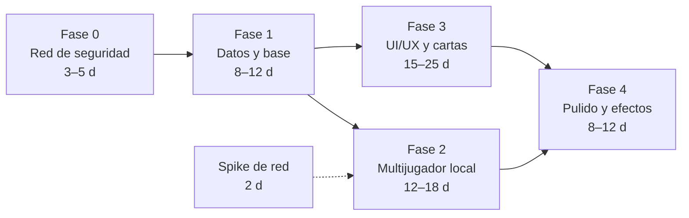

Las fases 2 y 3 son **independientes** una vez hecha la 1 (pueden hacerlas dos personas en paralelo; comparten sólo el sistema de diseño del lobby, §5.4).

| Fase | Foco | Hallazgos que cierra | Esfuerzo* | Riesgo |
|:-:|---|---|:-:|:-:|
| **0** | Tooling, tests de caracterización, actualización de RN, *quick wins* | OPS-1, OPS-5, ENG-4, NET-4, NET-8, PERF-1, UX-4 (parcial) | 3–5 d | Bajo |
| **1** | Dominio puro, ENG-1, tipado, almacén persistido, navegación | ENG-1…7, APP-1…8, QA-1 | 8–12 d | Medio |
| **2** | Sesión autoritativa, protocolo, descubrimiento, lobby con estado | NET-1…15 | 12–18 d | **Alto** |
| **3** | Sistema de diseño, cartas 3D, flujo, accesibilidad, notas | UX-1…12, PERF-2, PERF-3 | 15–25 d | Medio |
| **4** | Sonido, partículas, tutorial, estadísticas, publicación | — | 8–12 d | Bajo |

\* Orden de magnitud para una persona senior de RN; **no es un compromiso**. Total ≈ 46–72 días-persona; con dos personas en paralelo en 2 y 3, la ruta crítica es ≈ 34–54 días (≈ 7–11 semanas naturales).

### 7.3 Fase 0 — Red de seguridad (3–5 días)

**Objetivo:** poder cambiar cosas sin miedo y ver mejoras visibles desde el primer día.

| Paso | Tarea | Ficheros | Criterio de aceptación |
|:-:|---|---|---|
| 0.1 | **Congelar el motor actual**: copiar `motorMisterio.ts` a `src/legacy/` (sólo lectura) y escribir tests de caracterización (cada categoría A–E y F, 16 combinaciones de testigos) | `src/legacy/`, `__tests__/legacy.*.test.ts` | Los tests describen el comportamiento *actual*, incluido el defecto de ENG-1 marcado como `known-issue` |
| 0.2 | **Arreglar las herramientas**: `.eslintrc.js` y `.prettierrc.js` reales, `jest.config.js` con `transformIgnorePatterns` y *mocks* nativos, scripts `typecheck`, CI de §6.6 | `.eslintrc.js`, `.prettierrc.js`, `jest.config.js`, `.github/workflows/ci.yml` | `npm run lint && npm run typecheck && npm test` en verde en CI |
| 0.3 | **Rama de actualización de RN** (`chore/rn-upgrade`) con `targetSdk 36`, sin tocar lógica | `package.json`, `android/*`, `ios/*` | La app compila en ambas plataformas y el modo individual funciona |
| 0.4 | **Quick wins** (cada uno ≤ 1 día, sin tocar reglas): guarda en `handleReroll` (ENG-4); `crearSala` espera a `listening` y propaga el error (NET-4); «Cancelar» realmente cancela (NET-8); `Stopwatch` aislado (PERF-1); inserciones de *safe area* en la cabecera (UX-4); color del botón verde a ≥ 4,5 : 1 (UX-6); textos de testigos aclarados (§3.8, mejora 4) | `App.tsx`, `motorRed.ts`, `PantallaTablero.tsx`, `PantallaLobby.tsx` | Cada PR con su prueba o captura |
| 0.5 | **Imágenes a WebP** (−91 %) manteniendo nombres lógicos | `src/assets/images/*` | El paquete baja ≈ 6 MB; capturas idénticas |

> Si la Fase 2 va a empezar de inmediato, se pueden **omitir** los *quick wins* de red (NET-4, NET-8): se resolverán de forma definitiva al sustituir `motorRed.ts`. Se incluyen aquí porque dan valor al instante y no dependen del calendario.

**Salida de la Fase 0:** CI verde; paquete ≈ 6 MB menor; el juego individual se comporta igual; el defecto ENG-1 sigue ahí **pero está documentado y cubierto por un test marcado**.

### 7.4 Fase 1 — Refactorización de datos y base (8–12 días)

**Objetivo:** un dominio verificado, una arquitectura que se pueda cambiar y un estado que sobreviva.

| Paso | Tarea | Resultado |
|:-:|---|---|
| 1.1 | **Crear `src/domain/`** con el prototipo verificado (AST, `readAs`, `holds`, `findModels`, `renderEs`, `segmentsEs`, `explain`, RNG con semilla, `generateCase`) — Anexo D | Compila en `strict`; **paridad 100 %** en CI |
| 1.2 | **Adaptador** `GameCase ⇄ CasoGenerado` y *flag* `USE_NEW_DOMAIN`; la UI actual no cambia | Con el *flag* activo, la partida individual funciona igual |
| 1.3 | **Activar** el dominio nuevo (cierra **ENG-1**); borrar `src/legacy/` tras una versión | Ningún caso con ciclo defectuoso; tests de propiedad en verde |
| 1.4 | **Registro único de assets y de identificadores** (`SuspectId`, `WitnessId`): una sola copia de `IMAGENES` | `any` → 0 en dominio y UI; ESLint `no-explicit-any` |
| 1.5 | **Almacén Zustand + persistencia** (`kv` MMKV/AsyncStorage) y «Continuar partida» | Matar el proceso y reabrir restaura caso, notas, marcas y reloj |
| 1.6 | **Navegación** con `native-stack` tipado; modales → hojas; `useAndroidBack`; `useAppLifecycle` | El botón «atrás» ya no cierra la app; sin `pantallaActiva` manual |
| 1.7 | **Descomponer `App.tsx`**: *shell* + *hooks* de funcionalidad (`useSolo`, `useHost`, `useJoin`) | `App.tsx` < 40 líneas |
| 1.8 | **Tipos de resultado**: `generateCase` → `Result<GameCase, GenError>` | La UI nunca recibe un caso «vacío válido» |

**Salida de la Fase 1:** suite de paridad al 100 %; `any` = 0; `App.tsx` < 40 líneas; restauración tras *kill* probada.
**Reversión:** `USE_NEW_DOMAIN=false` restaura el motor anterior hasta su eliminación.

### 7.5 Fase 2 — Estabilización del multijugador local (12–18 días)

**Objetivo:** que un amigo se una en segundos, que se vea quién está conectado y que no se rompa al bloquear la pantalla.

| Paso | Tarea | Resultado |
|:-:|---|---|
| **2.0** | **Spike** (2 d, §4.9) en dispositivos reales | Tabla pasa/falla; decide librería TCP y mDNS |
| 2.1 | `net/protocol` + `codec` + esquema `zod` + `Transport` + `LoopbackTransport` | Pruebas de V8 en CI |
| 2.2 | `TcpTransport` con `listen()` honesto; **permisos**: quitar ubicación y Bluetooth; `NSLocalNetworkUsageDescription`/`NSBonjourServices` | NET-4, NET-11 |
| 2.3 | `SessionManager` (anfitrión y cliente) con XState: *handshake*, latido, reconexión con `resumeToken` | NET-1, NET-5 |
| 2.4 | **Descubrimiento**: código + QR → barrido acotado con la máscara real → mDNS (si pasa el *spike*) | NET-2, NET-14 |
| 2.5 | **Lobby** con estado de cada jugador, errores con causa, pantalla de diagnóstico | NET-7, NET-8 |
| 2.6 | **Reloj y arranque simultáneo**; Versus autoritativo (`SUBMIT`/`RESULT`) | NET-3, NET-6 |
| 2.7 | Ciclo de vida: *keep-awake*, re-escucha del anfitrión, `AppState` | NET-13 |
| 2.8 | **Pruebas de caos** + **matriz manual** de §4.7 | Informe de pruebas |
| 2.9 | Retirar `motorRed.ts` y `servidor.js` | NET-12, NET-15 |

**Salida de la Fase 2:**

- Tests de red (unitarios, integración, caos) en verde.
- Matriz manual: al menos **3 combinaciones reales** (p. ej. router doméstico, *hotspot* iOS, *hotspot* Android) sin fallos en *unirse → jugar → resultado*.
- Reconexión automática en < 10 s tras un corte de 5 s.
- Error de arranque simultáneo < 50 ms en Wi-Fi doméstica.
- Cada fallo del lobby muestra su **causa** (§4.4.12).

**Compatibilidad:** el protocolo nuevo **no habla** con el antiguo (el antiguo no tiene *handshake*): ambos dispositivos deben llevar la misma versión de la app. El modo individual no se ve afectado. Un *flag* `NET_V2` mantiene el multijugador antiguo en la rama hasta que la matriz pase.

### 7.6 Fase 3 — Renovación de UI/UX y cartas (15–25 días)

**Objetivo:** que la interfaz esté a la altura del arte y que deducir sea más claro sin tocar la lógica.

| Paso | Tarea | Hallazgos |
|:-:|---|---|
| 3.1 | **Sistema de diseño**: tokens (`theme.ts`), tipografía, iconos SVG, `Button`, `Plate`, `Sheet`, `ConnectionDot`, tema y *safe area* completos | UX-2, UX-4, UX-12 |
| 3.2 | **Assets**: re-exportación 2×/3×, WebP, textura de mesa, icono adaptativo, iOS `AppIcon`, *splash* | UX-5, UX-12 |
| 3.3 | **Cartas**: `SuspectCard` con capas (nombre, ♂/♀, corazones), `TestimonyCard` con `FlipCard`, texto enriquecido (`segmentsEs`) ≥ 12 pt | UX-1, UX-3 |
| 3.4 | **Tablero**: HUD, mesa, testigos con efecto, **hoja de referencia**, zoom compartido, `TiltCard` | UX-1, UX-10 |
| 3.5 | **Preparar caso** y **Modos** rediseñados; manual accesible en partida; tutorial interactivo (semilla fija) | UX-7, §3.8 |
| 3.6 | **Notas v2**: trazos como puntos, suavizado, deshacer, goma real, rejilla de deducción opcional | UX-11, PERF-2 |
| 3.7 | **Resolver y veredicto**: `HoldToConfirm`, sellos, giro de cartas, recap `explain` | UX-9, §3.6.7 |
| 3.8 | **Accesibilidad** completa (§5.7) y **responsive** (tabletas, plegables, horizontal) | UX-6, UX-7 |
| 3.9 | **Háptica** (§5.5) | UX-10 |

**Salida de la Fase 3:** revisión de diseño con el equipo; cumplimiento de la lista de §5.7; volteo y notas a 60 fps en un Android de gama baja; capturas de regresión visual; el jugador ve **género y rasgo sin abrir la carta**.
**Reversión:** cada pantalla nueva sustituye a la anterior en su propio PR; las anteriores se borran sólo tras la aprobación de diseño.

### 7.7 Fase 4 — Pulido y efectos (8–12 días)

| Paso | Tarea |
|:-:|---|
| 4.1 | Sonido (volteo, sello, cuenta atrás, acierto, cacareo en el fallo) con interruptor y respeto al modo silencio |
| 4.2 | Partículas: plumas en portada y veredicto (Lottie, o Skia si compensa el tamaño) y *parallax* de la portada |
| 4.3 | Ajuste fino de curvas, tiempos y háptica en dispositivos reales |
| 4.4 | **Modo asistido** (opt-in, desactivado por defecto) si el equipo de diseño lo aprueba (§3.8, mejora 10) |
| 4.5 | Ajustes (sonido, háptica, idioma), estadísticas locales, reto diario por semilla |
| 4.6 | Localización a un segundo idioma (opcional), `render(stmt, locale)` |
| 4.7 | Perfilado en gama baja, reducción de tamaño (R8, AAB, WebP), informes de fallos con *source maps* |
| 4.8 | Lista de publicación: icono, capturas, política de privacidad, licencias de fuentes y arte, *bundle id*, firma |

**Salida de la Fase 4:** sin *jank* en gama baja, tamaño de paquete objetivo, lista de publicación completa.

### 7.8 Cómo se garantiza que el juego sigue siendo 100 % funcional

| Garantía | Mecanismo |
|---|---|
| Las reglas no cambian | Suite de paridad con 1 057 536 comparaciones + propiedad «exactamente un modelo»; bloquea el *merge* |
| Lo nuevo no sustituye a lo viejo a ciegas | *Flags* (`USE_NEW_DOMAIN`, `NET_V2`) y adaptadores; el código antiguo se elimina sólo tras la aprobación |
| Nunca se rompe el juego individual | Prueba E2E del camino feliz (Maestro) en cada PR: portada → configurar → revelar → resolver |
| Los cambios son pequeños | Un hallazgo por PR; ramas de vida corta |
| Se puede volver atrás | Cada fase se entrega como unidad revertible; `git revert` de una sola PR o desactivar un *flag* |
| Se detectan regresiones de red | *Chaos tests* y matriz manual por versión |
| Se detectan regresiones visuales | Capturas de las pantallas clave por PR |

### 7.9 Lista de aceptación global

| # | Criterio | Fase |
|:-:|---|:-:|
| 1 | `tsc`, `eslint`, `jest` y `audit` (prod, nivel alto) en verde en CI | 0–1 |
| 2 | 0 `any` en código propio | 1 |
| 3 | Paridad del motor al 100 % y propiedad de unicidad en CI | 1 |
| 4 | Ningún caso generado con ciclos indeducibles (ENG-1) | 1 |
| 5 | «Continuar partida» tras matar el proceso | 1 |
| 6 | Conectar dos dispositivos en < 5 s en red doméstica con QR/código | 2 |
| 7 | Estado de conexión de cada jugador visible; reconexión automática < 10 s | 2 |
| 8 | Versus con arranque simultáneo (< 50 ms) y ganador automático | 2 |
| 9 | Género y rasgo visibles sin abrir la carta; manual accesible en partida | 3 |
| 10 | Todo texto ≥ 4,5 : 1; todo objetivo táctil ≥ 44 pt; 0 pantallas sin etiquetas de accesibilidad | 3 |
| 11 | 60 fps en volteo y notas en Android de gama baja | 3–4 |
| 12 | `targetSdk 36`, firma de *release*, iconos y permisos correctos | 0, 4 |


## 8. Garantías, riesgos y decisiones abiertas

### 8.1 Cumplimiento de la regla de oro

Para cada propuesta: ¿altera las reglas, la resolución, el propósito, los personajes o la temática?

| Propuesta | ¿Altera el core? | Por qué (o condición) |
|---|:-:|---|
| Dominio con AST, `readAs`, `holds`, `findModels` | **No** | Mismas reglas. El único efecto observable es que **deja de emitir** el 1,57 % de casos indeducibles (ENG-1): es corregir una implementación defectuosa de la regla *«el mentiroso dice lo contrario»*, no cambiarla |
| Semillas reproducibles | No | Sólo cambia de dónde sale el azar |
| Atributos en la carta y hoja de referencia | No | Es información **pública** del manual y de las cartas físicas (`Sospechosos.png`, `Testigos.png`) |
| Vocabulario unificado de testigos | No (narrativa) | Aclara la redacción; la semántica es la del código y del manual |
| Texto enriquecido, chips de retrato | No | Presentación |
| Recap «¿Por qué?» | No | Sólo se muestra **después** de entregar; no da pistas durante la partida |
| `HoldToConfirm` | No | Sigue siendo una entrega única |
| Anfitrión autoritativo, reloj y cuenta atrás | No | Hace cierta la frase del manual «al mismo tiempo»; automatiza la comparación de tiempos |
| Solución custodiada por el anfitrión (Versus) | No | Mismo resultado, sin posibilidad de trampa |
| Preajustes *Fácil/Normal/Difícil* | No | Atajos a configuraciones que **ya existen** |
| Rejilla de deducción en las notas | No | Equivale a papel y lápiz; opcional |
| Sonido, háptica, animación, tutorial, manual en partida | No | — |
| **Modo asistido** (marcar cartas afectadas por un testigo) | **Potencialmente** | **Opt-in, desactivado por defecto**; requiere aprobación del diseño (D2) |
| **Reto diario / compartir semilla** | Extensión | No cambia el juego; añade un modo opcional (D6) |

### 8.2 Lo que **no** se propone

- Cambiar el número de intentos de entrega, añadir pistas o reducir información.
- Cambiar categorías de testimonio, sus probabilidades, la escala de afecto o el efecto de los testigos.
- Añadir personajes o testigos con reglas nuevas.
- Cambiar la voz, el humor o la identidad visual del juego (se *respeta* y se refuerza).
- Cambiar la condición de victoria de ningún modo.
- Introducir un servidor en Internet o juego en línea: el alcance sigue siendo la red local.

### 8.3 Decisiones abiertas para el equipo

| ID | Decisión | Opciones | Recomendación |
|:-:|---|---|---|
| **D1** | ¿La solución viaja al invitado en Cooperativo? | Sí (se comprueba localmente) · No (siempre en el anfitrión) | **Sí en Cooperativo, no en Versus** (§4.4.6); si se prefiere un único comportamiento, el de Versus |
| **D2** | ¿Incluir el modo asistido? | No · Sí, opt-in | Decidir tras probar con jugadores nuevos; por defecto, **no** |
| **D3** | Procedencia y derechos del arte; destello ✦ en la esquina (UX-13) | Retocar · Regenerar · Redibujar | Confirmar licencia; **pedir los originales** (para 2×/3×, UX-5) |
| **D4** | ¿Seguir en React Native CLI «bare» o adoptar **Expo**? | Bare + módulos comunitarios · Bare + **Expo Modules** · Expo con *prebuild* (CNG) | Como mínimo **Expo Modules** (háptica, *keep-awake*, fuentes, imagen, cámara para QR, audio con soporte de primera clase y versionados con el SDK); evaluar *prebuild* para simplificar actualizaciones futuras. Coste: una capa más y alinear versiones |
| **D5** | Efectos avanzados | Reanimated + Lottie · Skia | Empezar con Reanimated + Lottie; Skia sólo si el *foil*/partículas justifican su peso |
| **D6** | Reto diario / compartir semilla | Sí · No | Sí en la Fase 4 (coste bajo gracias a la semilla) |
| **D7** | ¿Más de 2 jugadores? | 2 · hasta 4 | El protocolo ya es N-ario; decidir la UI según el interés |
| **D8** | Idiomas | Español · + inglés | `render(stmt, locale)` deja la puerta abierta; decidir según mercado |
| **D9** | Informes de fallos y estadísticas | Ninguno · Informes de fallos · + estadísticas anónimas | Informes de fallos con consentimiento; estadísticas sólo *opt-in* |
| **D10** | Orientación | Sólo vertical · + horizontal/tableta | Vertical primero; horizontal en tabletas en la Fase 3 |

### 8.4 Registro de riesgos

| ID | Riesgo | Prob. | Impacto | Mitigación | Fase |
|:-:|---|:-:|:-:|---|:-:|
| R1 | `react-native-tcp-socket` no funciona limpio con la Nueva Arquitectura | Media | Alto | *Spike* de 2 días; `Transport` aislado; alternativa de módulo nativo mínimo | 2 |
| R2 | La actualización de RN rompe librerías (`react-native-network-info`, SVG…) | Media | Medio | Rama dedicada; sustituir `network-info` por `@react-native-community/netinfo` (expone `ipAddress` y `subnet`); validar cada librería | 0 |
| R3 | mDNS no disponible o poco fiable | Media | Medio | Mejora progresiva: QR/código no lo necesita | 2 |
| R4 | Redes con aislamiento de clientes | Media | Alto | Detección + guía de *hotspot* | 2 |
| R5 | iOS suspende al anfitrión en segundo plano | Alta | Medio | Diseño de primer plano + re-escucha + reconexión | 2 |
| R6 | Arte sin originales de mayor resolución o con problemas de derechos | Media | Alto | Decisión D3 antes de la Fase 3 | 3 |
| R7 | Rendimiento de volteo/notas en gama baja | Baja | Medio | Reanimated en el hilo UI; perfilado temprano; reducir efectos | 3–4 |
| R8 | Estimaciones optimistas | Media | Medio | Fases independientes y entregables; el *spike* y la Fase 0 reducen la incertidumbre | todas |
| R9 | Ampliar el juego cambia la semántica sin querer | Baja | Alto | `RULES_VERSION` + suite de paridad en CI | 1+ |
| R10 | Divergencia entre iOS y Android al no haberse probado iOS nunca | Alta | Medio | Dispositivo iOS desde la Fase 0 (`ios/` es idéntico a la plantilla) | 0 |


## Anexo A — Inventario completo de ficheros (88)

«Respecto a la plantilla» compara el repositorio con el primer *commit* (`dc13842`, plantilla de React Native 0.74.5): **añadido** = lo creó el proyecto; **modificado** = existía en la plantilla y se cambió; **plantilla** = sin cambios.

Resumen: 13 ficheros de código propio añadidos + `App.tsx` modificado + `__tests__/App.test.tsx` de plantilla; 17 assets añadidos; `ios/` **sin ningún cambio** (14 ficheros); en `android/`, sólo el manifiesto y los 5 iconos.

| Grupo | Fichero | Líneas | Bytes | Respecto a la plantilla | Nota |
|---|---|--:|--:|---|---|
| Código propio | `App.tsx` | 279 | 12.379 | modificado | Orquestador (APP-1) |
| Código propio | `__tests__/App.test.tsx` | 17 | 364 | plantilla | Prueba de plantilla; falla (OPS-5) |
| Código propio | `servidor.js` | 68 | 2.124 | añadido | Servidor HTTP legado (OPS-6. NET-15) |
| Código propio | `src/components/CartaSospechoso.tsx` | 63 | 1.766 | añadido | Carta de sospechoso |
| Código propio | `src/components/CartaTestimonio.tsx` | 96 | 2.369 | añadido | Carta de testimonio |
| Código propio | `src/components/ManualReglas.tsx` | 225 | 7.814 | añadido | Manual (UX-1) |
| Código propio | `src/components/ModalSolucion.tsx` | 215 | 11.398 | añadido | Entrega y resultado (UX-9) |
| Código propio | `src/components/PapiroNotas.tsx` | 172 | 5.903 | añadido | Libreta (PERF-2. UX-11) |
| Código propio | `src/logic/motorMisterio.ts` | 349 | 13.053 | añadido | Motor de reglas y generación (ENG-1…8) |
| Código propio | `src/logic/motorRed.ts` | 205 | 5.540 | añadido | TCP anfitrión/invitado (NET-1…15) |
| Código propio | `src/logic/tipos.ts` | 49 | 913 | añadido | Tipos (ENG-3) |
| Código propio | `src/screens/PantallaBienvenida.tsx` | 128 | 6.386 | añadido | Portada y modos |
| Código propio | `src/screens/PantallaInicio.tsx` | 270 | 15.853 | añadido | Configuración del caso |
| Código propio | `src/screens/PantallaLobby.tsx` | 163 | 8.261 | añadido | Lobby y PIN |
| Código propio | `src/screens/PantallaTablero.tsx` | 295 | 16.280 | añadido | Tablero |
| Configuración raíz | `.bundle/config` |  | 59 | plantilla |  |
| Configuración raíz | `.eslintrc.js` | 0 | 0 | modificado | 0 bytes (OPS-5) |
| Configuración raíz | `.gitignore` |  | 1.076 | plantilla |  |
| Configuración raíz | `.prettierrc.js` | 0 | 0 | modificado | 0 bytes (OPS-5) |
| Configuración raíz | `.watchmanconfig` |  | 3 | plantilla |  |
| Configuración raíz | `Gemfile` |  | 365 | plantilla |  |
| Configuración raíz | `README.md` | 79 | 3.080 | plantilla | Plantilla de RN (OPS-8) |
| Configuración raíz | `app.json` | 4 | 58 | plantilla | Nombre del componente (OPS-9) |
| Configuración raíz | `babel.config.js` | 3 | 72 | plantilla | Preset RN |
| Configuración raíz | `index.js` | 9 | 183 | plantilla | AppRegistry |
| Configuración raíz | `jest.config.js` | 3 | 48 | plantilla | Preset sin transformIgnorePatterns (OPS-5) |
| Configuración raíz | `metro.config.js` | 11 | 285 | plantilla | Config por defecto |
| Configuración raíz | `package-lock.json` |  | 477.633 | modificado | Bloqueo de versiones |
| Configuración raíz | `package.json` | 39 | 1.033 | modificado | Dependencias (red. SVG) |
| Configuración raíz | `tsconfig.json` | 3 | 65 | plantilla | Extiende @react-native/typescript-config (strict) |
| Android | `android/app/build.gradle` | 118 | 4.671 | plantilla | targetSdk 34; release firmado con debug (OPS-1. OPS-2) |
| Android | `android/app/debug.keystore` |  | 2.257 | plantilla | Clave de debug estándar de RN |
| Android | `android/app/proguard-rules.pro` | 10 | 435 | plantilla |  |
| Android | `android/app/src/debug/AndroidManifest.xml` | 9 | 313 | plantilla |  |
| Android | `android/app/src/main/AndroidManifest.xml` | 33 | 1.619 | modificado | Permisos sin uso (OPS-4. NET-11) |
| Android | `android/app/src/main/java/com/bollijuego/MainActivity.kt` | 22 | 851 | plantilla |  |
| Android | `android/app/src/main/java/com/bollijuego/MainApplication.kt` | 43 | 1.583 | plantilla |  |
| Android | `android/app/src/main/res/drawable/rn_edit_text_material.xml` | 37 | 1.917 | plantilla |  |
| Android | `android/app/src/main/res/mipmap-hdpi/ic_launcher.png` |  | 8.996 | modificado |  |
| Android | `android/app/src/main/res/mipmap-hdpi/ic_launcher_round.png` |  | 5.024 | plantilla |  |
| Android | `android/app/src/main/res/mipmap-mdpi/ic_launcher.png` |  | 4.239 | modificado |  |
| Android | `android/app/src/main/res/mipmap-mdpi/ic_launcher_round.png` |  | 2.858 | plantilla |  |
| Android | `android/app/src/main/res/mipmap-xhdpi/ic_launcher.png` |  | 14.504 | modificado |  |
| Android | `android/app/src/main/res/mipmap-xhdpi/ic_launcher_round.png` |  | 7.098 | plantilla |  |
| Android | `android/app/src/main/res/mipmap-xxhdpi/ic_launcher.png` |  | 29.449 | modificado |  |
| Android | `android/app/src/main/res/mipmap-xxhdpi/ic_launcher_round.png` |  | 10.676 | plantilla |  |
| Android | `android/app/src/main/res/mipmap-xxxhdpi/ic_launcher.png` |  | 50.550 | modificado |  |
| Android | `android/app/src/main/res/mipmap-xxxhdpi/ic_launcher_round.png` |  | 15.523 | plantilla |  |
| Android | `android/app/src/main/res/values/strings.xml` | 3 | 73 | plantilla |  |
| Android | `android/app/src/main/res/values/styles.xml` | 9 | 282 | plantilla |  |
| Android | `android/build.gradle` | 21 | 547 | plantilla | SDK 34 (OPS-1) |
| Android | `android/gradle.properties` | 41 | 1.827 | plantilla |  |
| Android | `android/gradle/wrapper/gradle-wrapper.jar` |  | 63.721 | plantilla |  |
| Android | `android/gradle/wrapper/gradle-wrapper.properties` | 7 | 250 | plantilla |  |
| Android | `android/gradlew` |  | 8.692 | plantilla |  |
| Android | `android/gradlew.bat` | 92 | 2.826 | plantilla |  |
| Android | `android/settings.gradle` | 4 | 254 | plantilla |  |
| iOS | `ios/.xcode.env` |  | 482 | plantilla |  |
| iOS | `ios/Bollijuego.xcodeproj/project.pbxproj` | 688 | 28.322 | plantilla | Bundle id de plantilla; iOS 13.4 (OPS-3) |
| iOS | `ios/Bollijuego.xcodeproj/xcshareddata/xcschemes/Bollijuego.xcscheme` | 88 | 3.306 | plantilla |  |
| iOS | `ios/Bollijuego/AppDelegate.h` | 6 | 98 | plantilla |  |
| iOS | `ios/Bollijuego/AppDelegate.mm` | 31 | 802 | plantilla |  |
| iOS | `ios/Bollijuego/Images.xcassets/AppIcon.appiconset/Contents.json` | 53 | 849 | plantilla | Sin imágenes de icono (OPS-3) |
| iOS | `ios/Bollijuego/Images.xcassets/Contents.json` | 6 | 63 | plantilla |  |
| iOS | `ios/Bollijuego/Info.plist` | 52 | 1.618 | plantilla | Sin claves de red local; ubicación vacía (OPS-3) |
| iOS | `ios/Bollijuego/LaunchScreen.storyboard` | 47 | 4.234 | plantilla | Plantilla (UX-12) |
| iOS | `ios/Bollijuego/PrivacyInfo.xcprivacy` | 38 | 1.072 | plantilla |  |
| iOS | `ios/Bollijuego/main.m` | 10 | 199 | plantilla |  |
| iOS | `ios/BollijuegoTests/BollijuegoTests.m` | 66 | 1.996 | plantilla |  |
| iOS | `ios/BollijuegoTests/Info.plist` | 24 | 733 | plantilla |  |
| iOS | `ios/Podfile` |  | 1.121 | plantilla |  |
| Asset gráfico | `src/assets/images/Charlot.png` |  | 380.794 | añadido |  |
| Asset gráfico | `src/assets/images/Charls.png` |  | 386.433 | añadido |  |
| Asset gráfico | `src/assets/images/Croqueta-Batista.png` |  | 470.255 | añadido |  |
| Asset gráfico | `src/assets/images/Dorso.png` |  | 448.661 | añadido |  |
| Asset gráfico | `src/assets/images/La-Vicente.png` |  | 412.766 | añadido |  |
| Asset gráfico | `src/assets/images/Lolo.png` |  | 395.334 | añadido |  |
| Asset gráfico | `src/assets/images/Luisa.png` |  | 432.102 | añadido |  |
| Asset gráfico | `src/assets/images/Mr.-Red.png` |  | 444.444 | añadido |  |
| Asset gráfico | `src/assets/images/Pili.png` |  | 387.254 | añadido |  |
| Asset gráfico | `src/assets/images/Pork.png` |  | 407.524 | añadido |  |
| Asset gráfico | `src/assets/images/Portada.png` |  | 390.977 | añadido |  |
| Asset gráfico | `src/assets/images/Reisy.png` |  | 373.306 | añadido |  |
| Asset gráfico | `src/assets/images/Sospechosos.png` |  | 424.724 | añadido |  |
| Asset gráfico | `src/assets/images/Tavio.png` |  | 404.401 | añadido |  |
| Asset gráfico | `src/assets/images/Testigos.png` |  | 420.399 | añadido |  |
| Asset gráfico | `src/assets/images/Testimonio.png` |  | 348.785 | añadido |  |
| Asset gráfico | `src/assets/images/Thomas.png` |  | 390.888 | añadido |  |


## Anexo B — Matriz de generación (resumen)

Las 157 configuraciones alcanzables desde la UI (modo aleatorio), 4 casos por configuración en este cuadro (la comprobación de 150 por configuración está en V1/V4). Tiempos en Node; en Hermes sobre un móvil de gama baja cabe esperar un orden de magnitud más.

| Sospechosos | Configuraciones | Casos (×4) | Fallos | Mediana de medianas (ms) | Máx. (ms) | Intentos medios |
|:-:|--:|--:|--:|--:|--:|--:|
| 3 | 8 | 32 | 0 | 0,1 | 0,8 | 2,4 |
| 4 | 8 | 32 | 0 | 0,2 | 1,3 | 4,2 |
| 5 | 18 | 72 | 0 | 0,3 | 2,0 | 6,6 |
| 6 | 27 | 108 | 0 | 0,4 | 3,1 | 10,8 |
| 7 | 48 | 192 | 0 | 1,6 | 13,4 | 18,6 |
| 8 | 48 | 192 | 0 | 1,6 | 15,3 | 21,9 |
| **Total** | **157** | **628** | **0** | | | |

Con 150 casos por configuración (23 550 en total) tampoco hubo ningún fallo; en modo manual, 1 256 selecciones aleatorias, 0 fallos y 58 ms de máximo.

## Anexo C — Reproducción de los resultados

Todo se ejecutó **fuera del repositorio**, desde un directorio temporal:

```bash
# 1) Copia aislada del proyecto JS (sin tocar el repositorio) y dependencias exactas del lockfile
rsync -a --exclude .git --exclude ios --exclude android --exclude node_modules ./ /tmp/audit/proj/
cd /tmp/audit/proj && npm ci --ignore-scripts

# 2) Calidad del proyecto (V6)
npx tsc --noEmit            # 0 errores
npx eslint .                # 3 errores de parsing (config vacía)
npx jest                    # falla al importar react-native-tcp-socket (ESM sin transformar)
npm audit --omit=dev        # 17 avisos transitivos

# 3) Motor: matriz, consistencia, especificación independiente, modo manual, payload (V1–V5)
#    (esbuild empaqueta una copia instrumentada del motor — idéntica salvo un contador y exportar internos)
esbuild matrix.ts --bundle --platform=node --outfile=matrix.cjs && node matrix.cjs 4
esbuild consistency.ts --bundle --platform=node --outfile=c.cjs && node c.cjs 150
esbuild refcheck.ts    --bundle --platform=node --outfile=r.cjs && node r.cjs
```

El **solver independiente** de V4 (la pieza que descubre ENG-1) es esencialmente `findModels` (Anexo D) aplicado sobre el caso entregado por el motor actual. Su núcleo:

```ts
// Un mundo (A = asesinos, L = mentirosos) es un MODELO si, para cada hablante p:
//   p ∈ L  ⇔  su afirmación es FALSA en ese mundo.
// «X miente» / «X dice la verdad» se evalúan contra L (no se recursa sobre el testimonio de X).
for (const A of combos(presentes, nAsesinos))
  for (const L of combos(nombres, nMentirosos)) {
    const ok = asignaciones.every(({ personaje, testimonio: t }) => {
      const verdad = (t.cat === 'F' && !croqueta)
        ? (t.texto.includes('miente') ? L.includes(t.target) : !L.includes(t.target))
        : evaluarTestimonio(personaje, t, A, dict, testigos);   // A–E y F con Croqueta: motor actual
      return L.includes(personaje.nombre) === !verdad;
    });
    if (ok) modelos.push({ A, L });
  }
// Caso bien formado ⇔ modelos.length === 1
```

Los *scripts* de verificación viven en un directorio temporal; pueden incorporarse al repositorio (p. ej. `tools/audit/`) como base de la suite de paridad de la Fase 0.

## Anexo D — Dominio verificado (código completo)

Compilado en `strict` (+ `noUnusedLocals`, `noImplicitReturns`) con TypeScript 5.0.4, el del proyecto. Sin dependencias de React Native. Resultados de verificación en §3.6.6.

```ts
// domain/ — TypeScript puro (sin imports de react-native). Prototipo verificado de la propuesta.
export type SuspectId = 'Tavio' | 'Pili' | 'Pork' | 'Charlot' | 'Lolo' | 'Luisa' | 'Charls' | 'Reisy';
export type Gender = 'M' | 'F';
export type Level = 0 | 1 | 2 | 3; // 0 Muy arisco · 1 Arisco · 2 Cariñoso · 3 Muy cariñoso
export interface Suspect { readonly id: SuspectId; readonly gender: Gender; readonly level: Level }

export const SUSPECTS: readonly Suspect[] = [
  { id: 'Tavio', gender: 'M', level: 0 }, { id: 'Pili', gender: 'F', level: 0 },
  { id: 'Pork', gender: 'M', level: 1 },  { id: 'Charlot', gender: 'F', level: 1 },
  { id: 'Lolo', gender: 'M', level: 2 },  { id: 'Luisa', gender: 'F', level: 2 },
  { id: 'Charls', gender: 'M', level: 3 }, { id: 'Reisy', gender: 'F', level: 3 },
];
export const WITNESSES = ['Thomas', 'Mr. Red', 'La Vicente', 'Croqueta Batista'] as const;
export type WitnessId = (typeof WITNESSES)[number];

export type Quant = 'SOME' | 'NONE';   // "Al menos un" | "Ningún"
export type Dir = 'MORE' | 'LESS';
export type Axis = 'WARM' | 'COLD';    // cariñoso | arisco

export type Statement =
  | { kind: 'SELF_GUILTY' }
  | { kind: 'SELF_INNOCENT' }
  | { kind: 'ACCUSE'; target: SuspectId }
  | { kind: 'CLEAR'; target: SuspectId }
  | { kind: 'LIAR'; target: SuspectId }
  | { kind: 'TRUTHFUL'; target: SuspectId }
  | { kind: 'GENDER'; q: Quant; gender: Gender }
  | { kind: 'TRAIT'; q: Quant; level: Level }
  | { kind: 'COMPARE'; q: Quant; dir: Dir; axis: Axis }
  | { kind: 'GENDER_COMPARE'; gender: Gender; dir: Dir; axis: Axis };

const assertNever = (x: never): never => { throw new Error(`Statement no contemplado: ${JSON.stringify(x)}`); };

/** Lo que la carta DICE → lo que SIGNIFICA con los testigos activos (sustitución simultánea, sin encadenar). */
export function readAs(s: Statement, active: ReadonlySet<WitnessId>): Statement {
  const flipG = (g: Gender): Gender => (active.has('Thomas') ? (g === 'M' ? 'F' : 'M') : g);
  const mapLevel = (l: Level): Level =>
    active.has('Mr. Red') && l <= 1 ? ((3 - l) as Level)
    : active.has('La Vicente') && l >= 2 ? ((3 - l) as Level) : l;
  const mapAxis = (a: Axis): Axis =>
    active.has('Mr. Red') && a === 'COLD' ? 'WARM'
    : active.has('La Vicente') && a === 'WARM' ? 'COLD' : a;
  switch (s.kind) {
    case 'LIAR': return active.has('Croqueta Batista') ? { kind: 'CLEAR', target: s.target } : s;
    case 'TRUTHFUL': return active.has('Croqueta Batista') ? { kind: 'ACCUSE', target: s.target } : s;
    case 'GENDER': return { ...s, gender: flipG(s.gender) };
    case 'TRAIT': return { ...s, level: mapLevel(s.level) };
    case 'COMPARE': return { ...s, axis: mapAxis(s.axis) };
    case 'GENDER_COMPARE': return { ...s, gender: flipG(s.gender), axis: mapAxis(s.axis) };
    case 'SELF_GUILTY': case 'SELF_INNOCENT': case 'ACCUSE': case 'CLEAR': return s;
    default: return assertNever(s);
  }
}

/** Qué testigos pueden alterar la lectura de una carta (sustituye a los `tags` string del motor actual). */
export function affectedBy(s: Statement): WitnessId[] {
  switch (s.kind) {
    case 'LIAR': case 'TRUTHFUL': return ['Croqueta Batista'];
    case 'GENDER': return ['Thomas'];
    case 'TRAIT': return [s.level <= 1 ? 'Mr. Red' : 'La Vicente'];
    case 'COMPARE': return [s.axis === 'COLD' ? 'Mr. Red' : 'La Vicente'];
    case 'GENDER_COMPARE': return ['Thomas', s.axis === 'COLD' ? 'Mr. Red' : 'La Vicente'];
    default: return [];
  }
}

export interface World { readonly killers: ReadonlySet<SuspectId>; readonly liars: ReadonlySet<SuspectId> }
const byId = new Map<SuspectId, Suspect>(SUSPECTS.map(s => [s.id, s]));

/** ¿Es verdadera la afirmación (ya "leída") en este mundo? Función pura y total. */
export function holds(s: Statement, speaker: SuspectId, w: World): boolean {
  const me = byId.get(speaker)!;
  const K = [...w.killers].map(id => byId.get(id)!);
  const q = (quant: Quant, f: (k: Suspect) => boolean) => (quant === 'SOME' ? K.some(f) : !K.some(f));
  const cmp = (dir: Dir, axis: Axis, k: Suspect) => ((dir === 'MORE') === (axis === 'WARM') ? k.level > me.level : k.level < me.level);
  switch (s.kind) {
    case 'SELF_GUILTY': return w.killers.has(speaker);
    case 'SELF_INNOCENT': return !w.killers.has(speaker);
    case 'ACCUSE': return w.killers.has(s.target);
    case 'CLEAR': return !w.killers.has(s.target);
    case 'LIAR': return w.liars.has(s.target);
    case 'TRUTHFUL': return !w.liars.has(s.target);
    case 'GENDER': return q(s.q, k => k.gender === s.gender);
    case 'TRAIT': return q(s.q, k => k.level === s.level);
    case 'COMPARE': return q(s.q, k => cmp(s.dir, s.axis, k));
    case 'GENDER_COMPARE': return K.some(k => k.gender === s.gender && cmp(s.dir, s.axis, k));
    default: return assertNever(s);
  }
}

export interface Slot { readonly speaker: SuspectId; readonly statement: Statement }

export function combos<T>(arr: readonly T[], k: number): T[][] {
  const out: T[][] = [];
  const go = (start: number, acc: T[]) => {
    if (acc.length === k) { out.push([...acc]); return; }
    for (let i = start; i < arr.length; i++) { acc.push(arr[i]); go(i + 1, acc); acc.pop(); }
  };
  go(0, []);
  return out;
}

/**
 * Solver FIEL: un mundo es modelo ⇔ para todo hablante p: (p ∈ mentirosos) ⇔ su afirmación (leída) es falsa en ese mundo.
 * Enumera (asesinos × mentirosos) y corta en `limit` (2 basta para comprobar unicidad).
 */
export function findModels(slots: readonly Slot[], witnesses: ReadonlySet<WitnessId>, nKillers: number, nLiars: number, limit = 2): World[] {
  const ids = slots.map(s => s.speaker);
  const read = slots.map(s => readAs(s.statement, witnesses));
  const found: World[] = [];
  const liarSets = combos(ids, nLiars).map(l => new Set(l));
  for (const K of combos(ids, nKillers)) {
    const killers = new Set(K);
    for (const liars of liarSets) {
      const w: World = { killers, liars };
      if (slots.every((sl, i) => liars.has(sl.speaker) === !holds(read[i], sl.speaker, w))) {
        found.push(w);
        if (found.length >= limit) return found;
      }
    }
  }
  return found;
}

// ---- Render ES (reproduce EXACTAMENTE los textos actuales: la narrativa no cambia) ----
const LEVEL_ES = ['Muy Arisco', 'Arisco', 'Cariñoso', 'Muy Cariñoso'] as const;
export function renderEs(s: Statement): string {
  const Q = (q: Quant) => (q === 'SOME' ? 'Al menos un' : 'Ningún');
  const G = (g: Gender) => (g === 'M' ? 'un chico' : 'una chica');
  const D = (d: Dir) => (d === 'MORE' ? 'más' : 'menos');
  const A = (a: Axis) => (a === 'WARM' ? 'cariñoso' : 'arisco');
  switch (s.kind) {
    case 'SELF_GUILTY': return 'He sido yo.';
    case 'SELF_INNOCENT': return 'Yo no he sido.';
    case 'ACCUSE': return `Ha sido ${s.target}.`;
    case 'CLEAR': return `No ha sido ${s.target}.`;
    case 'LIAR': return `${s.target} miente.`;
    case 'TRUTHFUL': return `${s.target} dice la verdad.`;
    case 'GENDER': return `${Q(s.q)} asesino es ${G(s.gender)}.`;
    case 'TRAIT': return `${Q(s.q)} asesino es ${LEVEL_ES[s.level]}.`;
    case 'COMPARE': return `${Q(s.q)} asesino es ${D(s.dir)} ${A(s.axis)} que yo.`;
    case 'GENDER_COMPARE': return `Al menos un asesino es ${G(s.gender)} y ${D(s.dir)} ${A(s.axis)} que yo.`;
    default: return assertNever(s);
  }
}

/** Pool completo de afirmaciones posibles para un hablante (mismo tamaño que el generarPool actual). */
export function poolFor(speaker: SuspectId, present: readonly SuspectId[]): Statement[] {
  const out: Statement[] = [{ kind: 'SELF_GUILTY' }, { kind: 'SELF_INNOCENT' }];
  for (const t of present) if (t !== speaker) out.push({ kind: 'ACCUSE', target: t }, { kind: 'CLEAR', target: t }, { kind: 'LIAR', target: t }, { kind: 'TRUTHFUL', target: t });
  for (const q of ['SOME', 'NONE'] as const) {
    for (const g of ['M', 'F'] as const) out.push({ kind: 'GENDER', q, gender: g });
    for (const l of [0, 1, 2, 3] as const) out.push({ kind: 'TRAIT', q, level: l });
    for (const axis of ['WARM', 'COLD'] as const) for (const dir of ['MORE', 'LESS'] as const) out.push({ kind: 'COMPARE', q, dir, axis });
  }
  for (const gender of ['M', 'F'] as const) for (const axis of ['WARM', 'COLD'] as const) for (const dir of ['MORE', 'LESS'] as const) out.push({ kind: 'GENDER_COMPARE', gender, dir, axis });
  return out;
}

// ---- RNG con semilla (reproducibilidad: un caso = seed + config) ----

export type Rng = () => number;
export const mulberry32 = (seed: number): Rng => () => {
  seed |= 0; seed = (seed + 0x6d2b79f5) | 0;
  let t = Math.imul(seed ^ (seed >>> 15), 1 | seed);
  t = (t + Math.imul(t ^ (t >>> 7), 61 | t)) ^ t;
  return ((t ^ (t >>> 14)) >>> 0) / 4294967296;
};
export const shuffled = <T>(arr: readonly T[], rnd: Rng): T[] => {
  const a = [...arr];
  for (let i = a.length - 1; i > 0; i--) { const j = Math.floor(rnd() * (i + 1)); [a[i], a[j]] = [a[j], a[i]]; }
  return a;
};

export interface CaseConfig { suspects: number; killers: number; liars: number; witnesses: number; pickedSuspects?: SuspectId[]; pickedWitnesses?: WitnessId[] }
export interface GameCase { seed: number; rulesVersion: 1; witnesses: WitnessId[]; slots: Slot[]; solution: { killers: SuspectId[]; liars: SuspectId[] } }

export function generateCase(cfg: CaseConfig, seed: number, maxAttempts = 15000): GameCase | null {
  const rnd = mulberry32(seed);
  for (let attempt = 0; attempt < maxAttempts; attempt++) {
    const present = cfg.pickedSuspects ?? shuffled(SUSPECTS.map(s => s.id), rnd).slice(0, cfg.suspects);
    const wit = cfg.pickedWitnesses ?? shuffled(WITNESSES, rnd).slice(0, cfg.witnesses);
    const active = new Set<WitnessId>(wit);
    let slots: Slot[] | null = null;
    for (let tr = 0; tr < 100 && !slots; tr++) {
      const used = new Set<string>(); const chosen: Slot[] = [];
      for (const sp of shuffled(present, rnd)) {
        const options = poolFor(sp, present).filter(st => !used.has(renderEs(st)));
        if (!options.length) break;
        const need = new Set(wit.filter(w => chosen.filter(c => affectedBy(c.statement).includes(w)).length < 2));
        const prio = options.filter(st => affectedBy(st).some(w => need.has(w)));
        const pool = prio.length > 0 && rnd() < 0.85 ? prio : options;
        const st = pool[Math.floor(rnd() * pool.length)];
        chosen.push({ speaker: sp, statement: st }); used.add(renderEs(st));
      }
      if (chosen.length === present.length && wit.every(w => chosen.filter(c => affectedBy(c.statement).includes(w)).length >= 2)) slots = chosen;
    }
    if (!slots) continue;
    const models = findModels(slots, active, cfg.killers, cfg.liars, 2);
    if (models.length === 1) {
      const m = models[0];
      return { seed, rulesVersion: 1, witnesses: wit, slots, solution: { killers: [...m.killers], liars: [...m.liars] } };
    }
  }
  return null;
}

export interface Explanation {
  speaker: SuspectId;
  said: string;          // lo que pone en la carta
  read: string;          // lo que significa con los testigos activos
  readDiffers: boolean;  // ¿algún testigo cambió la lectura?
  holdsInTruth: boolean; // ¿es cierto en la solución real?
  isLiar: boolean;
}

/** Recap post-partida: "dijo X → significaba Y → era verdad/mentira". Sin tocar ninguna regla. */
export function explain(c: GameCase): Explanation[] {
  const active = new Set<WitnessId>(c.witnesses);
  const world: World = { killers: new Set(c.solution.killers), liars: new Set(c.solution.liars) };
  return c.slots.map(sl => {
    const read = readAs(sl.statement, active);
    return {
      speaker: sl.speaker,
      said: renderEs(sl.statement),
      read: renderEs(read),
      readDiffers: renderEs(read) !== renderEs(sl.statement),
      holdsInTruth: holds(read, sl.speaker, world),
      isLiar: world.liars.has(sl.speaker),
    };
  });
}

export type SegKind = 'quant' | 'gender' | 'trait' | 'name' | 'compare' | 'plain';
export interface Seg { text: string; kind: SegKind }

/** Mismo texto que `renderEs`, pero troceado para poder resaltar lo que importa al deducir. */
export function segmentsEs(s: Statement): Seg[] {
  const p = (text: string): Seg => ({ text, kind: 'plain' });
  const k = (text: string, kind: SegKind): Seg => ({ text, kind });
  const Q = (q: Quant) => k(q === 'SOME' ? 'Al menos un' : 'Ningún', 'quant');
  const G = (g: Gender) => k(g === 'M' ? 'un chico' : 'una chica', 'gender');
  const C = (d: Dir, a: Axis) => k(`${d === 'MORE' ? 'más' : 'menos'} ${a === 'WARM' ? 'cariñoso' : 'arisco'}`, 'compare');
  switch (s.kind) {
    case 'SELF_GUILTY': return [p('He sido yo.')];
    case 'SELF_INNOCENT': return [p('Yo no he sido.')];
    case 'ACCUSE': return [p('Ha sido '), k(s.target, 'name'), p('.')];
    case 'CLEAR': return [p('No ha sido '), k(s.target, 'name'), p('.')];
    case 'LIAR': return [k(s.target, 'name'), p(' miente.')];
    case 'TRUTHFUL': return [k(s.target, 'name'), p(' dice la verdad.')];
    case 'GENDER': return [Q(s.q), p(' asesino es '), G(s.gender), p('.')];
    case 'TRAIT': return [Q(s.q), p(' asesino es '), k(LEVEL_ES[s.level], 'trait'), p('.')];
    case 'COMPARE': return [Q(s.q), p(' asesino es '), C(s.dir, s.axis), p(' que yo.')];
    case 'GENDER_COMPARE': return [p('Al menos un asesino es '), G(s.gender), p(' y '), C(s.dir, s.axis), p(' que yo.')];
    default: return assertNever(s);
  }
}
```

## Anexo E — Protocolo y máquina de estados del cliente (código verificado)

### E.1 `protocol.ts` — mensajes, esquema y prueba de conocimiento del código

```ts
import { z } from 'zod';
import { hmac } from '@noble/hashes/hmac';
import { sha256 } from '@noble/hashes/sha256';
import { bytesToHex, utf8ToBytes } from '@noble/hashes/utils';

export const PROTOCOL_VERSION = 1 as const; // formato de los mensajes
export const RULES_VERSION = 1 as const;    // semántica del motor + diccionario de cartas

const SuspectIdZ = z.enum(['Tavio', 'Pili', 'Pork', 'Charlot', 'Lolo', 'Luisa', 'Charls', 'Reisy']);
const WitnessIdZ = z.enum(['Thomas', 'Mr. Red', 'La Vicente', 'Croqueta Batista']);
const Quant = z.enum(['SOME', 'NONE']);
const Dir = z.enum(['MORE', 'LESS']);
const Axis = z.enum(['WARM', 'COLD']);
const Gender = z.enum(['M', 'F']);
const Level = z.union([z.literal(0), z.literal(1), z.literal(2), z.literal(3)]);

export const StatementZ = z.discriminatedUnion('kind', [
  z.object({ kind: z.literal('SELF_GUILTY') }),
  z.object({ kind: z.literal('SELF_INNOCENT') }),
  z.object({ kind: z.literal('ACCUSE'), target: SuspectIdZ }),
  z.object({ kind: z.literal('CLEAR'), target: SuspectIdZ }),
  z.object({ kind: z.literal('LIAR'), target: SuspectIdZ }),
  z.object({ kind: z.literal('TRUTHFUL'), target: SuspectIdZ }),
  z.object({ kind: z.literal('GENDER'), q: Quant, gender: Gender }),
  z.object({ kind: z.literal('TRAIT'), q: Quant, level: Level }),
  z.object({ kind: z.literal('COMPARE'), q: Quant, dir: Dir, axis: Axis }),
  z.object({ kind: z.literal('GENDER_COMPARE'), gender: Gender, dir: Dir, axis: Axis }),
]);

/** El caso que viaja por la red: SIN solución. El huésped nunca la recibe antes de entregar. */
export const CaseDtoZ = z.object({
  seed: z.number().int(),
  rulesVersion: z.literal(RULES_VERSION),
  witnesses: z.array(WitnessIdZ).max(2),
  slots: z.array(z.object({ speaker: SuspectIdZ, statement: StatementZ })).min(3).max(8),
  killers: z.number().int().min(1).max(4),
  liars: z.number().int().min(1).max(4),
});
export type CaseDto = z.infer<typeof CaseDtoZ>;

const PlayerInfoZ = z.object({
  id: z.string().max(64),
  name: z.string().max(24),
  link: z.enum(['connecting', 'ok', 'degraded', 'reconnecting', 'left']),
  rttMs: z.number().nonnegative().optional(),
  ready: z.boolean(),
  submitted: z.boolean(),
});
export type PlayerInfo = z.infer<typeof PlayerInfoZ>;

const Envelope = z.object({
  v: z.literal(PROTOCOL_VERSION),
  seq: z.number().int().nonnegative(), // contador propio del emisor (idempotencia / deduplicación)
  ack: z.number().int().nonnegative(), // último seq del otro lado que he procesado
});

export const ClientMsgZ = z.discriminatedUnion('t', [
  Envelope.extend({ t: z.literal('HELLO'), clientId: z.string().max(64), name: z.string().max(24), mode: z.enum(['cooperativo', 'versus']), rulesVersion: z.number(), proof: z.string().max(128), resumeToken: z.string().max(64).optional() }),
  Envelope.extend({ t: z.literal('PING'), t0: z.number() }),
  Envelope.extend({ t: z.literal('READY'), ready: z.boolean() }),
  Envelope.extend({ t: z.literal('SUBMIT'), killers: z.array(SuspectIdZ).max(8), liars: z.array(SuspectIdZ).max(8), elapsedMs: z.number().nonnegative() }),
  Envelope.extend({ t: z.literal('BYE') }),
]);
export type ClientMsg = z.infer<typeof ClientMsgZ>;

export const HostMsgZ = z.discriminatedUnion('t', [
  Envelope.extend({ t: z.literal('CHALLENGE'), salt: z.string().max(64) }),
  Envelope.extend({ t: z.literal('WELCOME'), you: z.string(), resumeToken: z.string(), roster: z.array(PlayerInfoZ).max(8), caseDto: CaseDtoZ }),
  Envelope.extend({ t: z.literal('REJECT'), code: z.enum(['BAD_PROOF', 'BAD_RULES', 'MODE_MISMATCH', 'ROOM_FULL', 'ALREADY_STARTED']) }),
  Envelope.extend({ t: z.literal('ROSTER'), players: z.array(PlayerInfoZ).max(8) }),
  Envelope.extend({ t: z.literal('PONG'), t0: z.number(), t1: z.number(), t2: z.number() }),
  Envelope.extend({ t: z.literal('START'), atHostMs: z.number() }),
  Envelope.extend({ t: z.literal('RESULT'), winnerId: z.string().nullable(), board: z.array(z.object({ id: z.string(), correct: z.boolean(), elapsedMs: z.number() })), truth: z.object({ killers: z.array(SuspectIdZ), liars: z.array(SuspectIdZ) }) }),
]);
export type HostMsg = z.infer<typeof HostMsgZ>;

/** Prueba de conocimiento del PIN sin enviarlo: HMAC-SHA256(pin, salt ‖ clientId). */
export const proofOf = (pin: string, salt: string, clientId: string): string =>
  bytesToHex(hmac(sha256, utf8ToBytes(pin), utf8ToBytes(salt + clientId)));

/** Alfabeto sin caracteres ambiguos (0/O, 1/I/L) para códigos de sala de 6 caracteres. */
export const ROOM_ALPHABET = 'ABCDEFGHJKMNPQRSTUVWXYZ23456789';
```

### E.2 `clientMachine.ts` — ciclo de vida del invitado (XState v5)

La máquina **no conoce sockets**: los actores `discover`, `open` y `handshake` se inyectan con `clientMachine.provide({ actors })`, así que se prueba sin red y se reutiliza con cualquier `Transport`.

```ts
import { assign, fromPromise, setup } from 'xstate';
import type { Connection } from './transport';

interface Ctx { host?: { ip: string; port: number }; conn?: Connection; attempt: number; reason?: string }
type Ev =
  | { type: 'JOIN'; pin: string }
  | { type: 'LINK_LOST' }
  | { type: 'START' }
  | { type: 'FINISHED' }
  | { type: 'LEAVE' };

export const clientMachine = setup({
  types: { context: {} as Ctx, events: {} as Ev },
  actors: {
    // Se inyectan con clientMachine.provide({ actors: {...} }): la máquina no conoce sockets (testeable sin red).
    discover: fromPromise<{ ip: string; port: number }, { pin: string }>(async () => { throw new Error('provide'); }),
    open: fromPromise<Connection, { ip: string; port: number }>(async () => { throw new Error('provide'); }),
    handshake: fromPromise<void, { conn: Connection }>(async () => { throw new Error('provide'); }),
  },
  delays: { backoff: ({ context }) => Math.min(8_000, 500 * 2 ** context.attempt), giveUp: 60_000 },
}).createMachine({
  id: 'client',
  initial: 'idle',
  context: { attempt: 0 },
  states: {
    idle: { on: { JOIN: 'discovering' } },
    discovering: {
      invoke: { src: 'discover', input: ({ event }) => ({ pin: (event as Extract<Ev, { type: 'JOIN' }>).pin }),
        onDone: { target: 'connecting', actions: assign({ host: ({ event }) => event.output }) },
        onError: { target: 'failed', actions: assign({ reason: 'HOST_NOT_FOUND' }) } },
    },
    connecting: {
      invoke: { src: 'open', input: ({ context }) => context.host!,
        onDone: { target: 'handshaking', actions: assign({ conn: ({ event }) => event.output }) },
        onError: [{ guard: ({ context }) => context.attempt < 5, target: 'reconnecting' }, { target: 'failed', actions: assign({ reason: 'CONNECT_FAILED' }) }] },
    },
    handshaking: {
      invoke: { src: 'handshake', input: ({ context }) => ({ conn: context.conn! }),
        onDone: { target: 'online', actions: assign({ attempt: 0 }) },
        onError: { target: 'failed', actions: assign({ reason: 'HANDSHAKE_REJECTED' }) } },
    },
    online: {
      initial: 'lobby',
      states: { lobby: { on: { START: 'playing' } }, playing: { on: { FINISHED: 'finished' } }, finished: { type: 'final' } },
      on: { LINK_LOST: 'reconnecting', LEAVE: 'closed' },
    },
    reconnecting: {
      entry: assign({ attempt: ({ context }) => context.attempt + 1 }),
      after: { backoff: 'connecting', giveUp: { target: 'failed', actions: assign({ reason: 'LINK_LOST_TIMEOUT' }) } },
      on: { LEAVE: 'closed' },
    },
    failed: { on: { JOIN: 'discovering' } },
    closed: { type: 'final' },
  },
});
```

## Anexo F — Glosario

| Término | Significado en este documento |
|---|---|
| **Asesino / mentiroso («sapo»)** | Los dos roles que hay que deducir. Un mentiroso dice «exactamente lo contrario» de lo que significa su carta |
| **Testigo** | Carta pasiva que cambia **cómo se leen** los testimonios de los demás (Thomas, Mr. Red, La Vicente, Croqueta Batista) |
| **Caso** | Una partida concreta: sospechosos, testigos, un testimonio por sospechoso y una solución única |
| **Modelo** (lógica) | Una asignación de asesinos y mentirosos coherente con todos los testimonios |
| **AST** | Árbol de sintaxis abstracta: aquí, la representación estructurada de cada afirmación |
| **Anfitrión autoritativo** | El dispositivo que posee el reloj, el caso secreto y el veredicto; los clientes sólo le envían intenciones |
| **NDJSON** | Un JSON por línea; el delimitador es el salto de línea |
| **HMAC** | Código de autenticación con clave; permite demostrar que se conoce el código de sala sin enviarlo |
| **RTT** | Tiempo de ida y vuelta de un mensaje |
| **mDNS / Bonjour** | Descubrimiento de servicios por multidifusión en la red local |
| **Hermes** | Motor de JavaScript de React Native |
| **Nueva Arquitectura** | Fabric + TurboModules; predeterminada desde RN 0.76 |
| **Worklet** | Función JavaScript que se ejecuta en el hilo de UI (Reanimated) |
| **WCAG AA** | Nivel de accesibilidad: contraste ≥ 4,5 : 1 en texto normal y ≥ 3 : 1 en texto grande |

## Fuentes

Consultadas el 2026-10-27 para contrastar el estado de las plataformas y librerías citadas:

- React Native — [calendario y estado de versiones](https://reactnative.dev/docs/releases) y [lista de versiones](https://reactnative.dev/versions).
- Software Mansion — [tabla de compatibilidad de Reanimated](https://docs.swmansion.com/react-native-reanimated/docs/guides/compatibility), [migración desde 3.x](https://docs.swmansion.com/react-native-reanimated/docs/guides/migration-from-3.x) y [anuncio de Reanimated 4 estable](https://swmansion.com/blog/reanimated-4-stable-release-the-future-of-react-native-animations-ba68210c3713): Reanimated 4 sólo funciona con la Nueva Arquitectura y separa los *worklets* en `react-native-worklets`.
- Android Developers — [requisitos de *target API level* de Google Play](https://developer.android.com/google/play/requirements/target-sdk): API 36 para nuevas apps y actualizaciones desde el 31-ago-2026, con prórroga solicitable hasta el 1-nov-2026.
- `react-native-tcp-socket` — [README de la 6.4.2](https://cdn.jsdelivr.net/npm/react-native-tcp-socket@6.4.2/README.md): no se encontró confirmación del soporte de la Nueva Arquitectura.
- `react-native-zeroconf` — [ficha en npm](https://www.npmjs.org/package/react-native-zeroconf) y [análisis de Snyk](https://snyk.io/advisor/npm-package/react-native-zeroconf): última versión 0.13.8 (2023); no se encontró confirmación del soporte de la Nueva Arquitectura.

> Las versiones y la compatibilidad de librerías cambian con rapidez: **revalidarlas en el *spike* de §4.9 y al iniciar la Fase 0**.
